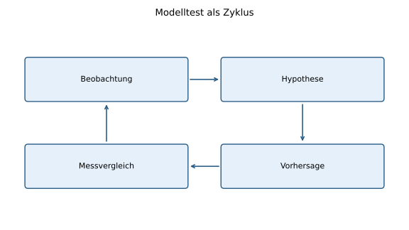

# M1-L1 – Chemische Fragestellungen und Modelle {#L1}

**Kursbereich:** M1 – Chemische Methodik und Laborsicherheit

**Niveau:** Bachelor

**Vorwissen:** Grundkenntnisse zu Stoffen, Teilchen und Einheiten.

**Lernziel:** Eine chemische Hypothese aus einer beobachtbaren Größe ableiten und einen aussagekräftigen Modelltest entwerfen.

## Drei Ebenen einer chemischen Erklärung {#S1}

Eine wässrige Lösung erscheint farbig. Auf der makroskopischen Ebene messen wir beispielsweise ihre Absorption. Auf der submikroskopischen Ebene erklären wir sie durch elektronische Zustände gelöster Teilchen. Auf der symbolischen Ebene beschreiben wir die Teilchen mit Formeln und das Messergebnis durch eine mathematische Beziehung. Die drei Ebenen sind nicht austauschbar: Ein Symbol ist kein beobachtetes Teilchen, ein Messsignal kein unmittelbarer Beweis einer Struktur.

Ein chemisches System umfasst den untersuchten Ausschnitt, etwa eine Probe in einem Messgerät; Umgebung, Temperatur und Zusammensetzung werden als Randbedingungen erfasst. Ein Modell enthält die Annahmen, die zur Erklärung nötig sind. Eine Hypothese ist eine überprüfbare Behauptung über das System. Aus ihr folgt eine Vorhersage; die Beobachtung kann diese stützen oder ihr widersprechen.

## Vom Modell zur Messreihe {#S2}

Für eine idealisierte verdünnte Lösung mit nur einer absorbierenden Spezies ist eine lineare Beziehung zwischen Absorbanz $A$ und Stoffmengenkonzentration $c$ plausibel, wenn Wellenlänge und optische Weglänge konstant bleiben. Ein vereinfachtes Modell lautet $A=kc+b$. Die Absorbanz ist dimensionslos, die Steigung besitzt die Einheit der inversen Konzentration, der Achsenabschnitt $b$ erfasst einen möglichen konstanten Beitrag. Das Modell behauptet keine Linearität bei beliebig hohen Konzentrationen.

*Von der Beobachtung zum Modelltest; Abweichungen führen zu überprüfbaren Änderungen des Modells.*

## Durchgerechnetes Beispiel {#S3}

Ein didaktischer Datensatz mit Konzentrationen in mmol/L und Absorbanzen lautet:

| Konzentration | Absorbanz |
|---:|---:|
| 0 | 0.02 |
| 1 | 0.12 |
| 2 | 0.22 |
| 3 | 0.32 |

Aus den Endpunkten folgt $k=(0.32-0.02)/(3\,\mathrm{mmol/L})=0.10\,\mathrm{L/mmol}$ und $b=0.02$. Bei 2.5 mmol/L sagt das Modell $A=0.27$ vorher. Wird bei einer unabhängig untersuchten Probe stattdessen 0.38 gemessen, beträgt das Residuum $A_{\mathrm{obs}}-A_{\mathrm{pred}}=0.11$. Ohne Unsicherheitsangabe lässt sich nicht entscheiden, ob das Modell verworfen werden muss. Mögliche Ursachen sind Probenverwechslung, instrumentelle Nichtlinearität oder eine veränderte chemische Spezies.

## Grenzen und typische Fehler {#S4}

Eine Korrelation beweist keinen Mechanismus. Wiederholte Messungen am selben Material erfassen nicht automatisch die Probenvariation. Eine Leerprobe hilft bei der Prüfung des Untergrunds, beweist aber nicht, dass alle Störungen entfernt sind. Eine gute Modellprüfung variiert die Zielgröße, kontrolliert relevante Randbedingungen, dokumentiert Messunsicherheit und prüft Vorhersagen an Daten, die nicht bereits zur Anpassung verwendet wurden. Das Beispiel ist eine Simulation, keine Laboranweisung.

## Selbstkontrolle {#S5}

### Aufgaben

1. Bestimme die modellierte Absorbanz bei 1.5 mmol/L.
2. Ein weiterer Datensatz stimmt bis 3 mmol/L überein, weicht aber bei 10 mmol/L ab. Was folgt daraus?
3. Warum genügt es nicht, eine Gerade durch zwei Datenpunkte zu legen?

::: {.lc-solutions data-lc-section="S5"}
1. $A=0.10\cdot 1.5+0.02=0.17$.
2. Der getestete Bereich der Linearität ist begrenzt; mögliche Ursachen und Messunsicherheit müssen geprüft werden. Eine Aussage über alle Konzentrationen ist nicht gerechtfertigt.
3. Zwei Punkte bestimmen eine Gerade, prüfen aber nicht die Linearität. Zusätzliche unabhängige Punkte und Unsicherheiten sind nötig.
:::

**Weiterlesen:** [M1-L2](M1-L2.md).

## Quellen (extern) {#S6}

### Nachweise

- [OpenStax – Chemistry 2e, 1.1 Chemistry in Context](https://openstax.org/books/chemistry-2e/pages/1-1-chemistry-in-context) · Wissenschaftliche Modellbildung und Beobachtung; Fachlicher Bezug zur Lektion: M1-L1 – Chemische Fragestellungen und Modelle · Zuletzt abgerufen: 2026-11-25
