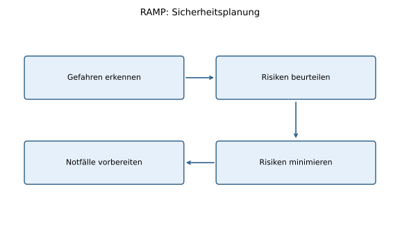

# M1-L2 – Gefährdungsbeurteilung und Schutzmaßnahmen {#L2}

**Kursbereich:** M1 – Chemische Methodik und Laborsicherheit

**Niveau:** Bachelor

**Vorwissen:** [M1-L1](M1-L1.md); keine Laborerfahrung erforderlich.

**Lernziel:** Gefahr und Risiko unterscheiden, Kontrollmaßnahmen hierarchisch einordnen und begründete Stop-Kriterien formulieren.

## Gefährdung, Exposition und Risiko {#S1}

Eine Gefahr ist eine Eigenschaft oder Situation, aus der ein Schaden entstehen kann. Das Risiko beschreibt, wie wahrscheinlich ein Schaden unter bestimmten Bedingungen ist und wie schwer seine Folgen sein können. Zur Bewertung gehören Expositionsweg, Dauer, Menge, Zustand des Materials, mögliche Wechselwirkungen sowie die tatsächlichen Arbeitsbedingungen. Auch Hitze, Druck, elektrische Anlagen, Glasbruch und mechanische Bewegungen sind Gefährdungen.

Die Sicherheitsdatenblätter und Kennzeichnungen eines Stoffes sind Ausgangspunkte der Informationsbeschaffung. Sie ersetzen nicht die tätigkeitsbezogene Gefährdungsbeurteilung durch die verantwortliche Institution. Eine fehlende Kennzeichnung belegt keine Ungefährlichkeit. Ein Selbstlernkurs kann diese fachliche Entscheidung nicht treffen oder eine praktische Freigabe erteilen.

## RAMP und Maßnahmenhierarchie {#S2}

Die RAMP-Systematik verbindet Gefahrenerkennung, Risikobewertung, Risikominderung und Notfallvorbereitung. Die einzelnen Schritte sind keine einmalige Checkliste: Wenn sich Bedingungen ändern, muss die Bewertung aktualisiert werden. In einer Maßnahmenhierarchie werden Gefahren vorrangig vermieden oder durch sicherere Alternativen ersetzt. Technische Schutzmaßnahmen trennen Menschen möglichst von der Gefahr; organisatorische Regeln und persönliche Schutzausrüstung ergänzen die wirksameren Maßnahmen. Schutzausrüstung allein kann ein ungeeignetes Verfahren nicht rechtfertigen.

*Risikobewertung als fortlaufende Entscheidung, nicht als Ersatz für die Laborfreigabe.*

## Fallanalyse ohne Versuchsanleitung {#S3}

In einem universitären Praktikum wird ein unbekanntes, nicht identifiziertes Gefäß entdeckt. Die richtige Entscheidung besteht zunächst darin, die Arbeit daran nicht aufzunehmen. Das Team informiert die zuständige Aufsicht und lässt Herkunft, Identität und geeignete Behandlung durch autorisierte Personen klären. Die Abwesenheit auffälliger Gerüche oder sichtbarer Veränderungen ist kein Sicherheitsnachweis. Es wird weder eigenmächtig geöffnet noch durch improvisierte Tests identifiziert.

| Information | Konsequenz für die Bewertung |
|---|---|
| Identität unbekannt | Gefährdung nicht zuverlässig charakterisierbar |
| Arbeitsanweisung fehlt | Keine autorisierte Durchführung |
| Zuständigkeit unklar | Erst Aufsicht und Verantwortlichkeit klären |

## Grenzen und typische Fehler {#S4}

Die Begriffe „kleine Menge“, „verdünnt“ oder „bekannt“ reichen allein nicht für eine Freigabe. Eine vereinfachte Risiko-Matrix kann eine Diskussion strukturieren, aber keine präzise Schadenswahrscheinlichkeit aus ordinalen Kategorien berechnen. Rechtsvorschriften, Unterweisung, Entsorgung und Notfallmaßnahmen richten sich nach Ort, Institution und Tätigkeit. Bei einem tatsächlichen Vorfall gelten die vor Ort festgelegten Notfallverfahren und die Anweisungen geschulter Verantwortlicher. Diese Lektion enthält keine Anleitung zur Durchführung eines Gefahrstoffversuchs.

## Selbstkontrolle {#S5}

### Aufgaben

1. Erkläre den Unterschied zwischen Gefahr und Risiko an einem heißen Gerät.
2. Warum ist persönliche Schutzausrüstung nicht automatisch die wirksamste Schutzmaßnahme?
3. Nenne zwei Gründe, warum die Arbeit an einer unbekannten Probe nicht begonnen werden sollte.

::: {.lc-solutions data-lc-section="S5"}
1. Eine heiße Oberfläche kann Verbrennungen verursachen; das Risiko hängt u. a. von Zugänglichkeit, Temperatur, Kontaktwahrscheinlichkeit und Schutzmaßnahmen ab.
2. Sie setzt am Menschen an, statt die Gefahr selbst zu beseitigen oder Exposition technisch zu verhindern.
3. Identität und Gefahren sind unbekannt; eine geprüfte tätigkeitsbezogene Gefährdungsbeurteilung oder Freigabe fehlt.
:::

**Weiterlesen:** [M1-L3](M1-L3.md).

## Quellen (extern) {#S6}

### Nachweise

- [American Chemical Society – What is RAMP?](https://institute.acs.org/acs-center/lab-safety/safety-basics-and-ramp/what-is-ramp.html) · Abschnitte Recognize, Assess, Minimize, Prepare; Gefährdung und Risikomanagement; Fachlicher Bezug zur Lektion: M1-L2 – Gefährdungsbeurteilung und Schutzmaßnahmen · Zuletzt abgerufen: 2026-11-25
