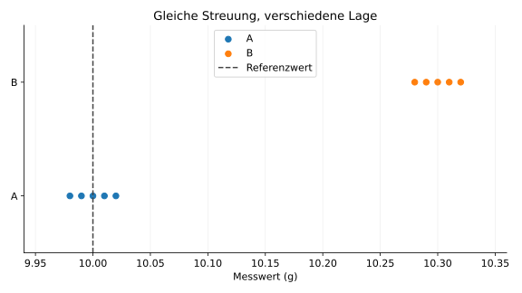

# M1-L3 – Messprotokolle und Unsicherheit {#L3}

**Kursbereich:** M1 – Chemische Methodik und Laborsicherheit

**Niveau:** Bachelor

**Vorwissen:** [M1-L1](M1-L1.md); Mittelwert und Quadratwurzel.

**Lernziel:** Messwerte, Streuung, systematische Abweichung und kombinierte Standardunsicherheit unterscheiden und berechnen.

## Messgröße und Messprotokoll {#S1}

Ein Messwert ist eine Schätzung einer definierten Messgröße, nicht die Größe selbst. Das Protokoll muss erkennen lassen, was unter welchen Bedingungen mit welcher Methode bestimmt wurde: Einheit, Probenkennung, Gerät, Kalibrierung, Rohwert, Zeitpunkt und Auswertung. Ohne diese Angaben lassen sich Abweichungen nicht zuverlässig deuten.

Präzision beschreibt die Übereinstimmung wiederholter Messungen unter festgelegten Bedingungen. Eine systematische Abweichung kann auch bei sehr präzisen Messungen vorhanden sein. Die Messunsicherheit beschreibt die Streuung der Werte, die der Messgröße plausibel zugeordnet werden können. Sie ist nicht mit einem bekannten Messfehler gleichzusetzen.

## Statistische und weitere Beiträge {#S2}

Für $n$ unabhängig wiederholte Werte $x_i$ schätzen wir den Mittelwert und die Stichprobenstandardabweichung durch

$$
\bar x=\frac{1}{n}\sum_{i=1}^{n}x_i,\qquad s=\sqrt{\frac{\sum_{i=1}^{n}(x_i-\bar x)^2}{n-1}}.
$$

Die Standardunsicherheit des Mittelwertes aus der Wiederholstreuung beträgt unter diesen Annahmen $u_A=s/\sqrt n$. Weitere Beiträge können beispielsweise aus Kalibrierung oder Auflösung stammen. Für zwei unkorrelierte Standardunsicherheiten mit gleicher Einheit ist $u_c=\sqrt{u_A^2+u_B^2}$. Diese quadratische Kombination setzt additive Beiträge zur Ergebnisgröße voraus; Korrelationen und Sensitivitätskoeffizienten müssen sonst berücksichtigt werden.

*Präzise Messungen können gegenüber einem Referenzwert systematisch verschoben sein.*

## Zahlenbeispiel {#S3}

Eine simulierte Massenmessreihe liefert 9.98, 10.00 und 10.02 g. Der Mittelwert beträgt 10.00 g. Die Summe der quadratischen Abweichungen beträgt $0.0008\,\mathrm{g^2}$, also $s=0.020\,\mathrm g$ und $u_A=0.01155\,\mathrm g$. Ein zusätzlicher, unkorrelierter Kalibrierbeitrag sei $u_B=0.015\,\mathrm g$. Damit folgt

$$
u_c=\sqrt{0.01155^2+0.015^2}\,\mathrm g\approx 0.0189\,\mathrm g.
$$

Als Ergebnis kann $m=(10.000\pm0.019)\,\mathrm g$ mit der Angabe „kombinierte Standardunsicherheit, $k=1$“ berichtet werden. Dies ist keine garantierte Fehlergrenze und bei drei Wiederholungen kein automatisch abgesichertes 68-%-Intervall. Die Daten sind frei gewählte Lehrwerte.

## Fehlerquellen und Rundung {#S4}

Eine hohe Anzeigeauflösung garantiert keine kleine Unsicherheit. Die Standardabweichung einzelner Werte ist nicht dieselbe Größe wie die Unsicherheit des Mittelwerts. Wiederholungen verringern einen konstanten systematischen Einfluss nicht. Bekannte systematische Abweichungen werden nach begründeter Kalibrierung korrigiert; die Restunsicherheit bleibt. Zwischenrechnungen behalten zusätzliche Stellen, die Ergebnisdarstellung richtet sich nach der Unsicherheit.

## Selbstkontrolle {#S5}

### Aufgaben

1. Berechne Mittelwert und Stichprobenstandardabweichung für 4.9, 5.0, 5.1 mL.
2. Wie verändert sich $u_A$ bei viermal so vielen unabhängigen Wiederholungen, falls $s$ gleich bleibt?
3. Warum bleibt eine systematische Kalibrierabweichung trotz weiterer Wiederholungen relevant?

::: {.lc-solutions data-lc-section="S5"}
1. $\bar x=5.0\,\mathrm{mL}$, $s=0.10\,\mathrm{mL}$.
2. Da $u_A=s/\sqrt n$, halbiert sich der Beitrag.
3. Die Werte können gemeinsam verschoben sein. Wiederholungen allein zeigen oder korrigieren diesen Einfluss nicht.
:::

**Weiterlesen:** [M1-L4](M1-L4.md).

## Quellen (extern) {#S6}

### Nachweise

- [OpenStax – Chemistry 2e, 1.5 Measurement Uncertainty, Accuracy, and Precision](https://openstax.org/books/chemistry-2e/pages/1-5-measurement-uncertainty-accuracy-and-precision) · Messunsicherheit, signifikante Stellen und Präzision; Fachlicher Bezug zur Lektion: M1-L3 – Messprotokolle und Unsicherheit · Zuletzt abgerufen: 2026-11-25
- [OpenStax – Introductory Statistics 2e, 2.7 Measures of the Spread of the Data](https://openstax.org/books/introductory-statistics-2e/pages/2-7-measures-of-the-spread-of-the-data) · Streuung, Standardabweichung und Standardfehler; Fachlicher Bezug zur Lektion: M1-L3 – Messprotokolle und Unsicherheit · Zuletzt abgerufen: 2026-11-25
