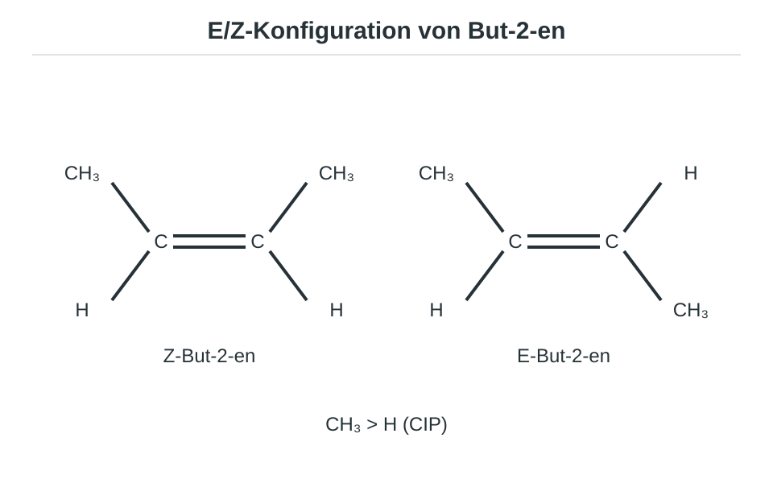

# M10-L2 – Stereochemie {#L2}

**Kursbereich:** M10 – Organische Chemie I: Struktur und Mechanismen

**Niveau:** Bachelor

**Vorwissen:** [M10-L1](M10-L1.md).

**Lernziel:** Konfiguration, Konformation und Enantiomerenüberschuss korrekt unterscheiden.

## Chiralität und räumliche Struktur {#S1}
Ein chirales Objekt lässt sich nicht mit seinem Spiegelbild zur Deckung bringen. Ein tetraedrischer Kohlenstoff mit vier unterschiedlichen Substituenten ist ein häufiger stereogener Mittelpunkt. Enantiomere sind nicht deckungsgleiche Spiegelbilder; Diastereomere sind Stereoisomere ohne diese Spiegelbildbeziehung. Bei mehreren Zentren kann innere Symmetrie trotz stereogener Zentren zu einem achiralen meso-Isomer führen. Die Obergrenze von $2^n$ Konfigurationen für n unabhängige Zentren kann deshalb unterschritten werden.

*CH₃ hat an beiden Enden höhere CIP-Priorität als H.*

## Konfiguration nach CIP {#S2}
Die Cahn-Ingold-Prelog-Regeln ordnen direkt gebundene Atome nach Ordnungszahl, bei Gleichstand werden die nächsten Atome verglichen; Isotope und Mehrfachbindungen erfordern zusätzliche Regeln. Zeigt der Substituent niedrigster Priorität nach hinten, ergibt die Folge 1–2–3 im Uhrzeigersinn R, gegen den Uhrzeigersinn S. Bei einer Doppelbindung werden die höher priorisierten Gruppen beider Enden verglichen: gleiche Seite Z, gegenüberliegend E. Diese Bezeichnungen sagen nichts über das Vorzeichen der optischen Drehung aus.
## Modellrechnung: Enantiomerenüberschuss {#S3}
Eine Modellprobe enthält 85 mol-% eines Enantiomers und 15 mol-% des anderen. Der Enantiomerenüberschuss beträgt $ee=|x_R-x_S|\cdot100\%=70\%$. Bei einem Racemat beträgt er null. In achiraler Umgebung sind viele physikalische Eigenschaften von Enantiomeren gleich, in chiralen Bindungstaschen können Wechselwirkungen jedoch verschieden sein.

## Grenzen und typische Fehler {#S4}

CIP-Reihenfolge nicht mit optischer Drehung gleichsetzen.

## Selbstkontrolle {#S5}

### Aufgaben

1. Wie viele Konfigurationen sind bei drei unabhängigen Zentren maximal möglich?
2. Berechne ee für 60:40.
3. Bedeutet R automatisch rechtsdrehend?

::: {.lc-solutions data-lc-section="S5"}
1. 2³ = 8.
2. 20 %.
3. Nein; die Drehrichtung ist eine experimentelle Eigenschaft.
:::

**Weiterlesen:** [M10-L3](M10-L3.md).

## Quellen (extern) {#S6}

### Nachweise

- [OpenStax – Organic Chemistry, Chapter 5: Summary](https://openstax.org/books/organic-chemistry/pages/5-summary) · Chiralität und Stereochemie · Fachlicher Bezug zur Lektion: M10-L2 – Stereochemie · Zuletzt abgerufen: 2026-11-25
- [OpenStax – Organic Chemistry, 5.5 Sequence Rules for Specifying Configuration](https://openstax.org/books/organic-chemistry/pages/5-5-sequence-rules-for-specifying-configuration) · CIP-Prioritäten · Fachlicher Bezug zur Lektion: M10-L2 – Stereochemie · Zuletzt abgerufen: 2026-11-25
