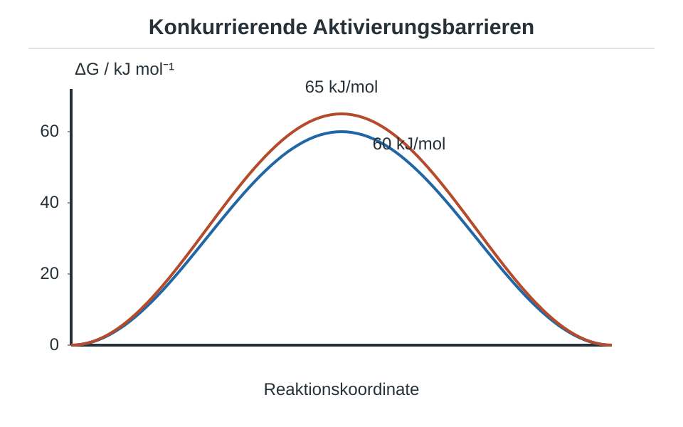

# M10-L5 – Grundprinzipien der Reaktivität {#L5}

**Kursbereich:** M10 – Organische Chemie I: Struktur und Mechanismen

**Niveau:** Bachelor

**Vorwissen:** [M10-L4](M10-L4.md).

**Lernziel:** Reaktivität aus elektronischen, sterischen, thermodynamischen und kinetischen Faktoren begründen.

## Elektronische und räumliche Faktoren {#S1}
Induktive Effekte werden über das σ-Bindungsgerüst übertragen, mesomere Effekte erfordern geeignete Orbitalüberlappung. Resonanzformeln sind alternative Darstellungen eines einzigen elektronischen Zustands und keine zeitlich wechselnden Moleküle. Sterische Hinderung kann einen Annäherungsweg erschweren, während Solvatation die relativen Energien von Ausgangszuständen und Übergangszuständen beeinflusst. Ein elektronenreiches Zentrum muss nicht unter allen Bedingungen stark nucleophil sein; Basizität ist eine Gleichgewichtseigenschaft, Nucleophilie eine kinetische Eigenschaft.

*Modellfreie Energien; keine experimentellen Daten.*

## Energielandschaft und Mechanismus {#S2}
Die freie Standardreaktionsenergie bestimmt das Gleichgewicht nach $\Delta G^\circ=-RT\ln K$. Die freie Aktivierungsenergie bestimmt dagegen die Geschwindigkeit eines elementaren Schritts im Übergangszustandsmodell. Ein Zwischenprodukt liegt in einem lokalen Energieminimum; ein Übergangszustand liegt am Sattelpunkt zwischen Zuständen. Eine negative Reaktionsenergie macht eine Reaktion nicht automatisch schnell. Katalyse verändert den Reaktionsweg, nicht das Gleichgewicht zwischen denselben Endzuständen.
## Modellrechnung: kinetische Bevorzugung {#S3}
Zwei parallele elementare Wege besitzen im Modell gleiche Vorfaktoren, aber Aktivierungsenergien in freier Enthalpie von 60 und 65 kJ/mol. Bei 298 K ergibt sich nach dem Eyring-Verhältnis $k_1/k_2=\exp(5000/(8{,}314\cdot298))\approx7{,}52$. Eine scheinbar kleine Barrierenänderung kann daher die Produktverteilung deutlich verschieben, solange keine Folgereaktionen oder Rückreaktionen dominieren.

## Grenzen und typische Fehler {#S4}

Thermodynamische und kinetische Größen nicht verwechseln.

## Selbstkontrolle {#S5}

### Aufgaben

1. Ist ein Zwischenprodukt ein Übergangszustand?
2. Welche Größe entscheidet über das Standardgleichgewicht?
3. Welcher Weg ist bei gleicher Vorfaktorannahme schneller?

::: {.lc-solutions data-lc-section="S5"}
1. Nein, es entspricht einem lokalen Minimum.
2. Die freie Standardreaktionsenergie.
3. Der mit geringerer freier Aktivierungsenergie.
:::

**Weiterlesen:** [M11-L1](M11-L1.md).

## Quellen (extern) {#S6}

### Nachweise

- [OpenStax – Organic Chemistry, Chapter 6: Summary](https://openstax.org/books/organic-chemistry/pages/6-summary) · Mechanismen und Energie · Fachlicher Bezug zur Lektion: M10-L5 – Grundprinzipien der Reaktivität · Zuletzt abgerufen: 2026-11-25
- [OpenStax – Organic Chemistry, Chapter 11: Summary](https://openstax.org/books/organic-chemistry/pages/11-summary) · Substitution und Eliminierung · Fachlicher Bezug zur Lektion: M10-L5 – Grundprinzipien der Reaktivität · Zuletzt abgerufen: 2026-11-25
