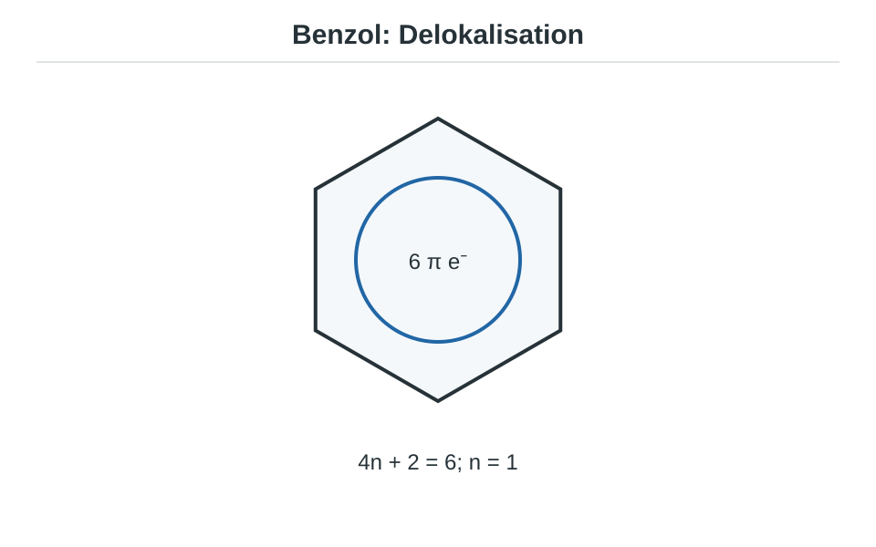

# M11-L3 – Aromatische Chemie {#L3}

**Kursbereich:** M11 – Organische Chemie II: Synthese und Analyse

**Niveau:** Bachelor

**Vorwissen:** [M11-L2](M11-L2.md).

**Lernziel:** Aromatizität aus Konjugation und Elektronenzahl beurteilen.

## Delokalisation im Ring {#S1}
Aromatizität beruht nicht auf Geruch, sondern auf der elektronischen Struktur. Für einfache monocyclische Systeme verlangt das Hückel-Modell einen ebenen oder hinreichend planaren, geschlossenen konjugierten Ring mit $4n+2$ π-Elektronen, wobei n eine nichtnegative ganze Zahl ist. Bei Benzol gehören sechs π-Elektronen zum gemeinsamen konjugierten System. Die Kekulé-Formeln beschreiben Grenzstrukturen, nicht zwei sich zeitlich abwechselnde Bindungsmuster.

*Die Kreisdarstellung ist symbolisch, kein Elektronenbahnmodell.*

## Aromatisch, antiaromatisch oder nichtaromatisch {#S2}
Ein planarer vollständig konjugierter Ring mit 4n π-Elektronen ist im einfachen Modell antiaromatisch; reale Systeme können durch Verzerrung oder Bindungslokalisierung dieser Destabilisierung ausweichen. Pyridin besitzt sechs π-Elektronen, während das freie Elektronenpaar seines Stickstoffs in einem Orbital in der Ringebene liegt und nicht zum Sextett gehört. Bei Pyrrol trägt dagegen ein freies Elektronenpaar zum Sextett bei. Man muss deshalb Orbitale betrachten, statt lediglich Heteroatome zu zählen.
## Modell und Reaktionsklasse {#S3}
Für sechs π-Elektronen gilt 6 = 4·1 + 2; ein konjugierter planarer Sechsring erfüllt damit die Elektronenzahlbedingung. Aromatische Substitution kann in einem Zwischenzustand die Aromatizität unterbrechen und sie im Produkt wiederherstellen. Eine dauerhafte Addition kann dagegen Konjugation verlieren. Diese energetische Betrachtung erklärt Reaktionsklassen qualitativ, ohne einen bestimmten Reaktionsablauf oder Bedingungen festzulegen.

## Grenzen und typische Fehler {#S4}

Elektronenzahl allein beweist keine Aromatizität.

## Selbstkontrolle {#S5}

### Aufgaben

1. Erfüllt ein Ring mit zehn π-Elektronen die Hückel-Elektronenzahlbedingung?
2. Zählt das freie Elektronenpaar von Pyridin zum aromatischen Sextett?
3. Ist jeder Ring mit vier π-Elektronen antiaromatisch?

::: {.lc-solutions data-lc-section="S5"}
1. Ja, 10 = 4·2 + 2; Planarität und durchgehende Konjugation müssen zusätzlich vorliegen.
2. Nein.
3. Nein, nur wenn die entsprechenden geometrischen und konjugativen Voraussetzungen vorliegen.
:::

**Weiterlesen:** [M11-L4](M11-L4.md).

## Quellen (extern) {#S6}

### Nachweise

- [OpenStax – Organic Chemistry, 15.2 Structure and Stability of Benzene](https://openstax.org/books/organic-chemistry/pages/15-2-structure-and-stability-of-benzene) · Delokalisation · Fachlicher Bezug zur Lektion: M11-L3 – Aromatische Chemie · Zuletzt abgerufen: 2026-11-25
- [OpenStax – Organic Chemistry, 15.3 Aromaticity and the Hückel 4n + 2 Rule](https://openstax.org/books/organic-chemistry/pages/15-3-aromaticity-and-the-huckel-4n-2-rule) · Aromatizität · Fachlicher Bezug zur Lektion: M11-L3 – Aromatische Chemie · Zuletzt abgerufen: 2026-11-25
