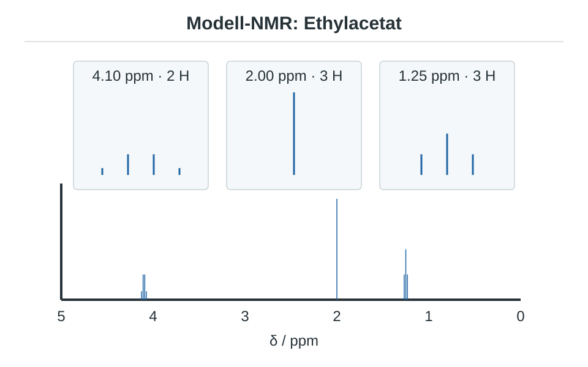

# M11-L5 – Strukturaufklärung aus Spektrendaten {#L5}

**Kursbereich:** M11 – Organische Chemie II: Synthese und Analyse

**Niveau:** Bachelor

**Vorwissen:** [M11-L4](M11-L4.md).

**Lernziel:** Summenformel, IR- und NMR-Daten zu einer überprüfbaren Strukturhypothese verbinden.

## Evidenz zusammenführen {#S1}
Eine Summenformel beschränkt die Zahl der Atome und die Ungesättigtheit. Massenspektrometrie kann dazu beitragen, eine Summenformel zuzuordnen, sofern Ionentyp, Ladung, Isotopenmuster und Messgenauigkeit bekannt sind. IR-Banden liefern Hinweise auf funktionelle Gruppen. NMR-Daten zeigen chemische Umgebungen, Kopplungsmuster und unter geeigneten Messbedingungen relative Protonenzahlen. Keine einzelne Information muss bereits eindeutig sein. Die Strukturhypothese soll möglichst alle unabhängigen Beobachtungen erklären.

*Simulierte Linien bei 400 MHz, J = 7 Hz, Integrale 2:3:3; Ausschnitte vergrößert.*

## Simulierter Datensatz {#S2}
Eine hypothetische Reinsubstanz besitzt die Formel C₄H₈O₂. Ihre IR-Daten zeigen eine starke Bande bei 1740 cm⁻¹. Ein idealisiertes ¹H-NMR-Spektrum enthält δ = 4,1 ppm (Quartett, 2 H), 2,0 ppm (Singulett, 3 H) und 1,25 ppm (Triplett, 3 H). Quartett und Triplett besitzen dieselbe Kopplungskonstante J = 7 Hz. Die chemischen Verschiebungen sind Modellwerte, keine realen Referenzmessungen.
## Hypothese und Gegenprobe {#S3}
DBE = (2·4+2−8)/2 = 1. Die Carbonylbande kann dieses Äquivalent erklären. Das gekoppelte Ethylmuster umfasst fünf H; die Verschiebung von CH₂ spricht für ein benachbartes O. Das Singulett passt zu einer isolierten Acetyl-Methylgruppe. Ethylacetat, CH₃C(=O)OCH₂CH₃, erklärt die Daten gemeinsam. Methylpropionat besitzt zwar dieselbe Formel, würde aber ein OCH₃-Singulett und ein anders verschobenes gekoppeltes Ethylmuster erwarten lassen. Vier unterschiedliche Kohlenstoffumgebungen wären im einfachen ¹³C-Modell zu erwarten. Eine Referenzmessung oder zusätzliche zweidimensionale Korrelationen könnten die Hypothese absichern.

## Grenzen und typische Fehler {#S4}

Spektrale Zuordnung als Hypothese behandeln und unabhängige Daten prüfen.

## Selbstkontrolle {#S5}

### Aufgaben

1. Wie viele H ergeben die Integrale zusammen?
2. Welches Strukturelement erklärt Quartett und Triplett?
3. Beweist eine Carbonylbande allein einen Ester?

::: {.lc-solutions data-lc-section="S5"}
1. 2+3+3 = 8.
2. Ein gekoppeltes CH₂–CH₃-Fragment unter einfachen Kopplungsbedingungen.
3. Nein; mehrere Stoffklassen enthalten eine Carbonylgruppe.
:::

## Quellen (extern) {#S6}

### Nachweise

- [OpenStax – Organic Chemistry, 12.7 Interpreting Infrared Spectra](https://openstax.org/books/organic-chemistry/pages/12-7-interpreting-infrared-spectra) · IR-Strukturhinweise · Fachlicher Bezug zur Lektion: M11-L5 – Strukturaufklärung aus Spektrendaten · Zuletzt abgerufen: 2026-11-25
- [OpenStax – Organic Chemistry, Chapter 13: Summary](https://openstax.org/books/organic-chemistry/pages/13-summary) · NMR-Strukturaufklärung · Fachlicher Bezug zur Lektion: M11-L5 – Strukturaufklärung aus Spektrendaten · Zuletzt abgerufen: 2026-11-25
- [OpenStax – Organic Chemistry, 12.2 Interpreting Mass Spectra](https://chem.libretexts.org/Bookshelves/Organic_Chemistry/Organic_Chemistry_%28OpenStax%29/12%3A_Structure_Determination_-_Mass_Spectrometry_and_Infrared_Spectroscopy/12.02%3A_Interpreting_Mass_Spectra) · Molekülionen, Fragmentierung · Fachlicher Bezug zur Lektion: M11-L5 – Strukturaufklärung aus Spektrendaten · Zuletzt abgerufen: 2026-11-25
