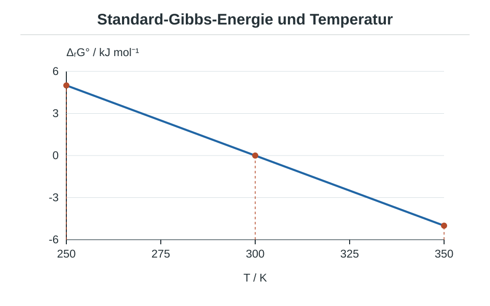

# M12-L2 – Enthalpie, Entropie und freie Energie {#L2}

**Kursbereich:** M12 – Physikalische Chemie I: Thermodynamik

**Niveau:** Bachelor

**Vorwissen:** [M12-L1](M12-L1.md).

**Lernziel:** Enthalpie, Entropie und Gibbs-Energie zur Beurteilung chemischer Prozesse verbinden.

## Thermodynamische Potenziale {#S1}
Die Enthalpie $H=U+pV$ ist bei konstantem Druck und ausschließlicher Volumenarbeit über $\Delta H=q_p$ zugänglich. Bei konstantem Volumen und ohne weitere Arbeit gilt $\Delta U=q_V$. Die Wärmekapazität $C_p=(\partial H/\partial T)_p$ beschreibt die Temperaturabhängigkeit bei festgehaltener Zusammensetzung. Hess' Satz erlaubt, Reaktionsenthalpien aus einer Summe hypothetischer Teilschritte zu berechnen, weil H eine Zustandsgröße ist.

*Modell: ΔH° = 30 kJ/mol, ΔS° = 100 J/(mol K).*

## Kriterium bei konstantem T und p {#S2}
Gibbs-Energie ist $G=H-TS$. Bei konstantem T und p entwickelt sich ein geschlossenes System ohne aufgeprägte Nicht-Volumenarbeit in Richtung kleinerer Gibbs-Energie. Für Reaktionen ist die momentane Steigung $\Delta_r G$ bezüglich des Reaktionsfortschritts entscheidend. $\Delta_r G<0$ begünstigt die Hinrichtung, $\Delta_r G>0$ die Rückrichtung. Im inneren Gleichgewicht gilt $\Delta_r G=0$. Das Helmholtz-Potenzial $A=U-TS$ ist das entsprechende Potenzial bei konstantem T und V. Weder G noch A liefern unmittelbar eine Geschwindigkeit.
## Modellrechnung: Temperaturabhängigkeit {#S3}
Für eine hypothetische Reaktion seien $\Delta_r H^\circ=30\,\mathrm{kJ/mol}$ und $\Delta_r S^\circ=100\,\mathrm{J/(mol\,K)}$ näherungsweise konstant. Bei 250 K ist $\Delta_r G^\circ=5\,\mathrm{kJ/mol}$, bei 350 K −5 kJ/mol. Der Nulldurchgang liegt bei 300 K. Das ist der Punkt K = 1, nicht automatisch das Gleichgewicht jeder beliebigen Zusammensetzung. Die lineare Näherung vernachlässigt insbesondere Wärmekapazitätsänderungen und Phasenübergänge.

## Grenzen und typische Fehler {#S4}

Gibbs-Energie nur bei den angegebenen Randbedingungen interpretieren.

## Selbstkontrolle {#S5}

### Aufgaben

1. Berechne ΔG für ΔH = −20 kJ/mol, ΔS = −50 J/(mol K), T = 300 K.
2. Welche Größe ist bei T und V konstant das passende Potenzial?
3. Beweist ΔG° < 0 einen schnellen Umsatz?

::: {.lc-solutions data-lc-section="S5"}
1. −20 + 15 = −5 kJ/mol.
2. Helmholtz-Energie A.
3. Nein, dafür ist die Kinetik maßgeblich; die reale Reaktionsrichtung hängt außerdem von der Zusammensetzung ab.
:::

**Weiterlesen:** [M12-L3](M12-L3.md).

## Quellen (extern) {#S6}

### Nachweise

- [OpenStax Chemistry 2e, Chapter 5 Summary](https://openstax.org/books/chemistry-2e/pages/5-summary) · Energiebilanz und Enthalpie · Fachlicher Bezug zur Lektion: M12-L2 – Enthalpie, Entropie und freie Energie · Zuletzt abgerufen: 2026-11-25
- [OpenStax Chemistry 2e, 16.3 Second and Third Laws](https://openstax.org/books/chemistry-2e/pages/16-3-the-second-and-third-laws-of-thermodynamics) · Entropie und Hauptsätze · Fachlicher Bezug zur Lektion: M12-L2 – Enthalpie, Entropie und freie Energie · Zuletzt abgerufen: 2026-11-25
- [OpenStax Chemistry 2e, 16.4 Free Energy](https://openstax.org/books/chemistry-2e/pages/16-4-free-energy) · Gibbs-Energie · Fachlicher Bezug zur Lektion: M12-L2 – Enthalpie, Entropie und freie Energie · Zuletzt abgerufen: 2026-11-25
