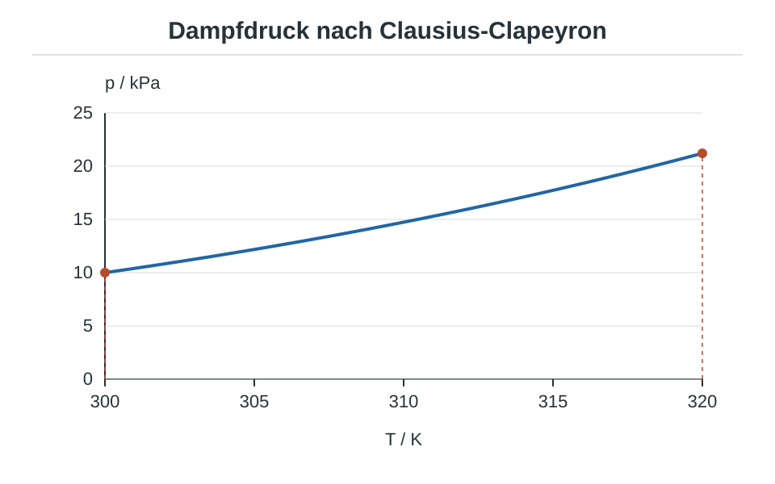

# M12-L3 – Phasengleichgewichte {#L3}

**Kursbereich:** M12 – Physikalische Chemie I: Thermodynamik

**Niveau:** Bachelor

**Vorwissen:** [M12-L2](M12-L2.md).

**Lernziel:** Phasengleichgewichte mit chemischen Potenzialen, Phasenregel und Clapeyron-Gleichung auswerten.

## Koexistenz und Freiheitsgrade {#S1}
Eine Phase ist ein räumlich homogener thermodynamischer Bereich. Im Gleichgewicht zweier Phasen einer reinen Substanz sind Temperatur, Druck (für ebene Grenzflächen ohne äußere Felder) und chemisches Potenzial gleich. Für ein nicht reagierendes System mit C unabhängigen Komponenten und P Phasen lautet die Gibbs'sche Phasenregel $F=C-P+2$. Für einen Reinstoff sind im Einphasengebiet zwei Variablen unabhängig, auf einer Koexistenzlinie eine und am Tripelpunkt keine. Der kritische Punkt beendet die Flüssig-Dampf-Koexistenzlinie; oberhalb davon gibt es keine scharfe Grenze zwischen Flüssigkeit und Gas entlang eines geeigneten Weges.

*Idealisiertes Modell mit konstanter Verdampfungsenthalpie 30 kJ/mol.*

## Druckabhängigkeit des Übergangs {#S2}
Für eine reine Phase gilt $d\mu=-S_m\,dT+V_m\,dp$. Auf der Koexistenzlinie bleiben beide Potenziale gleich. Subtraktion liefert $dp/dT=\Delta_{trs}H_m/(T\Delta_{trs}V_m)$. Das Vorzeichen hängt von der Volumenänderung ab; bei Wasser ist die Schmelzlinie in der Nähe des gewöhnlichen Schmelzpunkts negativ geneigt. Für Verdampfung bei idealem Dampf und vernachlässigbarem Flüssigkeitsvolumen folgt bei ungefähr konstantem ΔH die Clausius-Clapeyron-Näherung $\ln(p_2/p_1)=-\Delta_{vap}H_m/R\,(1/T_2-1/T_1)$.
## Modellrechnung: Dampfdruck {#S3}
Ein Modellstoff besitzt bei 300 K einen Dampfdruck von 10,0 kPa und eine konstante Verdampfungsenthalpie von 30,0 kJ/mol. Bei 320 K ergibt sich $\ln(p_2/p_1)=0,752$ und damit $p_2\approx21.2\,\mathrm{kPa}$. Die Aussage gilt nur für die angegebenen Annahmen, nicht als Messwert eines realen Stoffes. Bei Annäherung an den kritischen Punkt versagen die idealisierte Dampf- und Volumennäherung.

## Grenzen und typische Fehler {#S4}

Clausius-Clapeyron ist eine Näherung; nicht nahe am kritischen Punkt extrapolieren.

## Selbstkontrolle {#S5}

### Aufgaben

1. Wie viele Freiheitsgrade hat ein Reinstoff am Tripelpunkt?
2. Wie ändert sich der Dampfdruck bei steigender Temperatur und positiver Verdampfungsenthalpie?
3. Welche Einheit hat dp/dT?

::: {.lc-solutions data-lc-section="S5"}
1. F = 1 − 3 + 2 = 0.
2. Er steigt im betrachteten Koexistenzbereich.
3. Pa/K.
:::

**Weiterlesen:** [M12-L4](M12-L4.md).

## Quellen (extern) {#S6}

### Nachweise

- [DeVoe, Thermodynamics and Chemistry, 8.4 Coexistence Curves](https://chem.libretexts.org/Bookshelves/Physical_and_Theoretical_Chemistry_Textbook_Maps/DeVoes_Thermodynamics_and_Chemistry/08%3A_Phase_Transitions_and_Equilibria_of_Pure_Substances/8.04%3A_Coexistence_Curves) · Clapeyron-Gleichung · Fachlicher Bezug zur Lektion: M12-L3 – Phasengleichgewichte · Zuletzt abgerufen: 2026-11-25
- [DeVoe, Thermodynamics and Chemistry, 13.1 Gibbs Phase Rule](https://chem.libretexts.org/Bookshelves/Physical_and_Theoretical_Chemistry_Textbook_Maps/DeVoes_Thermodynamics_and_Chemistry/13%3A_The_Phase_Rule_and_Phase_Diagrams/13.01%3A_The_Gibbs_Phase_Rule_for_Multicomponent_Systems) · Phasenregel · Fachlicher Bezug zur Lektion: M12-L3 – Phasengleichgewichte · Zuletzt abgerufen: 2026-11-25
