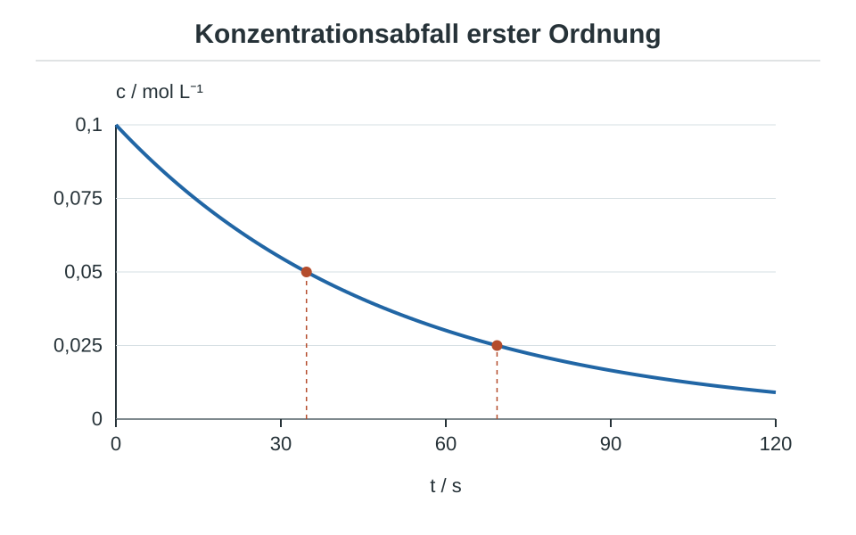

# M13-L1 – Geschwindigkeitsgesetze {#L1}

**Kursbereich:** M13 – Physikalische Chemie II: Kinetik und Elektrochemie

**Niveau:** Bachelor

**Vorwissen:** [M12-L5](M12-L5.md).

**Lernziel:** Reaktionsordnungen aus Messdaten bestimmen und integrierte Geschwindigkeitsgesetze anwenden.

## Definition und experimentelle Ordnung {#S1}
Für a A → b B bei konstantem Volumen ist die Reaktionsgeschwindigkeit $v=-\frac1a dc_A/dt=\frac1b dc_B/dt$. Ein empirisches Gesetz $v=k c_A^m c_B^n$ besitzt die Gesamtordnung m+n. Die Exponenten werden aus Daten bestimmt; aus der Summenstöchiometrie folgen sie im Allgemeinen nicht. Bei einem elementaren Schritt unter idealisierten Bedingungen kann die Molekularität dagegen zur Form des Gesetzes beitragen. Die Einheit von k hängt von der Gesamtordnung ab. Verdoppelt sich nur c(A), während sich v vervierfacht, ergibt sich m = 2.

*Modell: k = 0,0200 s⁻¹; markiert sind zwei Halbwertszeiten.*

## Integration und Modellwahl {#S2}
Für den Verbrauch A → P gilt bei erster Ordnung $dc_A/dt=-kc_A$, daraus folgt $c_A(t)=c_{A,0}e^{-kt}$ und $t_{1/2}=\ln 2/k$. Bei nullter Ordnung gilt $c_A(t)=c_{A,0}-kt$ bis zur Erschöpfung; bei zweiter Ordnung mit Verbrauchsgesetz $-dc_A/dt=kc_A^2$ gilt $1/c_A(t)=1/c_{A,0}+kt$. Bei konstant gehaltenem Überschuss eines Reaktanden kann eine scheinbare erste Ordnung entstehen. Residuen, Messunsicherheit und die physikalischen Randbedingungen sollten bei der Modellwahl berücksichtigt werden; die linearisierte Darstellung allein ist kein Beweis.
## Modellrechnung: Konzentrations-Zeit-Verlauf {#S3}
Für eine hypothetische Umsetzung erster Ordnung seien c₀ = 0,100 mol/L und k = 0,0200 s⁻¹. Die Halbwertszeit ist 34,7 s. Nach 50 s gilt $c=0.100e^{-1}=0.0368\,\mathrm{mol/L}$. Nach zwei Halbwertszeiten verbleibt ein Viertel der Anfangskonzentration. Eine gemessene Abweichung kann beispielsweise auf Temperaturänderungen oder eine Rückreaktion hinweisen. Die Parameter sind synthetische Lerndaten.

## Grenzen und typische Fehler {#S4}

Reaktionsordnung experimentell prüfen; integrierte Modelle nicht ungeprüft extrapolieren.

## Selbstkontrolle {#S5}

### Aufgaben

1. Welche Einheit hat k bei erster Ordnung?
2. Wie lange dauert der Abfall auf ein Achtel bei obigem Modell?
3. Was geschieht mit v bei Verdoppelung von A bei Ordnung 2 und konstantem B?

::: {.lc-solutions data-lc-section="S5"}
1. s⁻¹.
2. Drei Halbwertszeiten, ungefähr 104 s.
3. v vervierfacht sich.
:::

**Weiterlesen:** [M13-L2](M13-L2.md).

## Quellen (extern) {#S6}

### Nachweise

- [OpenStax Chemistry 2e, 12.3 Rate Laws](https://openstax.org/books/chemistry-2e/pages/12-3-rate-laws) · Reaktionsordnung · Fachlicher Bezug zur Lektion: M13-L1 – Geschwindigkeitsgesetze · Zuletzt abgerufen: 2026-11-25
- [OpenStax Chemistry 2e, 12.4 Integrated Rate Laws](https://openstax.org/books/chemistry-2e/pages/12-4-integrated-rate-laws) · Integrierte Geschwindigkeitsgesetze · Fachlicher Bezug zur Lektion: M13-L1 – Geschwindigkeitsgesetze · Zuletzt abgerufen: 2026-11-25
