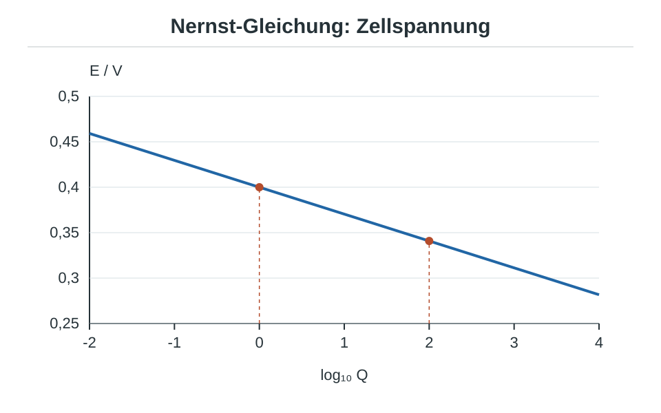

# M13-L4 – Elektrochemische Potenziale {#L4}

**Kursbereich:** M13 – Physikalische Chemie II: Kinetik und Elektrochemie

**Niveau:** Bachelor

**Vorwissen:** [M13-L3](M13-L3.md).

**Lernziel:** Elektrodenpotenziale, Zellspannung und chemisches Gleichgewicht quantitativ verbinden.

## Halbzellen und Vorzeichen {#S1}
Oxidation erfolgt an der Anode, Reduktion an der Kathode. In einer galvanischen Zelle fließen Elektronen im äußeren Stromkreis von Anode zu Kathode; der ionische Transport im Elektrolyten ermöglicht den Ladungsausgleich. Standardelektrodenpotenziale werden als Reduktionspotenziale relativ zu einer Referenz definiert. Für die als Hinrichtung formulierte Zellreaktion ist $E^\circ=E^\circ_{\mathrm{Kathode}}-E^\circ_{\mathrm{Anode}}$. Potentiale werden beim Multiplizieren einer Halbgleichung nicht mitmultipliziert, da sie intensive Größen sind.

*Reversible Modellspannung bei 298,15 K und n = 2.*

## Nernst-Gleichung {#S2}
Für eine reversible Zellreaktion gilt $\Delta_rG=-nFE$, mit Elektronenzahl n pro stöchiometrischem Reaktionsumsatz und Faraday-Konstante F ≈ 96485 C/mol. Aus der Beziehung für ΔrG folgt $E=E^\circ-(RT/nF)\ln Q$. Bei 298,15 K lautet der Faktor für den dekadischen Logarithmus 0,05916 V/n. Im chemischen Gleichgewicht der Gesamtreaktion ist E = 0 und $\ln K=nFE^\circ/(RT)$. Diese Aussagen betreffen reversible thermodynamische Spannungen; reale Klemmenspannungen unter Last enthalten Verluste durch ohmsche Widerstände, Überspannungen und Konzentrationsgradienten.
## Modellrechnung: Zellspannung {#S3}
Eine hypothetische Zellreaktion mit n = 2 besitze E° = 0,400 V. Für Q = 100 bei 298,15 K folgt E = 0,400 − (0,05916/2)·2 = 0,34084 V. Daraus ergibt sich $\Delta_rG\approx-65.8\,\mathrm{kJ/mol}$. Im Standardzustand beträgt die Gibbs-Energie dagegen −77,2 kJ/mol. Q ist dimensionslos, und n bezieht sich auf die gewählte Gesamtgleichung. Es handelt sich ausschließlich um Modelldaten.

## Grenzen und typische Fehler {#S4}

Thermodynamische Spannung von Klemmenspannung unter Last unterscheiden.

## Selbstkontrolle {#S5}

### Aufgaben

1. Was ist E für Q = 1?
2. Was geschieht mit E, wenn Q um Faktor 10 steigt, bei n = 2 und 298,15 K?
3. Darf ein verdoppeltes n bei verdoppelter Gesamtgleichung auch E verdoppeln?

::: {.lc-solutions data-lc-section="S5"}
1. E°.
2. E sinkt um 29,58 mV.
3. Nein; ΔrG und ln Q verdoppeln sich, die Spannung bleibt gleich.
:::

**Weiterlesen:** [M13-L5](M13-L5.md).

## Quellen (extern) {#S6}

### Nachweise

- [OpenStax Chemistry 2e, 17.4 Potential, Free Energy, and Equilibrium](https://openstax.org/books/chemistry-2e/pages/17-4-potential-free-energy-and-equilibrium) · Nernst-Gleichung · Fachlicher Bezug zur Lektion: M13-L4 – Elektrochemische Potenziale · Zuletzt abgerufen: 2026-11-25
- [OpenStax Chemistry 2e, 17.3 Electrode and Cell Potentials](https://openstax.org/books/chemistry-2e/pages/17-3-electrode-and-cell-potentials) · Zellpotenziale · Fachlicher Bezug zur Lektion: M13-L4 – Elektrochemische Potenziale · Zuletzt abgerufen: 2026-11-25
