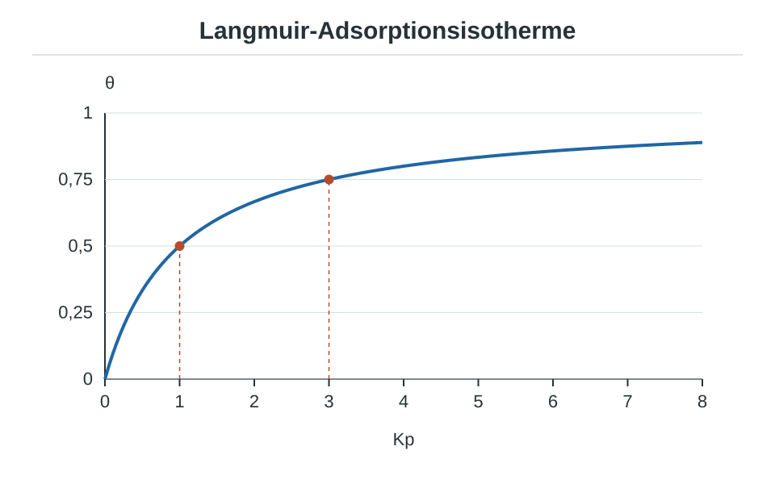

# M13-L5 – Grenzflächen und Transport {#L5}

**Kursbereich:** M13 – Physikalische Chemie II: Kinetik und Elektrochemie

**Niveau:** Bachelor

**Vorwissen:** [M13-L4](M13-L4.md).

**Lernziel:** Diffusion und Adsorption als begrenzende Prozesse an Grenzflächen modellieren.

## Transport durch Gradienten {#S1}
Ein Stoff kann durch Diffusion, Konvektion oder im elektrischen Feld durch Migration transportiert werden. Für eindimensionale Diffusion im einfachen Fick-Modell gilt $J=-D\partial c/\partial x$, wobei J die molare Flussdichte (mol m⁻² s⁻¹) und D der Diffusionskoeffizient (m²/s) ist. Aus der Stoffbilanz ohne Quellen folgt bei konstantem D $\partial c/\partial t=D\partial^2c/\partial x^2$. Das erste Gesetz beschreibt einen lokalen diffusiven Fluss auch bei zeitabhängigem Konzentrationsfeld; für stationäre Diffusion durch eine ebene Schicht mit konstantem D ist das Konzentrationsprofil linear. Bei geladenen Spezies kann zusätzlich der elektrische Potenzialgradient beitragen; ein einfaches Fick-Modell berücksichtigt ihn nicht.

*Modell für unabhängige gleichartige Adsorptionsplätze.*

## Adsorption und Grenzflächen {#S2}
Oberflächenenergie und Grenzflächenstruktur können die Bindung von Molekülen beeinflussen. Im Langmuir-Modell reversibler molekularer Adsorption auf gleichartigen unabhängigen Plätzen gilt $\theta=Kp/(1+Kp)$ für einen Druckparameter K mit Einheit 1/Druck. Bei Kp = 1 sind die Hälfte der Plätze besetzt. Die Annahmen schließen Mehrschichtadsorption und seitliche Wechselwirkungen aus. An Elektroden entsteht aufgrund von Oberflächenladung und Gegenionen eine elektrische Doppelschicht; das Potenzial und die lokale Zusammensetzung können sich von der Volumenlösung unterscheiden. Transport und Oberflächenreaktion sind deshalb getrennt zu modellieren.
## Modellrechnung: stationäre Schicht {#S3}
Eine ebene Schicht mit Dicke 100 µm trennt zwei Bereiche mit Konzentrationen 20 und 10 mol/m³. Für D = 1,0·10⁻⁹ m²/s ergibt sich in Richtung fallender Konzentration $J=D(20-10)/(10^{-4})=1.0\cdot10^{-4}\,\mathrm{mol/(m^2\,s)}$. Bei einer Fläche von 2 cm² beträgt der molare Durchsatz 2,0·10⁻⁸ mol/s. In einem unabhängigen Adsorptionsmodell gilt für Kp = 3 die Bedeckung θ = 0,75. Beide Datensätze sind hypothetisch; reale Systeme können Konvektion, Migration und gekoppelte Oberflächenreaktionen enthalten.

## Grenzen und typische Fehler {#S4}

Fick- und Langmuir-Modelle setzen idealisierte Randbedingungen voraus.

## Selbstkontrolle {#S5}

### Aufgaben

1. In welche Richtung zeigt der Fick-Fluss bei positivem Konzentrationsgradienten?
2. Was passiert mit dem stationären Fluss bei doppelter Schichtdicke und sonst gleichen Bedingungen?
3. Wie groß ist θ bei Kp = 0,25?

::: {.lc-solutions data-lc-section="S5"}
1. In negative x-Richtung.
2. Er halbiert sich.
3. 0,25/1,25 = 0,20.
:::

## Quellen (extern) {#S6}

### Nachweise

- [Introduction to Solid State Chemistry, 1.9 Diffusion](https://chem.libretexts.org/Bookshelves/Inorganic_Chemistry/Introduction_to_Solid_State_Chemistry/01%3A_Lectures/1.09%3A_Diffusion) · Stationärer Fick-Fluss · Fachlicher Bezug zur Lektion: M13-L5 – Grenzflächen und Transport · Zuletzt abgerufen: 2026-11-25
- [Nix, Surface Science, 3.2 Langmuir Isotherm](https://chem.libretexts.org/Bookshelves/Physical_and_Theoretical_Chemistry_Textbook_Maps/Surface_Science_%28Nix%29/03%3A_The_Langmuir_Isotherm/3.02%3A_Langmuir_Isotherm_-_derivation_from_equilibrium_considerations) · Langmuir-Adsorption · Fachlicher Bezug zur Lektion: M13-L5 – Grenzflächen und Transport · Zuletzt abgerufen: 2026-11-25
