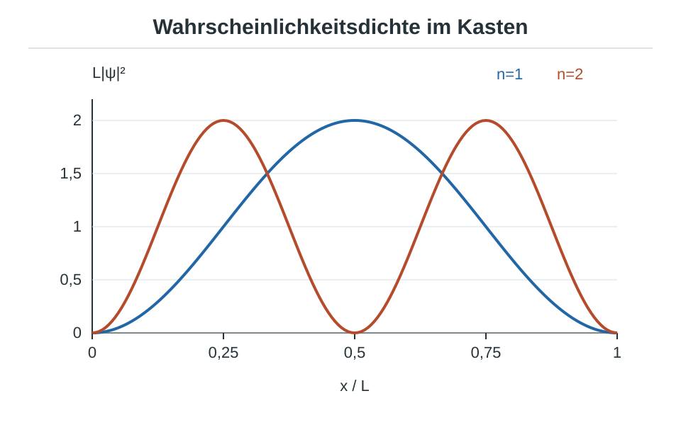

# M14-L1 – Wellenfunktion und Schrödingergleichung {#L1}

**Kursbereich:** M14 – Theoretische Chemie und Quantenchemie

**Niveau:** Bachelor

**Vorwissen:** [M13-L5](M13-L5.md).

**Lernziel:** Die stationäre Schrödingergleichung als Eigenwertproblem lösen und Wahrscheinlichkeitsdichten interpretieren.

## Quantenzustände und Observablen {#S1}
Ein reiner Quantenzustand wird durch eine normierte Wellenfunktion $\psi$ beschrieben. Ihr Betragsquadrat ist die Wahrscheinlichkeitsdichte; das Vorzeichen einer reellen Wellenfunktion ist dagegen keine negative Wahrscheinlichkeit. Messgrößen werden durch selbstadjungierte Operatoren beschrieben. Ein Eigenzustand des Hamiltonoperators $\hat H$ erfüllt $\hat H\psi=E\psi$; die Energie ist dann bestimmt. In einem allgemeinen Zustand ist der Erwartungswert $\langle E\rangle=\int\psi^*\hat H\psi\,dx$ nicht zwingend ein Eigenwert. Die zeitabhängige Gleichung lautet $i\hbar\partial_t\psi=\hat H\psi$.

*L|ψ|² = 2 sin²(nπx/L); Blau: n=1, Rot: n=2.*

## Teilchen im eindimensionalen Kasten {#S2}
Für ein Teilchen der Masse m in einem unendlich tiefen Kasten zwischen 0 und L gilt im Inneren $\hat H=-\hbar^2\partial_x^2/(2m)$. Die Randbedingungen $\psi(0)=\psi(L)=0$ ergeben $\psi_n=\sqrt{2/L}\sin(n\pi x/L)$ und $E_n=n^2h^2/(8mL^2)$ für n = 1, 2, … . Der Zustand n hat n−1 innere Knoten. Eine Verdoppelung der Kastenlänge verkleinert alle Energien auf ein Viertel. Die Nullpunktsenergie entsteht durch die räumliche Einschränkung und die Randbedingungen.
## Modellrechnung: eingeschlossenes Elektron {#S3}
Mit L = 1,00 nm, m = 9,109·10⁻³¹ kg und h = 6,62607015·10⁻³⁴ J s folgt E₁ = 6,02·10⁻²⁰ J = 0,376 eV. Der Abstand E₂−E₁ = 3E₁ beträgt 1,13 eV. Im Zustand n = 2 ist die Dichte in der Mitte null. Die Quantisierung illustriert eingeschlossene Elektronen, ersetzt aber keine Rechnung für ein reales Molekül mit Coulombpotenzial.

## Grenzen und typische Fehler {#S4}

Kastenmodell und reale Molekülpotenziale unterscheiden.

## Selbstkontrolle {#S5}

### Aufgaben

1. Welchen Wert hat E₃/E₁?
2. Wie ändert sich E₁ bei L = 2 nm?
3. Ist eine negative Wellenfunktion eine negative Wahrscheinlichkeit?

::: {.lc-solutions data-lc-section="S5"}
1. 9.
2. Es beträgt ein Viertel des Ausgangswerts, etwa 0,094 eV.
3. Nein, die Wahrscheinlichkeit folgt aus dem Betragsquadrat.
:::

**Weiterlesen:** [M14-L2](M14-L2.md).

## Quellen (extern) {#S6}

### Nachweise

- [Tokmakoff, 1.4 Basic Quantum Models](https://chem.libretexts.org/Bookshelves/Physical_and_Theoretical_Chemistry_Textbook_Maps/Time-Dependent_Quantum_Mechanics_and_Spectroscopy_2025e_%28Tokmakoff%29/01%3A_Overview_of_Time-Independent_Quantum_Mechanics/1.04%3A_Basic_Quantum_Models) · Kastenmodell · Fachlicher Bezug zur Lektion: M14-L1 – Wellenfunktion und Schrödingergleichung · Zuletzt abgerufen: 2026-11-25
- [Howard University, 4 Principles of Quantum Mechanics](https://chem.libretexts.org/Courses/Howard_University/Howard%3A_Physical_Chemistry/04%3A_Principles_of_Quantum_Mechanics) · Quantenmechanik und Variationsprinzip · Fachlicher Bezug zur Lektion: M14-L1 – Wellenfunktion und Schrödingergleichung · Zuletzt abgerufen: 2026-11-25
