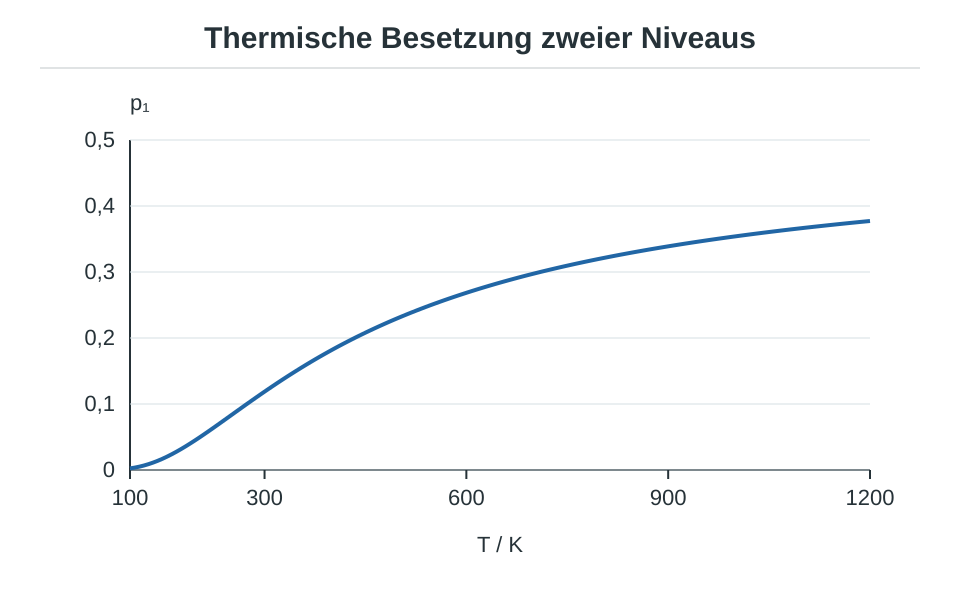

# M14-L4 – Statistische Thermodynamik {#L4}

**Kursbereich:** M14 – Theoretische Chemie und Quantenchemie

**Niveau:** Bachelor

**Vorwissen:** [M14-L3](M14-L3.md).

**Lernziel:** Aus diskreten Energieniveaus thermische Besetzungen und Zustandssummen berechnen.

## Vom Mikrozustand zur thermischen Verteilung {#S1}
Im kanonischen Ensemble sind Teilchenzahl, Volumen und Temperatur fest. Für Energieniveaus εᵢ mit Entartungen gᵢ gilt $q=\sum_i g_i e^{-\beta\epsilon_i}$ und $p_i=g_i e^{-\beta\epsilon_i}/q$, mit $\beta=1/(k_BT)$. Die Zustandssumme ist dimensionslos. Bei Verwendung molarer Energien ersetzt R die Boltzmannkonstante k_B. Die Normierung garantiert, dass die Besetzungen zusammen eins ergeben.

*Nicht entartete Niveaus, Energiedifferenz 5 kJ/mol.*

## Thermodynamische Größen {#S2}
Für ein kanonisches System gilt $U=-\partial\ln Z/\partial\beta$ und $F=-k_BT\ln Z$. Dabei ist Z die Zustandssumme des gesamten Systems, nicht automatisch das Produkt unabhängiger molekularer Summen; Ununterscheidbarkeit und Wechselwirkungen sind zu beachten. Für ein diskretes Ensemble von Mikrozuständen gilt $S=-k_B\sum_j p_j\ln p_j$. Entartete Energieniveaus können durch viele Mikrozustände stark besetzt sein, auch wenn ihr einzelner Boltzmannfaktor klein ist.
## Modellrechnung: Zweiniveausystem {#S3}
Zwei nicht entartete Niveaus haben molare Energien 0 und 5,00 kJ/mol. Bei T = 300 K folgt $r=\exp[-5000/(8.314\cdot300)]=0.135$ und $p_1=r/(1+r)=0.119$. Damit beträgt die mittlere molare Energie relativ zum unteren Niveau 0,594 kJ/mol. Bei Entartung g₁ = 2 wird die obere Gesamtbesetzung 2r/(1+2r) ≈ 0,212.

## Grenzen und typische Fehler {#S4}

Entartung und Energieeinheiten konsistent berücksichtigen.

## Selbstkontrolle {#S5}

### Aufgaben

1. Wie groß ist p₁ für gleiche Energien und gleiche Entartungen?
2. Was passiert mit p₁ des nicht entarteten Modells bei T gegen 0?
3. Was ist der Unterschied zwischen gᵢ und pᵢ?

::: {.lc-solutions data-lc-section="S5"}
1. 0,5.
2. Sie geht gegen null.
3. gᵢ zählt Zustände; pᵢ ist die normierte Wahrscheinlichkeit des Niveaus.
:::

**Weiterlesen:** [M14-L5](M14-L5.md).

## Quellen (extern) {#S6}

### Nachweise

- [Gutow, 1.5 Boltzmann Distribution and Entropy](https://chem.libretexts.org/Courses/University_of_Wisconsin_Oshkosh/Chem_370%3A_Physical_Chemistry_1_-_Thermodynamics_%28Gutow%29/01%3A_Thermodynamics/1.05%3A_The_Boltzmann_Distribution_and_the_Statistical_Definition_of_Entropy) · Boltzmann-Verteilung · Fachlicher Bezug zur Lektion: M14-L4 – Statistische Thermodynamik · Zuletzt abgerufen: 2026-11-25
- [Jeschke, 3.3 Canonical Ensemble](https://chem.libretexts.org/Bookshelves/Physical_and_Theoretical_Chemistry_Textbook_Maps/Statistical_Thermodynamics_%28Jeschke%29/03%253A_Classical_Ensembles/3.03%253A_Canonical_Ensemble) · Kanonisches Ensemble · Fachlicher Bezug zur Lektion: M14-L4 – Statistische Thermodynamik · Zuletzt abgerufen: 2026-11-25
