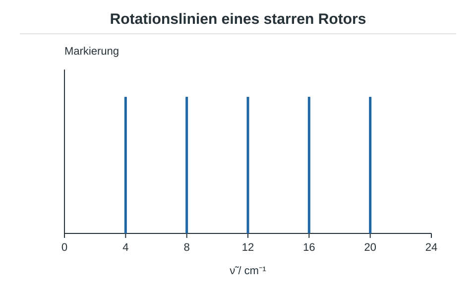

# M15-L1 – Rotations- und Schwingungsspektroskopie {#L1}

**Kursbereich:** M15 – Spektroskopie und Strukturaufklärung

**Niveau:** Bachelor

**Vorwissen:** [M14-L5](M14-L5.md).

**Lernziel:** Rotations- und Schwingungsspektren mit quantisierten Bewegungsmodellen auswerten.

## Starrer Rotor {#S1}
Ein zweiatomiges Molekül mit reduzierter Masse $\mu=m_1m_2/(m_1+m_2)$ und Bindungslänge r hat das Trägheitsmoment $I=\mu r^2$. Im starren Rotor gilt $E_J=hc\tilde B J(J+1)$ mit $\tilde B=h/(8\pi^2cI)$. Elektrische Dipol-Rotationsabsorption erfordert ein permanentes Dipolmoment; die Auswahlregel ist ΔJ = +1. Benachbarte Linien liegen idealisiert im Abstand $2\tilde B$. Zentrifugalverzerrung verändert die Abstände bei hohen J.

*B̃ = 2 cm⁻¹; nur Linienpositionen, keine Intensitätssimulation.*

## Harmonischer Oszillator {#S2}
Mit Kraftkonstante k gilt $\tilde\nu=(2\pi c)^{-1}\sqrt{k/\mu}$. Die Energien betragen $E_v=hc\tilde\nu(v+1/2)$. Harmonische elektrische Dipolabsorption hat Δv = +1 und setzt eine Änderung des Dipolmoments entlang der Schwingungskoordinate voraus. Raman-Streuung setzt eine Änderung der Polarisierbarkeit voraus. Anharmonizität führt unter anderem zu Obertonbanden und variierenden Niveauabständen. In mehratomigen Molekülen koppeln Atombewegungen zu Normalmoden.
## Modellrechnung: Linienabstände und Isotope {#S3}
Für einen idealisierten Rotor mit B̃ = 2,00 cm⁻¹ liegen die ersten drei Absorptionslinien bei 4,00; 8,00 und 12,00 cm⁻¹. Für einen harmonischen Oszillator mit μ = 1,00 u und k = 500 N/m ergibt sich mit 1 u = 1,66054·10⁻²⁷ kg und c = 2,9979·10¹⁰ cm/s eine Wellenzahl von etwa 2913 cm⁻¹. Verdoppelt sich μ bei gleichem k, sinkt die Wellenzahl auf etwa 2060 cm⁻¹.

## Grenzen und typische Fehler {#S4}

Auswahlregeln und idealisierte Rotor- und Oszillatormodelle nicht verallgemeinern.

## Selbstkontrolle {#S5}

### Aufgaben

1. Welche Linie folgt auf 12 cm⁻¹ im Rotormodell?
2. Wie ändert sich B̃ bei doppeltem I?
3. Warum kann eine IR-inaktive Mode Raman-aktiv sein?

::: {.lc-solutions data-lc-section="S5"}
1. 16 cm⁻¹.
2. Es halbiert sich.
3. Dipolmoment- und Polarisierbarkeitsänderung sind verschiedene Auswahlkriterien.
:::

**Weiterlesen:** [M15-L2](M15-L2.md).

## Quellen (extern) {#S6}

### Nachweise

- [Fleming, 5.7 Spectroscopy](https://chem.libretexts.org/Bookshelves/Physical_and_Theoretical_Chemistry_Textbook_Maps/Quantum_Chemistry_with_Applications_in_Spectroscopy_%28Fleming%29/05%3A_The_Rigid_Rotor_and_Rotational_Spectroscopy/5.07%3A_Spectroscopy) · Rotationsübergänge · Fachlicher Bezug zur Lektion: M15-L1 – Rotations- und Schwingungsspektroskopie · Zuletzt abgerufen: 2026-11-25
- [Peverati, 29.2 Vibrational Spectroscopy](https://chem.libretexts.org/Bookshelves/Physical_and_Theoretical_Chemistry_Textbook_Maps/The_Live_Textbook_of_Physical_Chemistry_%28Peverati%29/29%3A_Spectroscopy/29.02%3A_Vibrational_Spectroscopy) · Schwingungsspektroskopie · Fachlicher Bezug zur Lektion: M15-L1 – Rotations- und Schwingungsspektroskopie · Zuletzt abgerufen: 2026-11-25
- [LibreTexts, Selection Rules](https://chem.libretexts.org/Bookshelves/Physical_and_Theoretical_Chemistry_Textbook_Maps/Supplemental_Modules_%28Physical_and_Theoretical_Chemistry%29/Spectroscopy/Fundamentals_of_Spectroscopy/Selection_Rules) · Auswahlregeln · Fachlicher Bezug zur Lektion: M15-L1 – Rotations- und Schwingungsspektroskopie · Zuletzt abgerufen: 2026-11-25
