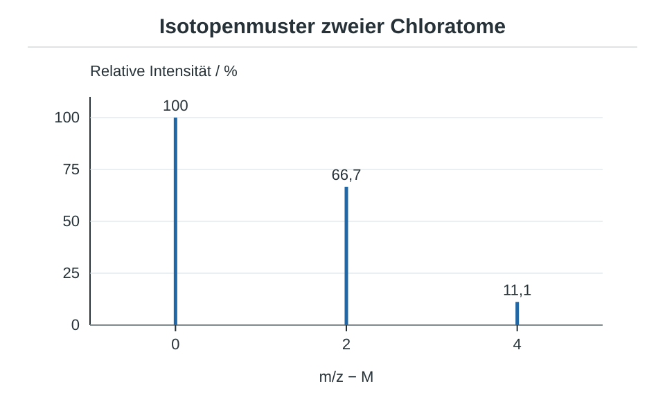

# M15-L4 – Massenspektren interpretieren {#L4}

**Kursbereich:** M15 – Spektroskopie und Strukturaufklärung

**Niveau:** Bachelor

**Vorwissen:** [M15-L3](M15-L3.md).

**Lernziel:** Massenspektren hinsichtlich Ionenzustand, Isotopenmuster, Auflösung und Fragmentierung auswerten.

## Masse-zu-Ladungs-Verhältnis {#S1}
Ein Massenspektrometer trennt Ionen nach m/z. Der Peak eines einfach geladenen Molekülions ist nicht dasselbe wie der Peak eines protonierten Moleküls oder eines Addukts. Die Zuordnung hängt vom Ionisationsverfahren ab. Der Basispeak erhält relative Intensität 100; seine Masse ist nicht notwendigerweise die Molekülmasse. Fragmentmuster liefern Strukturhinweise, während exakte Massen mögliche Summenformeln einschränken. Bei mehrfach geladenen Ionen liegen benachbarte Isotopenpeaks etwa 1/z Masseneinheiten auseinander, sofern die Isotopenmassendifferenz etwa 1 u beträgt.

*Binomialmodell 9:6:1; andere Isotope nicht enthalten.*

## Isotope und Auflösungsvermögen {#S2}
Für ein Ion mit genau einem Chloratom entsteht durch ³⁵Cl und ³⁷Cl näherungsweise ein M:M+2-Verhältnis von 3:1. Zwei Chloratome führen idealisiert bei Häufigkeiten 0,75 und 0,25 zu den Binomialgewichten 0,5625; 0,375; 0,0625, also 9:6:1. Andere Isotope und überlagerte Fragmente können das Bild verändern. Das Auflösungsvermögen wird als $R=m/\Delta m$ mit festgelegter Definition von Δm angegeben; Massengenauigkeit ist eine separate Größe.
## Modellrechnung: exakte Masse und Auflösung {#S3}
Zwei einfach geladene Signale bei m/z 100,000 und 100,010 unterscheiden sich um 0,010. Das rechnerisch erforderliche Auflösungsvermögen nach dieser Abstandsdefinition beträgt etwa 10 000. Ob Peaks tatsächlich trennbar sind, hängt von Peakform und Auflösungskriterium ab. Ein Messwert 100,002 statt einer Referenz 100,000 entspricht einem Massenfehler von +20 ppm.

## Grenzen und typische Fehler {#S4}

Ionenspezies, Ladung und Auflösung vor der Interpretation prüfen.

## Selbstkontrolle {#S5}

### Aufgaben

1. Wie groß ist der ungefähre Isotopenabstand eines zweifach geladenen Ions bei Δm ≈ 1 u?
2. Was ist der Basispeak?
3. Beweist ein M:M+2-Muster von 3:1 allein ein Chloratom?

::: {.lc-solutions data-lc-section="S5"}
1. 0,5 m/z-Einheiten.
2. Der Peak, dessen relative Intensität auf 100 normiert ist.
3. Nein, es ist ein Hinweis, der weitere Evidenz erfordert.
:::

**Weiterlesen:** [M15-L5](M15-L5.md).

## Quellen (extern) {#S6}

### Nachweise

- [OpenStax Organic Chemistry, 12.2 Interpreting Mass Spectra](https://openstax.org/books/organic-chemistry/pages/12-2-interpreting-mass-spectra) · Massenspektren · Fachlicher Bezug zur Lektion: M15-L4 – Massenspektren interpretieren · Zuletzt abgerufen: 2026-11-25
- [OpenStax Organic Chemistry, Chapter 12 Summary](https://openstax.org/books/organic-chemistry/pages/12-summary) · IR und MS · Fachlicher Bezug zur Lektion: M15-L4 – Massenspektren interpretieren · Zuletzt abgerufen: 2026-11-25
