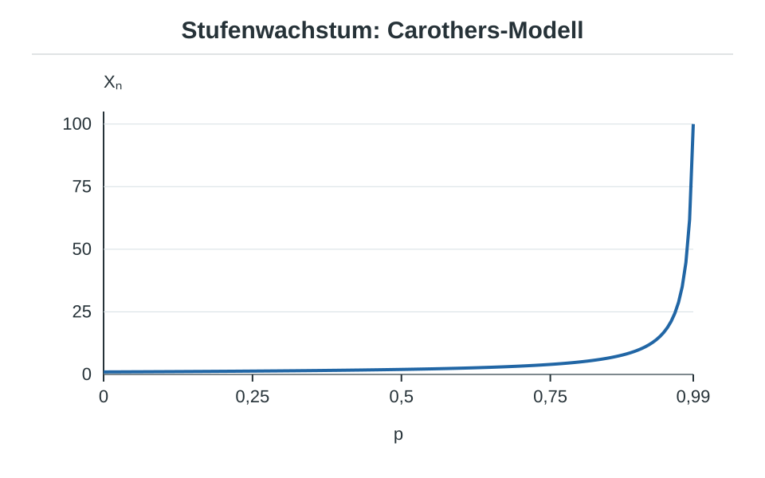

# M16-L3 – Polymerisation und Eigenschaften {#L3}

**Kursbereich:** M16 – Festkörper-, Material- und Polymerchemie

**Niveau:** Bachelor

**Vorwissen:** [M16-L2](M16-L2.md).

**Lernziel:** Polymerisationsmodelle, Molmassenverteilungen und thermische Eigenschaften unterscheiden.

## Ketten- und Stufenwachstum {#S1}
Beim Kettenwachstum reagieren Monomere mit aktiven Kettenenden; lange Ketten können schon bei geringem Gesamtumsatz vorliegen. Beim Stufenwachstum reagieren funktionelle Gruppen von Molekülen unterschiedlicher Größe. Für ideal bifunktionelle, stöchiometrisch ausgeglichene Systeme ohne Ringbildung gilt die Carothers-Beziehung $X_n=1/(1-p)$, wobei p den Umsatz funktioneller Gruppen bezeichnet. Bei p = 0,99 folgt Xₙ = 100. Vernetzung durch mehr als zwei funktionelle Gruppen kann Netzwerke erzeugen; diese lassen sich nicht wie lineare Ketten auflösen oder schmelzen.

*Ideales Modell Xₙ = 1/(1−p), bis p=0,99.*

## Molmassen und Struktur {#S2}
Für eine Population mit Nᵢ Ketten der molaren Masse Mᵢ gilt $M_n=\sum N_iM_i/\sum N_i$ und $M_w=\sum N_iM_i^2/\sum N_iM_i$. Die Dispersität $Đ=M_w/M_n$ ist mindestens eins. Verzweigung, Taktizität und intermolekulare Kräfte beeinflussen Packung und mechanische Eigenschaften. Die Glasübergangstemperatur Tg bezeichnet den temperatur- und zeitskalenabhängigen Wechsel der segmentalen Beweglichkeit amorpher Bereiche. Kristalline Bereiche können zusätzlich schmelzen. Ein Glasübergang ist nicht dasselbe wie ein Schmelzpunkt.
## Modellrechnung: zweifache Molmassenpopulation {#S3}
90 Ketten besitzen 10 kg/mol und 10 Ketten 100 kg/mol. Mₙ = 19 kg/mol, M_w = (90·100+10·10000)/1900 = 57,37 kg/mol und Đ = 3,02. Der kleine Anteil langer Ketten beeinflusst M_w stark. Für eine ideale Stufenpolymerisation bei p = 0,95 beträgt Xₙ dagegen nur 20; ein hoher Umsatz ist für lange Ketten entscheidend.

## Grenzen und typische Fehler {#S4}

Carothers gilt hier nur für ideal bifunktionelle, ausgeglichene Systeme.

## Selbstkontrolle {#S5}

### Aufgaben

1. Was ergibt Carothers bei p = 0,98?
2. Was gilt bei identischer Molmasse aller Ketten?
3. Ist Tg eine universelle Konstante unabhängig von Messbedingungen?

::: {.lc-solutions data-lc-section="S5"}
1. Xₙ = 50.
2. Mₙ = M_w und Đ = 1.
3. Nein, unter anderem die Messzeitskala und thermische Vorgeschichte sind wichtig.
:::

**Weiterlesen:** [M16-L4](M16-L4.md).

## Quellen (extern) {#S6}

### Nachweise

- [Open University, Introduction to Polymers 4.2](https://www.open.edu/openlearn/science-maths-technology/chemistry/introduction-polymers/content-section-4.2) · Ketten- und Stufenwachstum · Fachlicher Bezug zur Lektion: M16-L3 – Polymerisation und Eigenschaften · Zuletzt abgerufen: 2026-11-25
- [Whisnant, 5 Molecular Weight Averages](https://eng.libretexts.org/Bookshelves/Materials_Science/Polymer_Chemistry_%28Whisnant%29/05%3A_Molecular_Weight_Averages) · Molmassenmittelwerte · Fachlicher Bezug zur Lektion: M16-L3 – Polymerisation und Eigenschaften · Zuletzt abgerufen: 2026-11-25
- [Duke University, 11.5.4.4 Glass Transition](https://chem.libretexts.org/Courses/Duke_University/CHEM_210D%3A_Modern_Applications_of_Chemistry/3%3A_Textbook-_Modern_Applications_of_Chemistry/11%3A_Applications_in_Polymer_and_Biological_Chemistry/11.05%3A_Polymer_Chemistry_%28Schaller%29/11.5.04%3A_Polymer_Properties/11.5.4.04%3A_Glass_Transition) · Glasübergang · Fachlicher Bezug zur Lektion: M16-L3 – Polymerisation und Eigenschaften · Zuletzt abgerufen: 2026-11-25
