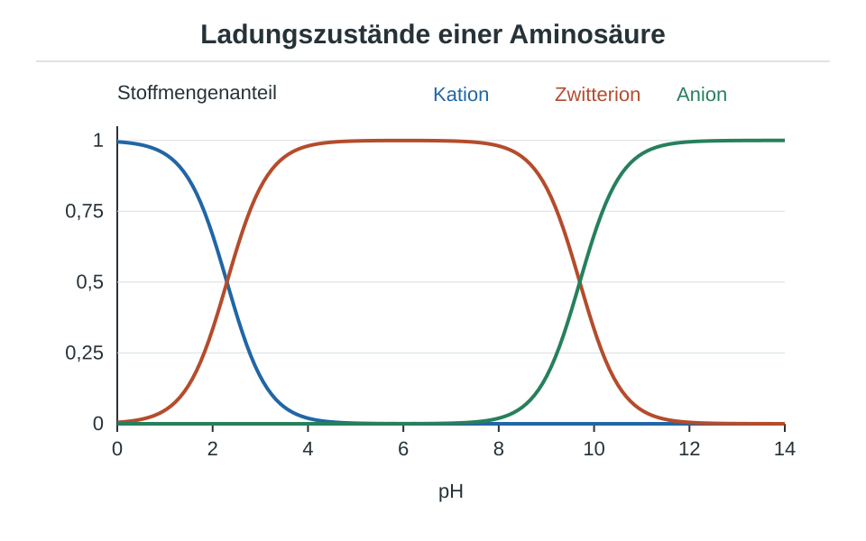

# M17-L1 – Biomoleküle und Stereochemie {#L1}

**Kursbereich:** M17 – Biochemische und bioorganische Grundlagen

**Niveau:** Bachelor

**Vorwissen:** [M16-L5](M16-L5.md).

**Lernziel:** Biomoleküle nach Struktur und Funktion ordnen und die Ladungszustände von Aminosäuren berechnen.

## Bausteine und räumliche Struktur {#S1}
Proteine bestehen aus Aminosäureresten, deren Peptidbindungen durch Resonanz annähernd planar sind. Die α-Kohlenstoffatome vieler Aminosäuren sind chiral; Glycin besitzt zwei Wasserstoffsubstituenten und ist achiral. L/D beschreibt eine relative Konfiguration, nicht die Richtung der optischen Drehung; L-Cystein ist nach CIP-Regeln R. Kohlenhydrate bilden unter anderem glycosidische Bindungen, Nukleinsäuren Phosphodiesterbindungen. Lipide umfassen sehr unterschiedliche hydrophobe oder amphiphile Verbindungen und sind nicht generell Polymere. Die Faltung eines Proteins hängt von zahlreichen Wechselwirkungen und dem Lösungsmittel ab.

*Modell pKa₁=2,3, pKa₂=9,7; Blau: Kation, Rot: Zwitterion, Grün: Anion.*

## Ladungszustände und isoelektrischer Punkt {#S2}
Eine einfache α-Aminosäure ohne ionisierbare Seitenkette besitzt einen kationischen, einen zwitterionischen und einen anionischen Zustand. Die Henderson-Hasselbalch-Beziehung für ein benachbartes Säure-Base-Paar lautet $\mathrm{pH}=\mathrm{p}K_a+\log_{10}([A^-]/[HA])$, im ideal verdünnten Modell. Der isoelektrische Punkt pI ist der pH-Wert, an dem die mittlere Nettoladung null ist. Für ein einfaches Ampholytmodell ergibt sich pI als Mittelwert der beiden pKa-Werte, die den ungeladenen Gesamtzustand einschließen. Ionisierbare Seitenketten erfordern eine erweiterte Bilanz.
## Modellrechnung: Aminosäureladung {#S3}
Für ein hypothetisches Ampholyt mit pKa₁ = 2,3 und pKa₂ = 9,7 beträgt pI = 6,0. Bei pH 7,0 ist das Verhältnis Anion/Zwitterion $10^{7-9.7}=0,0020$ und Kation/Zwitterion $10^{2.3-7}=0,000020$. Der Zwitterionenanteil beträgt rund 99,80 %, die mittlere Ladung ist leicht negativ. Eine Nettoladung null bedeutet nicht, dass einzelne Gruppen ungeladen sind.

## Grenzen und typische Fehler {#S4}

pI bedeutet mittlere Nettoladung null, nicht unpolare Gruppen.

## Selbstkontrolle {#S5}

### Aufgaben

1. Warum ist Glycin achiral?
2. Welche Nettoladung überwiegt bei pH weit unter pKa₁?
3. Bezeichnet L automatisch eine negative optische Drehung?

::: {.lc-solutions data-lc-section="S5"}
1. Es besitzt zwei gleiche Substituenten am α-C-Atom.
2. Positiv.
3. Nein, Konfiguration und Drehrichtung sind verschieden.
:::

**Weiterlesen:** [M17-L2](M17-L2.md).

## Quellen (extern) {#S6}

### Nachweise

- [OpenStax Organic Chemistry, 26.1 Structures of Amino Acids](https://openstax.org/books/organic-chemistry/pages/26-1-structures-of-amino-acids) · Aminosäurestrukturen · Fachlicher Bezug zur Lektion: M17-L1 – Biomoleküle und Stereochemie · Zuletzt abgerufen: 2026-11-25
- [OpenStax Organic Chemistry, 26.2 Isoelectric Points](https://openstax.org/books/organic-chemistry/pages/26-2-amino-acids-and-the-henderson-hasselbalch-equation-isoelectric-points) · Ladung und pI · Fachlicher Bezug zur Lektion: M17-L1 – Biomoleküle und Stereochemie · Zuletzt abgerufen: 2026-11-25
- [OpenStax Organic Chemistry, Chapter 26 Summary](https://openstax.org/books/organic-chemistry/pages/26-summary) · Peptide und Proteine · Fachlicher Bezug zur Lektion: M17-L1 – Biomoleküle und Stereochemie · Zuletzt abgerufen: 2026-11-25
