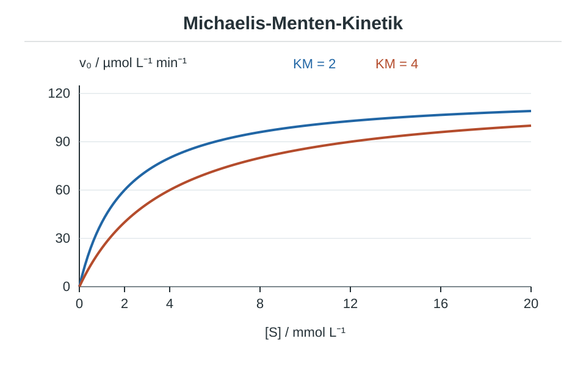

# M17-L2 – Enzyme und Katalyse {#L2}

**Kursbereich:** M17 – Biochemische und bioorganische Grundlagen

**Niveau:** Bachelor

**Vorwissen:** [M17-L1](M17-L1.md).

**Lernziel:** Enzymkinetik mit dem Michaelis-Menten-Modell auswerten und Hemmungsmodelle unterscheiden.

## Enzyme und Übergangszustände {#S1}
Enzyme beschleunigen Reaktionen, indem sie alternative Reaktionswege mit geringeren Aktivierungsbarrieren bereitstellen. Bindung, Orientierung, Säure-Base-Katalyse und Metallionen können zusammenwirken. Ein Enzym ändert nicht die Gleichgewichtskonstante der katalysierten Gesamtreaktion. Im einfachen Schema E + S ⇌ ES → E + P wird zu Beginn der Messung die Rückreaktion aus P vernachlässigt. Für einen quasistationären ES-Komplex und einen großen Substratüberschuss folgt $v_0=V_{\max}[S]/(K_M+[S])$ mit $V_{\max}=k_{cat}[E]_T$ und $K_M=(k_{-1}+k_{cat})/k_1$.

*Blau: KM=2; Rot: kompetitive Hemmung, KM=4 mmol/L; Vmax=120 µmol/(L min).*

## Sättigung und Hemmung {#S2}
Bei [S] = K_M ist die Anfangsgeschwindigkeit halbmaximal; bei großen [S] nähert sie sich Vmax. K_M ist nicht allgemein die Dissoziationskonstante. Ein ideal kompetitiver Inhibitor erhöht das scheinbare K_M um den Faktor $1+[I]/K_i$, während Vmax unverändert bleibt. Bei ideal rein nichtkompetitiver Hemmung sinkt Vmax bei unverändertem K_M. Gemischte Hemmung verändert beide Parameter. Experimentell sind mehrere Substratkonzentrationen und ein nichtlinearer Fit mit Residuenprüfung vorzuziehen.
## Modellrechnung: Anfangsgeschwindigkeit {#S3}
Für Vmax = 120 µmol/(L min) und K_M = 2,0 mmol/L ergeben sich bei [S] = 0,5, 2 und 8 mmol/L die Geschwindigkeiten 24, 60 und 96 µmol/(L min). Bei [I] = K_i verdoppelt sich K_M im kompetitiven Modell; bei 2 mmol/L sinkt v₀ auf 40 µmol/(L min). Bei [E]_T = 0,20 µmol/L entspricht Vmax einem kcat von 600 min⁻¹ = 10 s⁻¹. Alle Werte sind simuliert.

## Grenzen und typische Fehler {#S4}

KM nicht allgemein als Dissoziationskonstante interpretieren.

## Selbstkontrolle {#S5}

### Aufgaben

1. Wie groß ist v₀ bei 6 mmol/L ohne Hemmung?
2. Was passiert mit Vmax bei einer Verdoppelung der aktiven Enzymkonzentration?
3. Ist eine schwächere Substratbindung allein durch ein höheres K_M bewiesen?

::: {.lc-solutions data-lc-section="S5"}
1. 90 µmol/(L min).
2. Es verdoppelt sich im Modell.
3. Nein, K_M hängt auch von kinetischen Konstanten ab.
:::

**Weiterlesen:** [M17-L3](M17-L3.md).

## Quellen (extern) {#S6}

### Nachweise

- [OpenStax Biology 2e, 6.5 Enzymes](https://openstax.org/books/biology-2e/pages/6-5-enzymes) · Enzymkatalyse · Fachlicher Bezug zur Lektion: M17-L2 – Enzyme und Katalyse · Zuletzt abgerufen: 2026-11-25
- [LibreTexts, Michaelis–Menten Kinetics](https://chem.libretexts.org/Bookshelves/Biological_Chemistry/Supplemental_Modules_%28Biological_Chemistry%29/Enzymes/Enzymatic_Kinetics/Michaelis-Menten_Kinetics) · Sättigungskinetik · Fachlicher Bezug zur Lektion: M17-L2 – Enzyme und Katalyse · Zuletzt abgerufen: 2026-11-25
