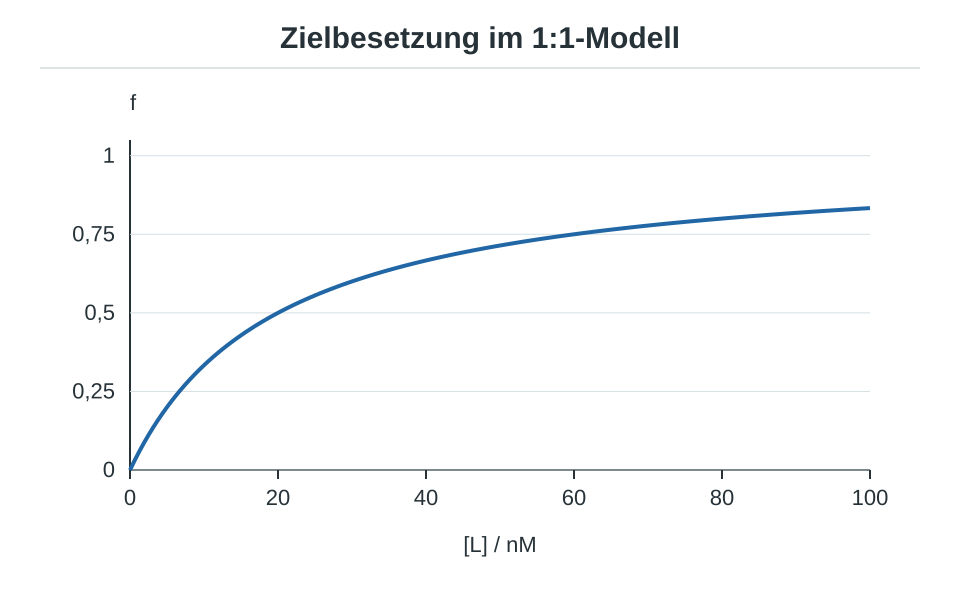

# M17-L5 – Schnittstelle zur chemischen Biologie {#L5}

**Kursbereich:** M17 – Biochemische und bioorganische Grundlagen

**Niveau:** Bachelor

**Vorwissen:** [M17-L4](M17-L4.md).

**Lernziel:** Chemische Sonden als Werkzeuge zur Prüfung biologischer Hypothesen bewerten und geeignete Kontrollen auswählen.

## Chemische Biologie als Schnittstelle {#S1}
Chemische Biologie verwendet definierte Moleküle, um biologische Prozesse zu beobachten oder gezielt zu verändern. Eine chemische Sonde kann beispielsweise an ein Protein binden oder durch eine Fluoreszenzänderung einen lokalen Zustand anzeigen. Potenz, Selektivität, Stabilität und die Verfügbarkeit im betrachteten System sind getrennte Eigenschaften. Ein Signal aus einem gereinigten Protein beweist nicht, dass derselbe Zielkontakt in einer intakten Zelle erreicht wird. Eine Sonde ist nicht automatisch ein therapeutischer Wirkstoff.

*Kd=20 nM; freie Ligandenkonzentration.*

## Evidenz und Kontrollbedingungen {#S2}
Eine Zielbindung muss durch geeignete unabhängige Daten gestützt werden. Eine strukturell verwandte, deutlich weniger aktive Negativkontrolle hilft unspezifische Effekte zu erkennen. Eine zweite chemisch verschiedene Sonde mit demselben Ziel kann zusätzliche Evidenz liefern; beide müssen auf relevante Nebenziele geprüft werden. Auch Lösungsmittelkontrollen, Messinterferenzen, Hintergrundsignale und Zellzustand sind wichtig. Korrelation zwischen Zielbindung und Phänotyp ist kein eindeutiger Kausalitätsnachweis.
## Modellrechnung: Bindung und Signal {#S3}
Für ein einfaches 1:1-Gleichgewicht mit freier Ligandenkonzentration L und Dissoziationskonstante Kd gilt $f=[L]/(K_d+[L])$. Bei Kd = 20 nM und [L] = 80 nM folgt f = 0,80. Ein hypothetisches Signal sinkt von 100 Einheiten in der Kontrolle auf 60 bei der Sonde, aber auch auf 75 bei der wenig aktiven Negativkontrolle. Der Rückgang um 40 % kann daher nicht vollständig als zielspezifisch gelten. Ein bloßes Subtrahieren der Kontrollwirkung beweist keinen kausalen Anteil. Zelluläre freie Konzentration und direkte Zielbindung müssen unabhängig geprüft werden.

## Grenzen und typische Fehler {#S4}

Zielbindung, Wirksamkeit und Kausalität getrennt prüfen.

## Selbstkontrolle {#S5}

### Aufgaben

1. Wie hoch ist die Modellbesetzung bei [L] = Kd?
2. Ist Kd mit einer zellulären halbmaximalen Wirkung gleichzusetzen?
3. Welche Schlussfolgerung ist bei starkem Effekt der Negativkontrolle zulässig?

::: {.lc-solutions data-lc-section="S5"}
1. 50 %.
2. Nein, zusätzliche biologische und pharmakokinetische Faktoren beeinflussen die Wirkung.
3. Unspezifische Effekte oder Messinterferenzen müssen weiter untersucht werden.
:::

## Quellen (extern) {#S6}

### Nachweise

- [Chemical Probes Portal, FAQ](https://www.chemicalprobes.org/faq) · Sondenauswahl · Fachlicher Bezug zur Lektion: M17-L5 – Schnittstelle zur chemischen Biologie · Zuletzt abgerufen: 2026-11-25
- [Nature Chemical Biology, Determining target engagement in living systems (2013)](https://www.nature.com/articles/nchembio.1211) · Zielbindung · Fachlicher Bezug zur Lektion: M17-L5 – Schnittstelle zur chemischen Biologie · Zuletzt abgerufen: 2026-11-25
- [Chemical Probes Portal, Controls for chemical probes](https://www.chemicalprobes.org/info/controls) · Negativkontrolle · Fachlicher Bezug zur Lektion: M17-L5 – Schnittstelle zur chemischen Biologie · Zuletzt abgerufen: 2026-11-25
