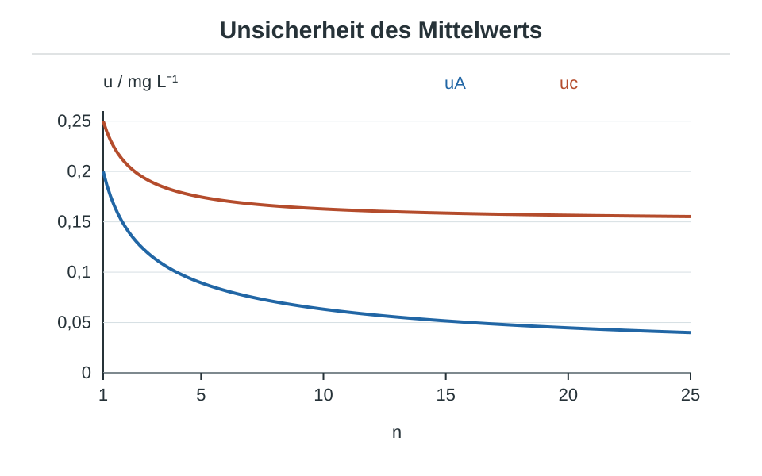

# M18-L4 – Messdaten auswerten {#L4}

**Kursbereich:** M18 – Chemische Praktika und wissenschaftliche Arbeit

**Niveau:** Bachelor – Praxis

**Vorwissen:** [M18-L3](M18-L3.md).

**Lernziel:** Messreihen statistisch auswerten und Unsicherheiten mit nachvollziehbaren Annahmen berichten.

## Streuung und Mittelwert {#S1}
Für n unabhängige Wiederholwerte ist das arithmetische Mittel $\bar{x}=\sum x_i/n$ und die Stichprobenstandardabweichung $s=\sqrt{\sum(x_i-\bar{x})^2/(n-1)}$. Die geschätzte Standardunsicherheit des Mittelwerts aus Wiederholpräzision ist $u_A=s/\sqrt n$. Sie beschreibt nicht sämtliche Unsicherheitsquellen. Eine Kalibrationsunsicherheit oder ein Probenahmeeffekt verschwindet nicht durch mehr Wiederholmessungen derselben Probe. Ein auffälliger Wert wird nicht willkürlich entfernt; seine Behandlung muss methodisch begründet und dokumentiert sein.

*Blau: uA = 0,2/√n; Rot: kombinierte Standardunsicherheit mit unabhängigem Kalibrationsbeitrag 0,15 mg/L.*

## Unsicherheitsbudget {#S2}
Für unabhängige, additiv auf die Messgröße bezogene Standardunsicherheiten gilt $u_c=\sqrt{\sum u_i^2}$. Bei korrelierten Beiträgen müssen Kovarianzen berücksichtigt werden. Eine erweiterte Unsicherheit U=k u_c verwendet einen begründeten Erweiterungsfaktor. k=2 ist oft eine Näherung für etwa 95 % Überdeckung unter geeigneten Annahmen, aber keine universelle Garantie. Kleine Stichproben erfordern besondere Beachtung der Freiheitsgrade.
## Modellrechnung: drei Wiederholwerte {#S3}
Die Werte 9,8; 10,0; 10,2 mg/L ergeben Mittelwert 10,0 mg/L, s=0,2 mg/L und u_A=0,1155 mg/L. Ein unabhängiger, bereits als Standardunsicherheit ausgedrückter Kalibrationsbeitrag von 0,15 mg/L führt zu u_c≈0,1893 mg/L. Mit illustrativem k=2 ergibt sich U≈0,38 mg/L. Die Angabe 10,00 ± 0,38 mg/L nennt explizit k=2, aber behauptet bei n=3 ohne weitere Begründung keine exakte Überdeckungswahrscheinlichkeit.

## Grenzen und typische Fehler {#S4}

Korrelationen, Stichprobengröße und Überdeckungsfaktor berücksichtigen.

## Selbstkontrolle {#S5}

### Aufgaben

1. Was ergibt u_A bei n=4 und s=0,2 mg/L?
2. Verschwindet der Kalibrationsbeitrag durch mehr Wiederholungen?
3. Darf k=2 immer mit exakt 95 % gleichgesetzt werden?

::: {.lc-solutions data-lc-section="S5"}
1. 0,1 mg/L.
2. Nicht allgemein, insbesondere nicht bei gemeinsamem systematischem Beitrag.
3. Nein, Verteilung und Freiheitsgrade sind zu beachten.
:::

**Weiterlesen:** [M18-L5](M18-L5.md).

## Quellen (extern) {#S6}

### Nachweise

- [Eurachem, Fitness for Purpose of Analytical Methods (3rd ed., 2025)](https://www.eurachem.org/index.php/publications/guides/mv) · Methodenvalidierung und Messqualität · Fachlicher Bezug zur Lektion: M18-L4 – Messdaten auswerten · Zuletzt abgerufen: 2026-11-25
- [DFG, Handling of Research Data](https://www.dfg.de/en/basics-topics/digital-topics/research-data) · Dokumentation und Datenmanagement · Fachlicher Bezug zur Lektion: M18-L4 – Messdaten auswerten · Zuletzt abgerufen: 2026-11-25
