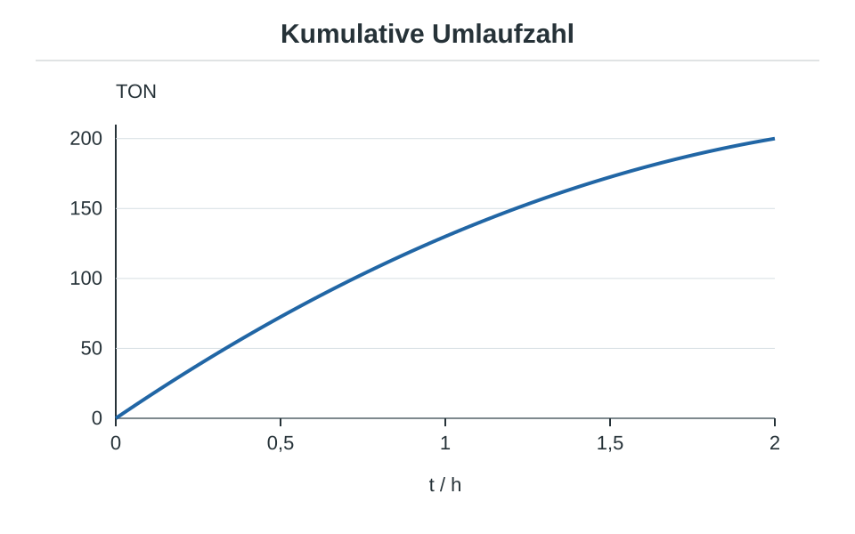

# M19-L2 – Homogene Katalyse {#L2}

**Kursbereich:** M19 – Fortgeschrittene anorganische Chemie und Katalyse

**Niveau:** Master – Vertiefung (hochschulabhängiger Pflicht-/Wahlstatus)

**Vorwissen:** [M19-L1](M19-L1.md).

**Lernziel:** Elementarschritte homogener Katalyse unterscheiden und katalytische Leistung auf definierte Bezugsgrößen beziehen.

## Elementarschritte und Zyklusbilanz {#S1}
Bei homogener Katalyse befinden sich Katalysator und Reaktionspartner im selben Phasenbereich. Ligandenassoziation und -dissoziation verändern Koordinationszahl und Elektronenzahl. Eine klassische oxidative Addition einer A–B-Bindung an ein Metall erhöht dessen formale Oxidationsstufe typischerweise um zwei; reduktive Eliminierung ist der umgekehrte Schritt. Bei migratorischer Insertion wird ein Ligand formal in eine Metall-Ligand-Bindung eingebaut. Nicht jeder Zyklus enthält alle diese Schritte. Für einen plausiblen Zyklus müssen Atome, Ladung und Regeneration der aktiven Spezies bilanziert sein.

*Zusätzliche Modellannahme: TOF = 160 − 60t in h⁻¹ für t in h; TON(2 h)=200.*

## Aktivität und Selektivität {#S2}
Ein geschlossener Zyklus ist eine mechanistische Hypothese, kein unmittelbarer Beweis für die aktive Spezies. Ruhespezies, reversible Zwischenstufen und Desaktivierung beeinflussen beobachtete Geschwindigkeiten. Die hier verwendete kumulative Umlaufzahl TON ist die gebildete Produktstoffmenge pro Stoffmenge aktiver Zentren; die TOF ist die Reaktionsrate pro aktivem Zentrum. Bei unbekannter Zentrenzahl ist eine Normierung auf die gesamte eingesetzte Metallmenge ausdrücklich als scheinbare Größe zu kennzeichnen. IUPAC verwendet in unterschiedlichen Kontexten auch abweichende TON-Terminologie.
## Modellrechnung: zeitlich gemittelte Leistung {#S3}
In einem fiktiven System entsprechen 0,50 mmol Katalysator 0,50 mmol aktiven Zentren. Nach 2,0 h liegen 100 mmol Produkt vor; das Modell nimmt keine Nebenprodukte an. TON=200, die mittlere TOF=100 h⁻¹. Eine anfängliche Produktbildungsrate von 80 mmol/h ergäbe dagegen eine anfängliche TOF von 160 h⁻¹. Beide Werte können gleichzeitig zutreffen, etwa bei abnehmender Aktivität.

## Grenzen und typische Fehler {#S4}

TON und TOF mit Bezugsgröße und Zeitintervall angeben.

## Selbstkontrolle {#S5}

### Aufgaben

1. Wie hoch ist TON bei 25 mmol Produkt und 0,5 mmol Zentren?
2. Verschiebt ein Katalysator bei gleicher Temperatur die thermodynamische Gleichgewichtskonstante?
3. Ist die mittlere TOF gleich der Anfangs-TOF?

::: {.lc-solutions data-lc-section="S5"}
1. 50.
2. Nein, er verändert den Reaktionsweg und die Geschwindigkeit.
3. Nicht notwendigerweise.
:::

**Weiterlesen:** [M19-L3](M19-L3.md).

## Quellen (extern) {#S6}

### Nachweise

- [East Tennessee State University, 10.5 Organometallic Reactions and Catalysis](https://chem.libretexts.org/Courses/East_Tennessee_State_University/CHEM_4110%3A_Advanced_Inorganic_Chemistry/10%3A_Organometallic_Chemistry/10.05%3A_Organometallic_Reactions_and_Catalysis) · Elementarschritte und Katalyse · Fachlicher Bezug zur Lektion: M19-L2 – Homogene Katalyse · Zuletzt abgerufen: 2026-11-25
- [IUPAC Gold Book, turnover frequency (T06534)](https://goldbook.iupac.org/terms/view/T06534) · Normierung der katalytischen Rate · Fachlicher Bezug zur Lektion: M19-L2 – Homogene Katalyse · Zuletzt abgerufen: 2026-11-25
