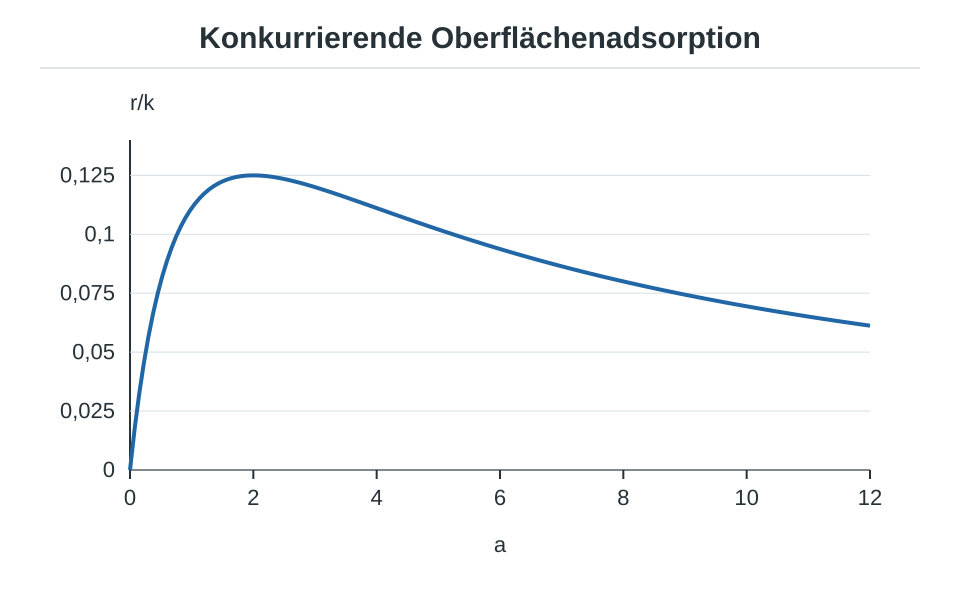

# M19-L3 – Heterogene Katalyse {#L3}

**Kursbereich:** M19 – Fortgeschrittene anorganische Chemie und Katalyse

**Niveau:** Master – Vertiefung (hochschulabhängiger Pflicht-/Wahlstatus)

**Vorwissen:** [M19-L2](M19-L2.md).

**Lernziel:** Adsorption, Oberflächenreaktion und Stofftransport als unterscheidbare Beiträge zur heterogenen Katalyse modellieren.

## Oberflächenzentren und Adsorption {#S1}
Bei heterogener Katalyse sind Katalysator und Reaktanden in unterschiedlichen Phasen. Nur ein Teil der Oberfläche muss katalytisch aktiv sein. In einem idealisierten Langmuir-Modell konkurrieren A und B um gleichartige Plätze; mit den dimensionslosen Größen a=K_A p_A und b=K_B p_B gilt für den Anteil freier Plätze $\theta_*=1/(1+a+b)$, für belegte Plätze $\theta_A=a\theta_*$ und $\theta_B=b\theta_*$. Die Summe der Bedeckungen ist eins. Das Modell setzt unter anderem unabhängige Plätze, Adsorptionsgleichgewicht und keine Mehrfachbelegung voraus.

*Langmuir-Hinshelwood-Modell mit b=1: r/k=a/(2+a)².*

## Oberflächenreaktion und Transport {#S2}
Im Langmuir-Hinshelwood-Modell reagieren zwei adsorbierte Spezies. Bei zufälliger Platzverteilung und geschwindigkeitsbestimmender Oberflächenreaktion ist $r=k\theta_A\theta_B=kab/(1+a+b)^2$. k hat dieselbe Einheit wie die gewählte normierte Rate. Starke Adsorption eines Reaktanden kann andere Spezies verdrängen und die Rate verringern. Beim Eley-Rideal-Modell reagiert dagegen eine nicht adsorbierte Spezies mit einer adsorbierten. Externe Film- und interne Porendiffusion können die gemessene Rate begrenzen; dann ist eine scheinbare Geschwindigkeitskonstante nicht ohne Weiteres intrinsisch.
## Modellrechnung: konkurrierende Belegung {#S3}
Für b=1 und a=2 ergeben sich freie Plätze 0,25, A-Bedeckung 0,50 und B-Bedeckung 0,25. r/k=0,125. Bei a=10 und gleichem b ist r/k=10/144≈0,0694. Die Rate erreicht bei a=1+b ihr Maximum, da die Ableitung von ab/(1+a+b)² dort null ist. Dies ist ein abstraktes Modell, keine Betriebsoptimierung eines konkreten chemischen Verfahrens.

## Grenzen und typische Fehler {#S4}

Oberflächenmodell und Stofftransport getrennt prüfen.

## Selbstkontrolle {#S5}

### Aufgaben

1. Wie groß ist die freie Bedeckung bei a=b=1?
2. Was passiert mit r/k für a gegen unendlich bei festem b?
3. Beweist eine passende Rategleichung allein den Mechanismus?

::: {.lc-solutions data-lc-section="S5"}
1. 1/3.
2. Der Wert nähert sich null.
3. Nein, alternative Mechanismen und Transporteffekte können ähnliche Daten erzeugen.
:::

**Weiterlesen:** [M19-L4](M19-L4.md).

## Quellen (extern) {#S6}

### Nachweise

- [New York University, 1.22 Kinetics of Catalysis](https://chem.libretexts.org/Courses/New_York_University/CHEM-UA_652%3A_Thermodynamics_and_Kinetics/01%3A_Lectures/1.22%3A_Kinetics_of_Catalysis) · Oberflächenkinetik · Fachlicher Bezug zur Lektion: M19-L3 – Heterogene Katalyse · Zuletzt abgerufen: 2026-11-25
- [IUPAC Gold Book, turnover frequency (T06534)](https://goldbook.iupac.org/terms/view/T06534) · Normierung der katalytischen Rate · Fachlicher Bezug zur Lektion: M19-L3 – Heterogene Katalyse · Zuletzt abgerufen: 2026-11-25
