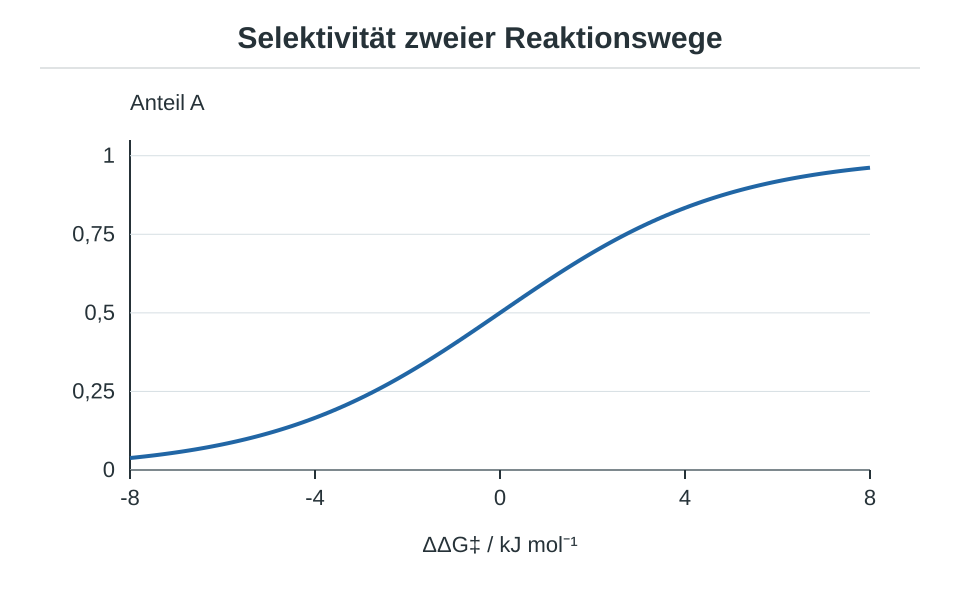

# M19-L4 – Struktur-Reaktivitäts-Beziehungen {#L4}

**Kursbereich:** M19 – Fortgeschrittene anorganische Chemie und Katalyse

**Niveau:** Master – Vertiefung (hochschulabhängiger Pflicht-/Wahlstatus)

**Vorwissen:** [M19-L3](M19-L3.md).

**Lernziel:** Struktur-Reaktivitäts-Hypothesen anhand geeigneter Vergleichsgrößen und konkurrierender Erklärungen prüfen.

## Elektronische und sterische Einflüsse {#S1}
Liganden beeinflussen die Elektronendichte, Geometrie und Zugänglichkeit eines Metallzentrums. Elektronische Donor- und Akzeptoreigenschaften können verschiedene Elementarschritte unterschiedlich beeinflussen. Sterische Abschirmung kann Bindungen und Übergangszustände destabilisieren, aber auch eine gewünschte Koordination begünstigen. Ein einzelner Deskriptor beschreibt nicht notwendigerweise alle Einflüsse. Ein beobachteter Trend kann durch gleichzeitig veränderte Speziation oder Konzentration aktiver Zentren entstehen.

*Ideales Parallelmodell bei 298 K; ΔΔG‡ = G‡B − G‡A.*

## Vergleich auf gemeinsamer Basis {#S2}
Für zwei konkurrierende irreversible Wege aus derselben Ausgangsspezies liefert die Übergangszustandstheorie bei gleichen Transmissionskoeffizienten das Verhältnis $k_A/k_B=\exp[-(\Delta G_A^\ddagger-\Delta G_B^\ddagger)/(RT)]$. Freie Aktivierungsenergien müssen auf gleiche Standardzustände und Temperatur bezogen sein. Bei vorgelagerten Gleichgewichten oder Produktumwandlungen lässt sich das gemessene Produktverhältnis nicht allgemein mit diesem Verhältnis gleichsetzen. Strukturmodelle werden daher zusammen mit Kinetik und spektroskopischer Evidenz beurteilt.
## Modellrechnung: zwei Reaktionswege {#S3}
Bei T=298 K liegen die hypothetischen Barrieren bei 70 und 74 kJ/mol. Das Verhältnis A:B beträgt exp(4000/(8,314·298))≈5,03:1. Im idealisierten Parallelmodell ist der Produktanteil A damit etwa 83,4 %. Eine Unsicherheit der Differenz von 1 kJ/mol verändert das Verhältnis um einen Faktor von etwa 1,50; scheinbar kleine Modellfehler sind kinetisch bedeutsam. Aus dem Zahlenwert folgt kein Nachweis einer bestimmten realen Katalysatorstruktur.

## Grenzen und typische Fehler {#S4}

Selektivität nur unter den angegebenen kinetischen Annahmen ableiten.

## Selbstkontrolle {#S5}

### Aufgaben

1. Welches Verhältnis ergibt gleiche freie Aktivierungsenergie?
2. Darf aus einer Korrelation direkt Kausalität gefolgert werden?
3. Warum sind Standardzustände beim Vergleich wichtig?

::: {.lc-solutions data-lc-section="S5"}
1. 1:1 bei gleichen übrigen Modellannahmen.
2. Nein, konkurrierende Einflüsse müssen geprüft werden.
3. Weil die freien Aktivierungsenergien auf konsistenten Bezugszuständen beruhen müssen.
:::

**Weiterlesen:** [M19-L5](M19-L5.md).

## Quellen (extern) {#S6}

### Nachweise

- [University of Wisconsin–Whitewater, 4.15 The 18-electron Rule](https://chem.libretexts.org/Courses/UW-Whitewater/Chem_260%3A_Inorganic_Chemistry_%28Girard%29/04%3A_Coordination_Chemistry_and_Crystal_Field_Theory/4.15%3A_The_18-electron_Rule) · Elektronenzählung · Fachlicher Bezug zur Lektion: M19-L4 – Struktur-Reaktivitäts-Beziehungen · Zuletzt abgerufen: 2026-11-25
- [East Tennessee State University, 10.5 Organometallic Reactions and Catalysis](https://chem.libretexts.org/Courses/East_Tennessee_State_University/CHEM_4110%3A_Advanced_Inorganic_Chemistry/10%3A_Organometallic_Chemistry/10.05%3A_Organometallic_Reactions_and_Catalysis) · Elementarschritte und Katalyse · Fachlicher Bezug zur Lektion: M19-L4 – Struktur-Reaktivitäts-Beziehungen · Zuletzt abgerufen: 2026-11-25
- [New York University, 1.22 Kinetics of Catalysis](https://chem.libretexts.org/Courses/New_York_University/CHEM-UA_652%3A_Thermodynamics_and_Kinetics/01%3A_Lectures/1.22%3A_Kinetics_of_Catalysis) · Oberflächenkinetik · Fachlicher Bezug zur Lektion: M19-L4 – Struktur-Reaktivitäts-Beziehungen · Zuletzt abgerufen: 2026-11-25
