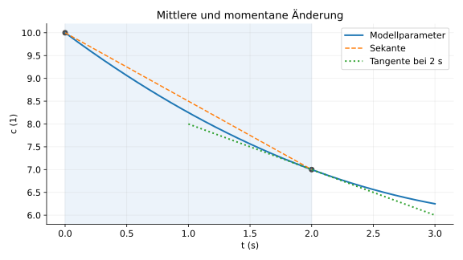

# M2-L2 – Differential- und Integralrechnung {#L2}

**Kursbereich:** M2 – Mathematik für Chemiker

**Niveau:** Bachelor

**Vorwissen:** [M2-L1](M2-L1.md).

**Lernziel:** Ableitungen als lokale Änderungsraten und Integrale als aufsummierte Änderungen interpretieren und anwenden.

## Ableitung als lokale Rate {#S1}

Die mittlere Änderung einer Konzentration $c(t)$ zwischen zwei Zeitpunkten beträgt $\Delta c/\Delta t$. Im Grenzübergang entsteht die Ableitung $dc/dt$. Bei einer abnehmenden Konzentration ist sie negativ; die positive Verbrauchsrate ist $-dc/dt$. Die Einheit einer solchen Rate ist Konzentration pro Zeit. Die stöchiometrisch normierte Reaktionsrate wird später gesondert eingeführt.

Wichtige Regeln sind die Potenzregel $(x^p)'=px^{p-1}$ im zulässigen Definitionsbereich, die Produktregel $(fg)'=f'g+fg'$ und die Kettenregel $(f(g(x)))'=f'(g(x))g'(x)$. Beispielsweise gilt $d\exp(-kt)/dt=-k\exp(-kt)$ für konstantes $k$.

## Integral und Bilanz {#S2}

Das bestimmte Integral summiert lokale Beiträge. Für eine stetige Änderungsrate $r(t)=dc/dt$ folgt aus dem Hauptsatz

$$
c(t_2)-c(t_1)=\int_{t_1}^{t_2}r(t)\,dt.
$$

Die Einheit des Integrals ist Konzentration. Bei einer negativen Rate beschreibt das Integral eine Abnahme, nicht eine positive Fläche. Für ein unbekanntes $c(t)$ muss zusätzlich ein Anfangswert bekannt sein. Bei diskreten Messwerten können numerische Integrationsmethoden benutzt werden; ihre Genauigkeit hängt von Abständen, Messfehlern und Verlauf ab.

*Die Tangente zeigt die momentane Änderungsrate; die Sekante zeigt eine mittlere Rate.*

## Beispiel: Zeitabhängigkeit {#S3}

Ein dimensionsloser Modellparameter nimmt für $0\le t\le3\,\mathrm s$ gemäß $c(t)=10-2(t/\mathrm s)+(t/\mathrm s)^2/4$ ab. Für den Zeitpunkt 2 s folgt $dc/dt=(-2+2/2)\,\mathrm{s^{-1}}=-1\,\mathrm{s^{-1}}$. Die gesamte Änderung von 0 bis 2 s beträgt

$$
\int_0^{2\,\mathrm s}(-2+t/(2\,\mathrm s))\,\frac{dt}{\mathrm s}=-3.
$$

Direkt geprüft: $c(2\,\mathrm s)-c(0)=7-10=-3$. In der Praxis können dieselben Regeln etwa auf Stoffmengenänderungen und Wärmeleistungen angewandt werden.

## Mehrere Einflussgrößen {#S4}

Chemische Zustandsgrößen hängen oft von Temperatur, Druck und Zusammensetzung ab. Eine partielle Ableitung gibt an, wie eine Größe auf eine Variable reagiert, während die anderen festgehalten werden. Für eine Funktion $f(T,p)$ gilt lokal $df=(\partial f/\partial T)_p\,dT+(\partial f/\partial p)_T\,dp$. Eine Ableitung entlang eines Wegs, auf dem sich beide Variablen ändern, ist damit nicht dasselbe wie die partielle Ableitung. Die Gleichung setzt Differenzierbarkeit voraus.

## Selbstkontrolle {#S5}

### Aufgaben

1. Was unterscheidet $dc/dt$ von $\Delta c/\Delta t$?
2. Eine konstante Verbrauchsrate beträgt 0.30 mmol/(L s). Welche Konzentrationsabnahme ergibt sich in 4 s?
3. Bestimme die Ableitung von $f(x)=3x^2+2x$ bei $x=2$.

::: {.lc-solutions data-lc-section="S5"}
1. Momentane Grenzrate gegenüber mittlerer Rate über ein endliches Intervall.
2. 1.20 mmol/L; die vorzeichenbehaftete Änderung ist −1.20 mmol/L.
3. $(6x+2)_{x=2}=14$.
:::

**Weiterlesen:** [M2-L3](M2-L3.md).

## Quellen (extern) {#S6}

### Nachweise

- [OpenStax – Calculus Volume 1, 3.4 Derivatives as Rates of Change](https://openstax.org/books/calculus-volume-1/pages/3-4-derivatives-as-rates-of-change) · Mittlere und momentane Änderungsrate; Fachlicher Bezug zur Lektion: M2-L2 – Differential- und Integralrechnung · Zuletzt abgerufen: 2026-11-25
- [OpenStax – Calculus Volume 1, 5.3 The Fundamental Theorem of Calculus](https://openstax.org/books/calculus-volume-1/pages/5-3-the-fundamental-theorem-of-calculus) · Hauptsatz und bestimmtes Integral; Fachlicher Bezug zur Lektion: M2-L2 – Differential- und Integralrechnung · Zuletzt abgerufen: 2026-11-25
