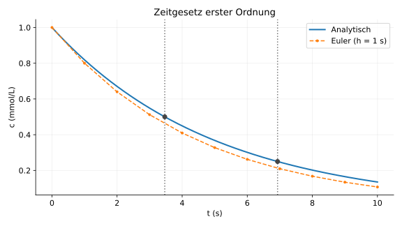

# M2-L3 – Differentialgleichungen {#L3}

**Kursbereich:** M2 – Mathematik für Chemiker

**Niveau:** Bachelor

**Vorwissen:** [M2-L2](M2-L2.md).

**Lernziel:** Ein Anfangswertproblem erster Ordnung lösen und analytische mit numerischer Zeitentwicklung vergleichen.

## Differentialgleichungen als chemische Modelle {#S1}

Eine Differentialgleichung enthält eine unbekannte Funktion und ihre Ableitungen. Aus einer lokalen Entwicklungsregel soll der gesamte Verlauf bestimmt werden. Für den modellierten Verbrauch einer Spezies bei konstanter Temperatur und konstantem Volumen sei $dc/dt=-kc$. Diese mathematische Annahme beschreibt eine Kinetik erster Ordnung bezüglich dieser Spezies. Sie gilt nicht automatisch für alle realen Reaktionen.

## Analytische Lösung {#S2}

Für $c>0$ trennen wir die Variablen und integrieren vom Anfangszustand $c_0>0$ bis zum Zeitpunkt $t$:

$$
\int_{c_0}^{c(t)}\frac{dc}{c}=-\int_0^t k\,dt,\qquad \ln(c(t)/c_0)=-kt.
$$

Daraus folgt $c(t)=c_0\exp(-kt)$. Die konstante Lösung $c(t)=0$ muss separat betrachtet werden, weil die Division durch $c$ dort nicht erlaubt ist. Für $k>0$ ist die Halbwertszeit $t_{1/2}=\ln(2)/k$. Der Anfangswert bestimmt die konkrete Lösung; ohne ihn gibt es eine Lösungsfamilie.

*Analytischer Verlauf und diskrete Euler-Näherung für ein Modell erster Ordnung.*

## Beispiel: Euler-Verfahren {#S3}

Ein Anfangswert von 1.00 mmol/L und $k=0.20\,\mathrm{s^{-1}}$ liefern nach 5 s den analytischen Wert $e^{-1}\,\mathrm{mmol/L}\approx0.368\,\mathrm{mmol/L}$. Beim expliziten Euler-Verfahren wird die lokale Steigung über einen Zeitschritt $h$ fortgesetzt:

$$
c_{j+1}=c_j+h(-kc_j)=(1-kh)c_j.
$$

Für $h=1\,\mathrm s$ erhält man nach fünf Schritten $0.8^5=0.32768$ mmol/L. Der relative Unterschied zum exakten Wert beträgt ungefähr −10.9 %. Eine kleinere Schrittweite führt für dieses Modell zur Konvergenz, erhöht aber den Rechenaufwand. Wenn $kh>1$, entstehen bei positivem Anfangswert negative Konzentrationen; dies ist hier ein unphysikalisches numerisches Artefakt.

## Modellgrenzen {#S4}

Ein System mehrerer Reaktionen kann gekoppelte Differentialgleichungen benötigen. Bei sehr unterschiedlichen Zeitskalen können einfache explizite Verfahren unpraktisch werden. Prüfe neben numerischer Konvergenz auch Stoffbilanzen, Positivität und die fachliche Gültigkeit der Annahmen. Die berechnete Kurve ist keine experimentelle Messreihe.

## Selbstkontrolle {#S5}

### Aufgaben

1. Bestimme $t_{1/2}$ für $k=0.10\,\mathrm{s^{-1}}$.
2. Berechne einen Euler-Schritt für $c_0=2.0$ mmol/L, $k=0.25\,\mathrm{s^{-1}}$ und $h=1\,\mathrm s$.
3. Warum reicht die gute Übereinstimmung einer numerischen Lösung mit der analytischen Lösung nicht als experimentelle Validierung?

::: {.lc-solutions data-lc-section="S5"}
1. $\ln(2)/0.10\approx6.93\,\mathrm s$.
2. $(1-0.25)\cdot2.0=1.5$ mmol/L.
3. Beide lösen dieselbe angenommene Gleichung. Die Gültigkeit dieser Gleichung für reale Daten ist separat zu prüfen.
:::

**Weiterlesen:** [M2-L4](M2-L4.md).

## Quellen (extern) {#S6}

### Nachweise

- [OpenStax – Calculus Volume 2, 4.3 Separable Equations](https://openstax.org/books/calculus-volume-2/pages/4-3-separable-equations) · Separation der Variablen; Fachlicher Bezug zur Lektion: M2-L3 – Differentialgleichungen · Zuletzt abgerufen: 2026-11-25
- [OpenStax – Chemistry 2e, 12.4 Integrated Rate Laws](https://openstax.org/books/chemistry-2e/pages/12-4-integrated-rate-laws) · Integriertes Zeitgesetz erster Ordnung und Halbwertszeit; Fachlicher Bezug zur Lektion: M2-L3 – Differentialgleichungen · Zuletzt abgerufen: 2026-11-25
