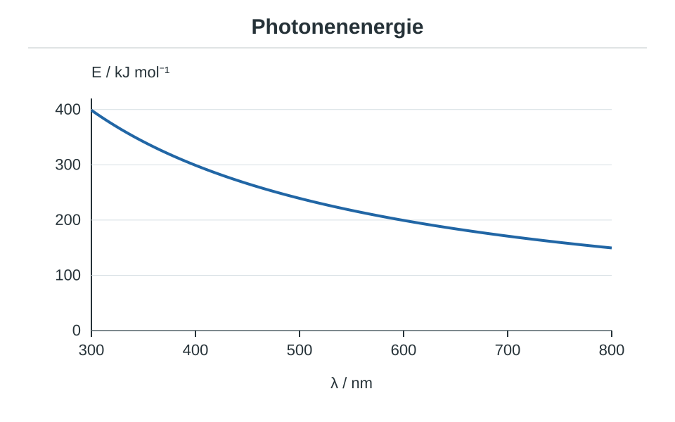

# M20-L3 – Photochemie und Radikalchemie {#L3}

**Kursbereich:** M20 – Fortgeschrittene organische Chemie

**Niveau:** Master – Vertiefung (hochschulabhängiger Pflicht-/Wahlstatus)

**Vorwissen:** [M20-L2](M20-L2.md).

**Lernziel:** Elektronisch angeregte Zustände, Radikalreaktionen und photochemische Quantenausbeuten einordnen.

## Anregung und Relaxation {#S1}
Ein absorbiertes Photon kann ein Molekül in einen elektronisch angeregten Zustand überführen. Die Energiedifferenz ist $E=h\nu=hc/\lambda$. Angeregte Zustände können strahlend relaxieren, durch innere Umwandlung Energie abgeben, zwischen Spinzuständen wechseln oder reagieren. Ein Jablonski-Schema unterscheidet elektronische Zustände und diese Übergänge. Die Auswahlregeln und die relative Konkurrenz der Prozesse bestimmen, welche Vorgänge relevant sind. Nicht jedes absorbierte Photon führt zu einer chemischen Veränderung.

*E = Nₐhc/λ; bei 400 nm etwa 299 kJ/mol Photonen.*

## Radikale und Reaktionsnetze {#S2}
Radikale besitzen mindestens ein ungepaartes Elektron. Homolytische Bindungsspaltung unterscheidet sich von heterolytischer Spaltung in der Elektronenverteilung. Ein Radikalkettenmodell trennt Initiierung, Fortpflanzung und Abbruch; bei der Fortpflanzung entsteht erneut ein Kettenträger. Eine große Quantenausbeute kann bei Kettenprozessen daher mehr als ein umgesetztes Molekül pro absorbiertem Photon bedeuten. Photochemische Reaktionen müssen nicht radikalisch sein: elektronisch angeregte Zustände können andere konzertierte Wege als thermisch angeregte Grundzustände zugänglich machen.
## Modellrechnung {#S3}
Ein Photon bei 400 nm entspricht ungefähr 299 kJ je Mol Photonen. In einem rein fiktiven Datensatz werden 0,80 mmol Photonen absorbiert und 0,20 mmol Produkt gebildet. Die produktbezogene Quantenausbeute ist $\Phi=0.20/0.80=0.25$. Einfallende und absorbierte Photonen sind nicht gleichzusetzen. Die Berechnung beschreibt keine praktische Bestrahlung oder Synthese; Messgeometrie, Absorption und konkurrierende Prozesse sind bei realen Untersuchungen zusätzlich zu klären.

## Grenzen und typische Fehler {#S4}

Absorbierte und einfallende Photonen unterscheiden; keine Laboranleitung.

## Selbstkontrolle {#S5}

### Aufgaben

1. Wie groß ist die Quantenausbeute für 0,60 mmol Produkt bei 0,30 mmol absorbierten Photonen?
2. Was ändert sich bei Verdopplung der Wellenlänge?
3. Sind alle photochemischen Reaktionen radikalisch?

::: {.lc-solutions data-lc-section="S5"}
1. 2,0; möglich etwa bei Kettenprozessen.
2. Die Energie pro Photon halbiert sich.
3. Nein.
:::

**Weiterlesen:** [M20-L4](M20-L4.md).

## Quellen (extern) {#S6}

### Nachweise

- [OpenStax Organic Chemistry §30.4](https://openstax.org/books/organic-chemistry/pages/30-4-photochemical-electrocyclic-reactions) · Photochemische Elektrocyclisierung · Fachlicher Bezug zur Lektion: M20-L3 – Photochemie und Radikalchemie · Zuletzt abgerufen: 2026-11-25
- [RPTU, Organische Chemie V: lecture outline](https://kubik.chem.rptu.de/index.php?lan=de&lev1=0tea&lev2=oc5) · Curtin-Hammett, pericyclische und photochemische Reaktionen · Fachlicher Bezug zur Lektion: M20-L3 – Photochemie und Radikalchemie · Zuletzt abgerufen: 2026-11-25
- [OpenStax Organic Chemistry §6.6](https://openstax.org/books/organic-chemistry/pages/6-6-radical-reactions) · Radikalmechanismen · Fachlicher Bezug zur Lektion: M20-L3 – Photochemie und Radikalchemie · Zuletzt abgerufen: 2026-11-25
- [IUPAC Gold Book, quantum yield (Q04991)](https://goldbook.iupac.org/terms/view/Q04991) · Quantenausbeute · Fachlicher Bezug zur Lektion: M20-L3 – Photochemie und Radikalchemie · Zuletzt abgerufen: 2026-11-25
