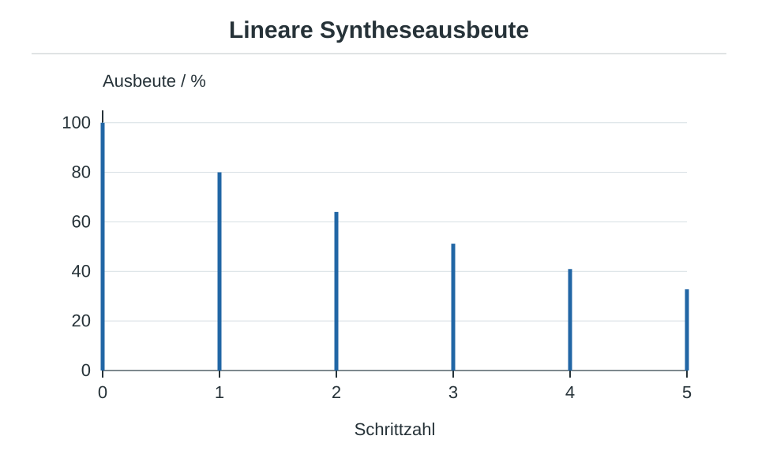

# M20-L4 – Synthesestrategien {#L4}

**Kursbereich:** M20 – Fortgeschrittene organische Chemie

**Niveau:** Master – Vertiefung (hochschulabhängiger Pflicht-/Wahlstatus)

**Vorwissen:** [M20-L3](M20-L3.md).

**Lernziel:** Retrosynthetische Alternativen entwickeln und lineare oder konvergente Synthesepläne quantitativ vergleichen.

## Retrosynthetisches Denken {#S1}
Retrosynthese zerlegt eine Zielstruktur gedanklich in einfachere Vorstufen. Eine Diskonnektion ist keine physische Bindungsspaltung; sie bezeichnet einen Planungsentscheid. Ein Synthon beschreibt eine idealisierte Reaktivität, während ein Syntheseäquivalent eine dazu passende reale Verbindung oder Reaktionsklasse darstellt. Eine funktionelle Gruppenumwandlung kann einen geeigneteren Vorläufer zugänglich machen. Stereochemie und chemoselektive Konkurrenz müssen entlang der gesamten Route bedacht werden, nicht erst am letzten Schritt. Schutzgruppen können Konflikte lösen, verursachen jedoch zusätzliche Schritte und Abfall.

*Modell: jeder 1:1-Schritt liefert 80 Prozent; nach vier Schritten 40,96 Prozent.*

## Linear und konvergent {#S2}
Eine lineare Route verbindet alle Umwandlungen hintereinander. Bei unabhängigen Teilrouten einer konvergenten Synthese werden Fragmente parallel aufgebaut und später verbunden. Für eine lineare Route aus vier 1:1-Schritten mit jeweils 80 % Ausbeute ergibt sich $0.8^4=0.4096$. Für zwei parallele Zweischrittzweige mit je 1 mmol Startmenge und je 80 % Ausbeute pro Schritt stehen je 0,64 mmol Fragment zur Verfügung. Bei einer anschließenden 1:1-Kupplung mit 80 % Ausbeute entstehen 0,512 mmol Produkt. Diese Werte beziehen sich auf unterschiedliche Startmaterialmengen; sie erlauben keinen unmittelbaren Kostenvergleich.
## Bewertungsmatrix {#S3}
Eine tragfähige Route muss neben Ausbeute auch Zahl der Transformationen, Reinigungsaufwand, Verfügbarkeit und Masse der Startmaterialien, Sicherheit und Energiebedarf berücksichtigen. Atomökonomie ist eine theoretische stöchiometrische Kennzahl, nicht gleich isolierter Ausbeute. Eine retrosynthetische Datenbankempfehlung liefert einen Kandidaten, keinen experimentellen Nachweis. Die Beispielpfade sind abstrakte Netzwerke, keine Arbeitsanweisung zur Herstellung bestimmter Stoffe.

## Grenzen und typische Fehler {#S4}

Ausbeuten nur bei gemeinsamer Bezugsbasis vergleichen.

## Selbstkontrolle {#S5}

### Aufgaben

1. Wie groß ist die Gesamtausbeute von drei 90-%-Schritten?
2. Welche Fragmentmenge begrenzt eine 1:1-Kupplung bei 0,5 und 0,8 mmol?
3. Bedeutet hohe Atomökonomie hohe isolierte Ausbeute?

::: {.lc-solutions data-lc-section="S5"}
1. 72,9 %.
2. 0,5 mmol vor Berücksichtigung der Kupplungsausbeute.
3. Nein, beide Kennzahlen erfassen unterschiedliche Aspekte.
:::

**Weiterlesen:** [M20-L5](M20-L5.md).

## Quellen (extern) {#S6}

### Nachweise

- [OpenStax Organic Chemistry §9.9](https://openstax.org/books/organic-chemistry/pages/9-9-an-introduction-to-organic-synthesis) · Retrosynthetische Planung · Fachlicher Bezug zur Lektion: M20-L4 – Synthesestrategien · Zuletzt abgerufen: 2026-11-25
- [RPTU, Organische Chemie V: lecture outline](https://kubik.chem.rptu.de/index.php?lan=de&lev1=0tea&lev2=oc5) · Curtin-Hammett, pericyclische und photochemische Reaktionen · Fachlicher Bezug zur Lektion: M20-L4 – Synthesestrategien · Zuletzt abgerufen: 2026-11-25
