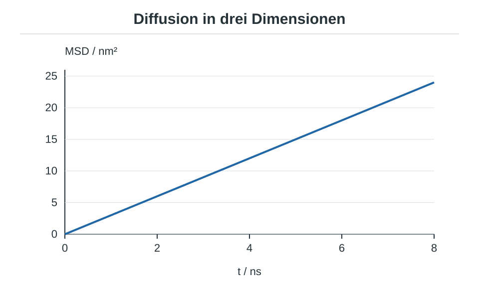

# M21-L3 – Moleküldynamik {#L3}

**Kursbereich:** M21 – Computational Chemistry und Simulation

**Niveau:** Master – Vertiefung (hochschulabhängiger Pflicht-/Wahlstatus)

**Vorwissen:** [M21-L2](M21-L2.md).

**Lernziel:** Klassische Moleküldynamik, Kraftfelder, Ensembles und Diffusionsauswertung erklären.

## Modell und Bewegung {#S1}
Klassische Moleküldynamik integriert Newtons Bewegungsgleichungen $m_i\ddot{\mathbf r}_i=-\nabla_i U$. Das Kraftfeld definiert die potentielle Energie über gebundene und nichtgebundene Wechselwirkungen. Parameter sind für bestimmte Stoffklassen und Eigenschaften entwickelt; ein nichtreaktives Kraftfeld beschreibt gewöhnlich keine Bindungsbrüche oder Elektronentransfers. Verlet-artige Integratoren approximieren die zeitliche Entwicklung. Der Zeitschritt muss schnelle Bewegungen und numerische Stabilität berücksichtigen; ein größerer Zeitschritt ist nicht automatisch effizienter, wenn er das Ergebnis verfälscht.

*Idealisiertes Langzeitmodell mit D=0,5 nm²/ns; Steigung 6D=3 nm²/ns.*

## Ensembles und Randbedingungen {#S2}
NVE bezeichnet konstante Teilchenzahl, Volumen und Gesamtenergie; NVT konstante Teilchenzahl, Volumen und Temperatur; NPT konstante Teilchenzahl, Druck und Temperatur. Thermostate und Barostate beeinflussen die Verteilung und teilweise die Dynamik. Periodische Randbedingungen reduzieren Oberflächeneffekte, erzeugen aber künstliche Wiederholungen. Der Umgang mit periodisch überquerten Koordinaten ist für Transportgrößen entscheidend. Nach Equilibrierung müssen Stichproben über hinreichend viele unabhängige Zeitbereiche gewonnen werden; viele aufeinanderfolgende Frames sind nicht gleich viele unabhängige Beobachtungen.
## Modellrechnung: Diffusion {#S3}
Für normale isotrope Diffusion in drei Dimensionen gilt im langfristig linearen Bereich $\langle |\Delta\mathbf r|^2\rangle=6Dt$. Ein fiktiver Datensatz hat zwischen 2 und 6 ns einen Anstieg von 12 nm². Die Steigung beträgt 3 nm²/ns, daher $D=0.5$ nm²/ns oder $5\times10^{-10}$ m²/s. Ein kurzer ballistischer Bereich darf nicht mit der diffusen Steigung verwechselt werden. Eine echte Auswertung benötigt unter anderem geeignete Koordinaten, Fitfenster, Größenkorrekturen und Unsicherheiten.

## Grenzen und typische Fehler {#S4}

Diffusionsfit auf den geeigneten Zeitbereich begrenzen.

## Selbstkontrolle {#S5}

### Aufgaben

1. Wie viele Integrationsschritte umfasst 1 ns bei 2 fs?
2. Wie lautet der Diffusionskoeffizient bei einer 3D-MSD-Steigung von 6 nm²/ns?
3. Sind aufeinanderfolgende Frames statistisch unabhängig?

::: {.lc-solutions data-lc-section="S5"}
1. 500 000.
2. 1 nm²/ns.
3. Nicht notwendigerweise; Zeitkorrelationen müssen geprüft werden.
:::

**Weiterlesen:** [M21-L4](M21-L4.md).

## Quellen (extern) {#S6}

### Nachweise

- [GROMACS 2026.4: Molecular Dynamics](https://manual.gromacs.org/documentation/2026.4/reference-manual/algorithms/molecular-dynamics.html) · Integration und Ensembles · Fachlicher Bezug zur Lektion: M21-L3 – Moleküldynamik · Zuletzt abgerufen: 2026-11-25
- [GROMACS 2025.0: Terminology](https://manual.gromacs.org/documentation/2025.0/user-guide/terminology.html) · Periodische Randbedingungen · Fachlicher Bezug zur Lektion: M21-L3 – Moleküldynamik · Zuletzt abgerufen: 2026-11-25
