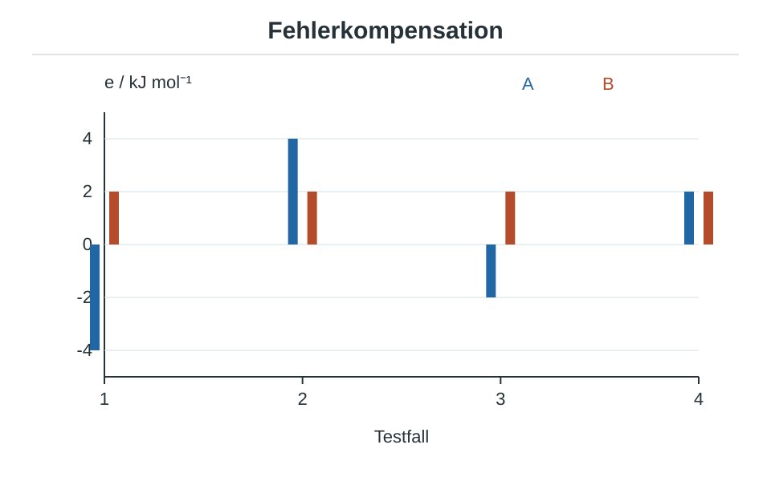

# M21-L5 – Modellfehler und Interpretation {#L5}

**Kursbereich:** M21 – Computational Chemistry und Simulation

**Niveau:** Master – Vertiefung (hochschulabhängiger Pflicht-/Wahlstatus)

**Vorwissen:** [M21-L4](M21-L4.md).

**Lernziel:** Modellfehler quantifizieren, Fehlerkompensation erkennen und den Gültigkeitsbereich einer Vorhersage begründen.

## Fehlerhierarchie {#S1}
Numerische Fehler entstehen etwa durch unvollständige Konvergenz oder endliche Zeitschritte. Modellfehler entstehen aus approximierter Elektronenkorrelation, vereinfachten Kraftfeldern oder fehlenden Umgebungsbeiträgen. Stichprobenfehler resultieren aus endlicher Beobachtungsdauer; Referenzdaten besitzen eigene Unsicherheit. Diese Beiträge sind nicht immer unabhängig und lassen sich nicht pauschal quadratisch kombinieren. Eine chemische Vorhersage muss deshalb einen klar definierten Zielparameter, Gültigkeitsbereich und eine Vergleichsbasis besitzen.

*Fiktive Testwerte: A = −4, +4, −2, +2; B = +2, +2, +2, +2 kJ/mol.*

## Fehlermaße {#S2}
Für $N$ Referenzwerte $y_i$ und Vorhersagen $\hat y_i$ seien Fehler $e_i=\hat y_i-y_i$. Der mittlere Fehler $\mathrm{ME}=\sum_i e_i/N$ erfasst Vorzeichen, der MAE $\sum_i|e_i|/N$ die mittlere absolute Abweichung und der RMSE $\sqrt{\sum_i e_i^2/N}$ gewichtet größere Abweichungen stärker. Ein ME nahe null kann durch Fehlerkompensation entstehen. Vergleichswerte sollten dieselben Einheiten, Bedingungen und Definitionen besitzen. NIST CCCBDB bietet hierfür reale Referenz- und Vergleichsdaten für zahlreiche kleine Gasphasenmoleküle, jedoch keinen universellen Test für Lösungen, Materialien oder Biomoleküle.
## Modellrechnung: Methodenvergleich {#S3}
Ein fiktiver Test in kJ/mol ergibt Fehler A: −4, +4, −2, +2; B: +2, +2, +2, +2. A hat ME 0, MAE 3 und RMSE $\sqrt{10}=3.16$. B hat ME 2, MAE 2 und RMSE 2. B ist nach MAE und RMSE besser, A nach Betrag des ME. Ein Korrekturterm, der anhand dieser Testwerte geschätzt wird, ist an einem neuen unabhängigen Satz zu prüfen. Die Wahl der Metrik hängt von der Frage ab; ein kleiner mittlerer Fehler rechtfertigt keine präzise Einzelvorhersage.

## Grenzen und typische Fehler {#S4}

Fehlerkompensation und unabhängige Testdaten beachten.

## Selbstkontrolle {#S5}

### Aufgaben

1. Was ist der ME bei −5 und +5?
2. Was ist der RMSE bei Fehlern 0 und 6?
3. Darf ein Gasphasenbenchmark ohne Prüfung auf wässrige Systeme übertragen werden?

::: {.lc-solutions data-lc-section="S5"}
1. 0; der MAE ist dennoch 5.
2. $\sqrt{18}\approx4.24$.
3. Nein, der Gültigkeitsbereich muss geprüft werden.
:::

## Quellen (extern) {#S6}

### Nachweise

- [NIST CCCBDB SRD 101, Release 22 (May 2022)](https://cccbdb.nist.gov/summaryx.asp) · Experimentelle und berechnete Referenzdaten · Fachlicher Bezug zur Lektion: M21-L5 – Modellfehler und Interpretation · Zuletzt abgerufen: 2026-11-25
- [Psi4 1.10 documentation: Density Functional Theory](https://psicode.org/psi4manual/1.10.x/dft.html) · DFT und numerische Parameter · Fachlicher Bezug zur Lektion: M21-L5 – Modellfehler und Interpretation · Zuletzt abgerufen: 2026-11-25
- [GROMACS 2025.3: Managing long simulations](https://manual.gromacs.org/documentation/2025.3/user-guide/managing-simulations.html) · Reproduzierbarkeit · Fachlicher Bezug zur Lektion: M21-L5 – Modellfehler und Interpretation · Zuletzt abgerufen: 2026-11-25
