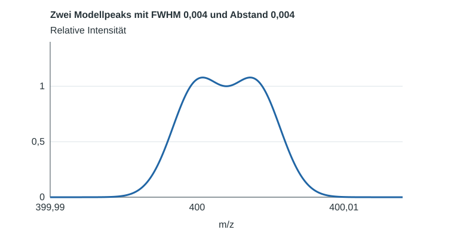

# M22-L1 – Hochauflösende Massenspektrometrie {#L1}

**Kursbereich:** M22 – Moderne Analytik und Oberflächen

**Niveau:** Master – Vertiefung (hochschulabhängiger Pflicht-/Wahlstatus)

**Vorwissen:** [M15-L4](M15-L4.md).

**Lernziel:** Auflösung, Massengenauigkeit und Summenformelzuordnung getrennt bewerten.

## Fachliche Grundlagen {#S1}

Hochauflösende Massenspektrometrie unterscheidet Ionen mit eng benachbarten Masse-zu-Ladung-Verhältnissen. Das Auflösungsvermögen $R=m/\Delta m$ hängt von der Definition der Peakbreite ab; häufig wird die Breite bei halber Höhe (FWHM) verwendet. Orbitrap- und FT-ICR-Systeme leiten die Masse aus charakteristischen Bewegungsfrequenzen ab; Flugzeitgeräte aus der Flugzeit. Hohe Auflösung allein garantiert keine korrekte Massenkalibrierung.

## Methoden und Modellannahmen {#S2}

Die exakte Masse ist die berechnete Masse eines bestimmten Isotopenaufbaus; die gemessene genaue Masse hat eine Unsicherheit. Für ein Ion müssen Ladung und Addukt berücksichtigt werden. Der relative Massenfehler beträgt $10^6(m_{mess}-m_{ref})/m_{ref}$ in ppm. Summenformelkandidaten lassen sich über Isotopenmuster, chemische Plausibilität und Fragmentionen einschränken. Strukturisomere mit gleicher Summenformel bleiben durch die exakte Masse allein ununterscheidbar.

## Modellrechnung {#S3}

Ein simuliertes Ion hat einen Referenzwert von 400,0000 und einen Messwert von 400,0012. Der Fehler beträgt +3,0 ppm. Bei einer FWHM von 0,0040 beträgt R = 100 000. Zwei Linien mit Abstand 0,0040 können sich dennoch stark überlagern; die tatsächliche Trennbarkeit hängt von Linienform, Intensitätsverhältnis und Rauschen ab.

*Zwei Modellpeaks mit FWHM 0,004 und Abstand 0,004.*

## Grenzen und typische Fehler {#S4}

Ein ppm-Fenster ist kein Identitätsbeweis. Kalibration, Ionentyp und orthogonale Befunde dokumentieren.

## Selbstkontrolle {#S5}

### Aufgaben

1. Wie groß ist R bei m/z 500 und FWHM 0,005?
2. Wie groß ist der Fehler bei 200,0000 als Referenz und 199,9996 als Messwert?
3. Lassen sich Strukturisomere allein anhand der exakten Masse unterscheiden?

::: {.lc-solutions data-lc-section="S5"}
1. 100 000.
2. −2 ppm.
3. Nein; zusätzliche strukturbezogene Befunde sind erforderlich.
:::

**Weiterlesen:** [M22-L2](M22-L2.md).

## Quellen (extern) {#S6}

### Nachweise

- [Scripps Research – What is Mass Spectrometry](https://masspec.scripps.edu/learn/ms/) · Resolution (Resolving Power); accuracy; Auflösungsvermögen und Massengenauigkeit · Fachlicher Bezug zur Lektion: M22-L1 – Hochauflösende Massenspektrometrie · Zuletzt recherchiert: 2026-11-25 (indexed web result; full section review pending).
- [Universität Bremen – Mass Spectrometry (MS)](https://www.uni-bremen.de/en/fb2-1/instrumentelle-analytik/analytics/mass-spectrometry-ms) · Instrument characteristics; Massengenauigkeit, Isotopenmuster und FWHM · Fachlicher Bezug zur Lektion: M22-L1 – Hochauflösende Massenspektrometrie · Zuletzt recherchiert: 2026-11-25 (indexed web result; full section review pending).
