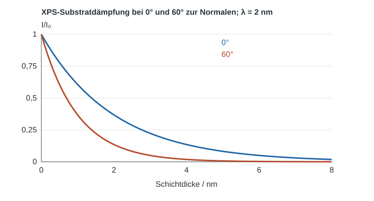

# M22-L3 – Oberflächenanalyse {#L3}

**Kursbereich:** M22 – Moderne Analytik und Oberflächen

**Niveau:** Master – Vertiefung (hochschulabhängiger Pflicht-/Wahlstatus)

**Vorwissen:** [M16-L4](M16-L4.md).

**Lernziel:** Oberflächensensitive Methoden unterscheiden und ein einfaches XPS-Dämpfungsmodell auswerten.

## Fachliche Grundlagen {#S1}

Die Röntgenphotoelektronenspektroskopie (XPS) misst kinetische Energien emittierter Elektronen. Bei kalibrierter Energieachse gilt $E_B=h\nu-E_K-\phi$ mit der Spektrometer-Austrittsarbeit $\phi$. Elementtypische Bindungsenergien und chemische Verschiebungen liefern Hinweise auf Zusammensetzung und Bindungsumgebung. Aufladung, Überlagerungen und Referenzierung können Zuordnungen verfälschen. Quantitative Intensitätsvergleiche erfordern Empfindlichkeitsfaktoren.

## Methoden und Modellannahmen {#S2}

Elektronen verlieren auf ihrem Weg durch Materie Energie; XPS ist deshalb oberflächensensitiv. Eine effektive Dämpfungslänge $\lambda$ beschreibt in einem vereinfachten homogenen Schichtmodell die Abnahme des Substratsignals. Bei Emissionswinkel $\theta$ zur Oberflächennormalen gilt $I/I_0=\exp[-d/(\lambda\cos\theta)]$. AFM liefert dagegen topographische Information; SIMS detektiert durch Ionenbeschuss freigesetzte Sekundärionen, oft mit starken Matrixeffekten. Die Methoden sind komplementär.

## Modellrechnung {#S3}

Eine ebene, homogene Modellschicht reduziert das Substratsignal bei normaler Emission auf 0,368 des Referenzsignals. Für eine angenommene Dämpfungslänge von 2 nm folgt $d=-\lambda\ln(I/I_0)\approx2,0$ nm. Bei 60° zur Normalen wird das Verhältnis im selben Modell zu exp(−2) ≈ 0,135. Rauheit, unterschiedliche Matrix und elastische Streuung begrenzen die Näherung.

*XPS-Substratdämpfung bei 0° und 60° zur Normalen; λ = 2 nm.*

## Grenzen und typische Fehler {#S4}

Die Dämpfungslänge nicht mit einer universellen Informationstiefe verwechseln; Winkelkonvention und Materialabhängigkeit angeben.

## Selbstkontrolle {#S5}

### Aufgaben

1. Wie groß ist I/I₀ für d=4 nm, λ=2 nm, θ=0°?
2. Welche Methode liefert unmittelbar Topographie?
3. Warum sind chemische Verschiebungen nicht ohne Kalibration eindeutig?

::: {.lc-solutions data-lc-section="S5"}
1. Etwa 0,135.
2. AFM.
3. Aufladung und Energieachsenfehler können Peaklagen verschieben.
:::

**Weiterlesen:** [M22-L4](M22-L4.md).

## Quellen (extern) {#S6}

### Nachweise

- [NIST – Surface Data](https://www.nist.gov/srd/surface-data) · SRD 20 and SRD 100; Oberflächenanalyse, Bindungsenergien und Elektronentransport · Fachlicher Bezug zur Lektion: M22-L3 – Oberflächenanalyse · Zuletzt recherchiert: 2026-11-25 (indexed web result; full section review pending).
- [NIST – Practical Guides for X-Ray Photoelectron Spectroscopy (2019)](https://www.nist.gov/publications/practical-guides-x-ray-photoelectron-spectroscopy-first-steps-planning-conducting-and) · Publication abstract; DOI 10.1116/1.5065501; Planung, Durchführung und Berichterstattung bei XPS · Fachlicher Bezug zur Lektion: M22-L3 – Oberflächenanalyse · Zuletzt recherchiert: 2026-11-25 (indexed web result; full section review pending).
