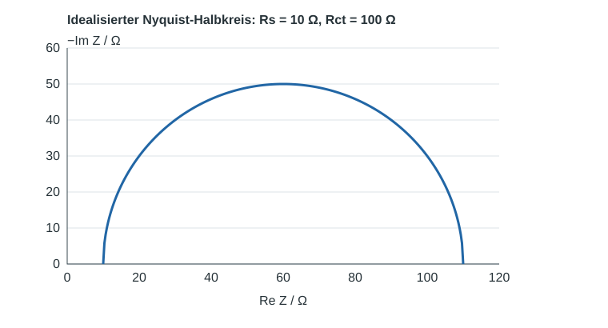

# M22-L4 – Elektrochemische Grenzflächen {#L4}

**Kursbereich:** M22 – Moderne Analytik und Oberflächen

**Niveau:** Master – Vertiefung (hochschulabhängiger Pflicht-/Wahlstatus)

**Vorwissen:** [M13-L5](M13-L5.md).

**Lernziel:** Doppelschicht und Ladungstransfer anhand eines idealisierten Impedanzmodells unterscheiden.

## Fachliche Grundlagen {#S1}

An einer Elektrode entsteht eine elektrische Doppelschicht durch die Verteilung von Ladung und Lösungsmittel an der Grenzfläche. Ihre differentielle Kapazität ist $C=dq/dE$. Bei einer elektrochemischen Reaktion kommt ein faradayscher Strom hinzu. Impedanzspektroskopie (EIS) untersucht im näherungsweise linearen, zeitinvarianten Bereich die komplexe Antwort auf eine kleine sinusförmige Störung: $Z(\omega)=\tilde E/\tilde I$.

## Methoden und Modellannahmen {#S2}

Ein einfaches Modell besteht aus Lösungswiderstand $R_s$ in Reihe mit einer Parallelschaltung aus Ladungstransferwiderstand $R_{ct}$ und idealer Doppelschichtkapazität C. Es gilt $Z=R_s+R_{ct}/(1+j\omega R_{ct}C)$. Im Nyquist-Diagramm (−Im Z gegen Re Z) liegt ein Halbkreis mit den Achsenabschnitten $R_s$ und $R_s+R_{ct}$. Die Scheitelfrequenz ist $f=1/(2\pi R_{ct}C)$. Diffusion, poröse Strukturen und Verteilungen von Zeitkonstanten können davon abweichen.

## Modellrechnung {#S3}

Im Modell seien $R_s=10$ Ω, $R_{ct}=100$ Ω und C=20 µF. Die Zeitkonstante beträgt 2 ms, die Scheitelfrequenz 79,6 Hz. Der Halbkreis reicht von 10 bis 110 Ω, der Scheitel liegt bei (60,50) Ω. Ein realer Halbkreis beweist allerdings nicht, dass dieses Ersatzschaltbild die einzige physikalische Erklärung ist.

*Idealisierter Nyquist-Halbkreis: Rs = 10 Ω, Rct = 100 Ω.*

## Grenzen und typische Fehler {#S4}

Linearität, Stabilität und Frequenzbereich prüfen. Ähnliche Fits können durch verschiedene Modelle entstehen.

## Selbstkontrolle {#S5}

### Aufgaben

1. Welche Zeitkonstante folgt aus 200 Ω und 10 µF?
2. Wie groß ist der rechte Achsenabschnitt bei Rs=5 Ω und Rct=80 Ω?
3. Welche Eigenschaft muss eine kleine Störung näherungsweise gewährleisten?

::: {.lc-solutions data-lc-section="S5"}
1. 2 ms.
2. 85 Ω.
3. Lineare Antwort um den Arbeitspunkt.
:::

**Weiterlesen:** [M22-L5](M22-L5.md).

## Quellen (extern) {#S6}

### Nachweise

- [Electrochemical Impedance Spectroscopy—A Tutorial (2023)](https://pmc.ncbi.nlm.nih.gov/articles/PMC10288619/) · Randles circuit; Figs. 13–16; Impedanz, Doppelschicht und Ersatzschaltbilder · Fachlicher Bezug zur Lektion: M22-L4 – Elektrochemische Grenzflächen · Zuletzt recherchiert: 2026-11-25 (indexed web result; full section review pending).
