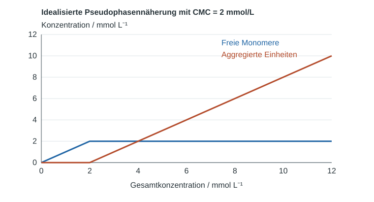

# M23-L2 – Selbstorganisation {#L2}

**Kursbereich:** M23 – Supramolekulare, Polymer- und Materialchemie

**Niveau:** Master – Vertiefung (hochschulabhängiger Pflicht-/Wahlstatus)

**Vorwissen:** [M23-L1](M23-L1.md).

**Lernziel:** Selbstorganisation und kritische Aggregationskonzentration aus Modellbeobachtungen erklären.

## Fachliche Grundlagen {#S1}

Selbstorganisation bezeichnet die Bildung geordneter supramolekularer Strukturen durch Wechselwirkungen zwischen Bausteinen. Amphiphile besitzen lösungsmittelaffine und lösungsmittelmeidende Bereiche. In Wasser können sich abhängig von Geometrie, Konzentration, Temperatur und Salzgehalt Mizellen, Vesikel oder andere Aggregate bilden. Entropische Beiträge von Lösungsmittel und Bausteinen sind ebenso wichtig wie energetische Wechselwirkungen.

## Methoden und Modellannahmen {#S2}

Die kritische Mizellkonzentration (CMC) beschreibt einen charakteristischen Konzentrationsbereich für die Mizellbildung. In einer vereinfachten Pseudophasennäherung steigt die freie Monomerkonzentration bis zur CMC und bleibt oberhalb ungefähr konstant. Die tatsächlich verteilten Aggregationszahlen und Formübergänge werden dadurch nicht abgebildet. Oberflächenspannung, Fluoreszenz und Streumethoden können komplementäre Hinweise auf Aggregation geben.

## Modellrechnung {#S3}

Ein Modellamphiphil habe CMC=2 mmol/L und eine mittlere Aggregationszahl von 50. Bei Gesamtkonzentration 12 mmol/L liegen im Pseudophasenmodell 10 mmol/L Monomereinheiten in Aggregaten vor, also 0,20 mmol/L Aggregate. Bei 1 mmol/L sagt die vereinfachte Näherung keine Aggregate voraus; in realen Systemen gibt es einen Übergangsbereich und möglicherweise Präaggregate.

*Idealisierte Pseudophasennäherung mit CMC = 2 mmol/L.*

## Grenzen und typische Fehler {#S4}

Die CMC ist keine universelle Stoffkonstante ohne Angabe von Temperatur und Medium. Ein einzelnes Messsignal bestimmt keine Aggregatmorphologie.

## Selbstkontrolle {#S5}

### Aufgaben

1. Wie viel aggregierte Monomereinheiten liegen bei 8 mmol/L und CMC 2 mmol/L vor?
2. Welche Aggregatkonzentration folgt bei Aggregationszahl 60?
3. Beweist ein Knick der Oberflächenspannung eine bestimmte Mizellform?

::: {.lc-solutions data-lc-section="S5"}
1. 6 mmol/L.
2. 0,10 mmol/L.
3. Nein; weitere strukturelle Messungen sind nötig.
:::

**Weiterlesen:** [M23-L3](M23-L3.md).

## Quellen (extern) {#S6}

### Nachweise

- [Chemical Society Reviews – Tools to enable the study and translation of supramolecular amphiphiles (2023)](https://pubs.rsc.org/en/content/articlehtml/2023/cs/d3cs00480e) · Association events; 2.6 Critical aggregate concentration; Wirt-Gast-Bindung und Selbstorganisation · Fachlicher Bezug zur Lektion: M23-L2 – Selbstorganisation · Zuletzt recherchiert: 2026-11-25 (indexed web result; full section review pending).
