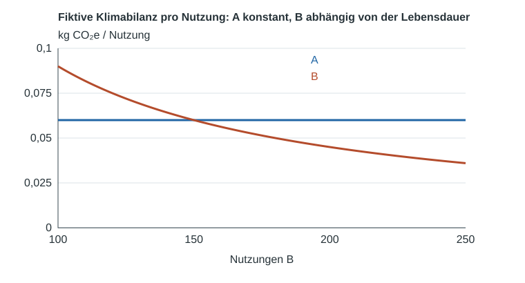

# M23-L5 – Nachhaltiges Materialdesign {#L5}

**Kursbereich:** M23 – Supramolekulare, Polymer- und Materialchemie

**Niveau:** Master – Vertiefung (hochschulabhängiger Pflicht-/Wahlstatus)

**Vorwissen:** [M16-L5](M16-L5.md).

**Lernziel:** Materialalternativen anhand einer funktionellen Einheit und transparenten Systemgrenzen bewerten.

## Fachliche Grundlagen {#S1}

Nachhaltiges Materialdesign verbindet chemische Zusammensetzung, Herstellung, Nutzungsdauer und End-of-Life-Optionen. Erneuerbare Rohstoffe, geringe Toxizität, Reparierbarkeit und Recyclingfähigkeit sind verschiedene Eigenschaften; keine einzelne garantiert geringe Umweltwirkungen. Die Ökobilanz (LCA) definiert Ziel, Systemgrenze und funktionelle Einheit, erfasst Stoff- und Energieströme und bewertet mehrere Wirkungskategorien.

## Methoden und Modellannahmen {#S2}

Vergleiche benötigen dieselbe bereitgestellte Funktion. Materialmasse allein ist unzureichend, wenn Haltbarkeit, Barrierewirkung oder Wartung verschieden sind. Allokation bei Koppelprodukten, Strommix, Rücknahmequoten und angenommene Recyclinggutschriften können Ergebnisse verändern. Sensitivitätsanalysen zeigen, welche Annahmen den Vergleich dominieren. Ein niedriger Klimafußabdruck schließt andere Umwelt- oder Sicherheitsrisiken nicht aus.

## Modellrechnung {#S3}

Zwei fiktive Schutzmaterialien erfüllen dieselbe Funktion pro Nutzung. A verursacht 6 kg CO₂-Äquivalente pro Stück und hält 100 Nutzungen; B verursacht 9 kg und hält 200. Ohne weitere Beiträge ergeben sich 0,060 und 0,045 kg CO₂e pro Nutzung. B liegt 25 % niedriger. Hält B nur 120 Nutzungen, steigt sein Wert auf 0,075 kg. Der Break-even liegt bei 150 Nutzungen; reale Bilanzen müssen zusätzliche Lebenszyklusphasen und Unsicherheiten einbeziehen.

*Fiktive Klimabilanz pro Nutzung: A konstant, B abhängig von der Lebensdauer.*

## Grenzen und typische Fehler {#S4}

Keine reale Umweltbewertung aus fiktiven Zahlen ableiten. Funktion, Randbedingungen, Datengüte und Wirkungskategorien offenlegen.

## Selbstkontrolle {#S5}

### Aufgaben

1. Welcher Wert ergibt sich für 8 kg CO₂e und 160 Nutzungen?
2. Wie lange muss B für Gleichstand mit A mindestens halten?
3. Beweist ein niedriger CO₂e-Wert allgemein nachhaltigere Chemie?

::: {.lc-solutions data-lc-section="S5"}
1. 0,05 kg CO₂e/Nutzung.
2. 150 Nutzungen.
3. Nein; weitere Umweltwirkungen und Funktion müssen berücksichtigt werden.
:::

## Quellen (extern) {#S6}

### Nachweise

- [US EPA – Life Cycle Assessment: Principles and Practice](https://nepis.epa.gov/Exe/ZyPURL.cgi?Dockey=P1000L86.TXT) · Functional unit; system boundary; Funktionelle Einheit und Lebenszyklusgrenzen · Fachlicher Bezug zur Lektion: M23-L5 – Nachhaltiges Materialdesign · Zuletzt recherchiert: 2026-11-25 (indexed web result; full section review pending).
- [US EPA – Glossary of Sustainable Manufacturing Terms](https://www.epa.gov/sustainability/glossary-sustainable-manufacturing-terms) · Life cycle assessment; Lebenszyklusbewertung · Fachlicher Bezug zur Lektion: M23-L5 – Nachhaltiges Materialdesign · Zuletzt recherchiert: 2026-11-25 (indexed web result; full section review pending).
