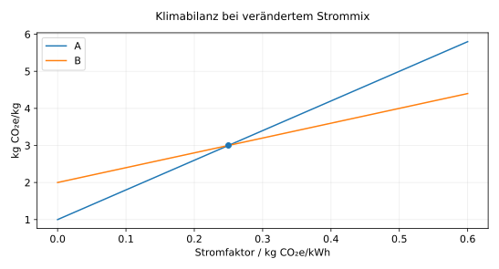

# M24-L1 – Ressourcen und Lebenszyklus {#L1}

**Kursbereich:** M24 – Grüne Chemie und chemische Nachhaltigkeit

**Niveau:** Master – Wahlprofil (hochschulabhängig)

**Vorwissen:** [M23-L5](M23-L5.md).

**Lernziel:** Stoff- und Energieströme auf eine funktionelle Einheit beziehen.

## Fachliche Grundlagen {#S1}

Grüne Chemie setzt bei der molekularen und verfahrenstechnischen Gestaltung an: Abfälle und Gefahren sollen möglichst gar nicht entstehen. Die Herkunft eines Rohstoffs allein entscheidet nicht über seine Umweltwirkung. Erneuerbare Ressourcen beanspruchen gegebenenfalls Land, Wasser und Energie; fossile Ressourcen können hohe Emissionen verursachen.

## Methoden und Modellannahmen {#S2}

Eine Lebenszyklusanalyse erfasst Herstellung, Transport, Nutzung und Entsorgung entsprechend der festgelegten Systemgrenze. Die funktionelle Einheit beschreibt die bereitgestellte Leistung. Für eine Wirkungskategorie werden Inventarflüsse mit Charakterisierungsfaktoren gewichtet. Annahmen zur Stromversorgung und zur Allokation von Koppelprodukten sind getrennt auszuweisen.

## Modellrechnung {#S3}

Zwei fiktive Verfahren liefern je 1 kg eines gleichwertigen Produkts. A benötigt 8 kWh Strom und verursacht zusätzlich 1 kg CO₂e; B benötigt 4 kWh und verursacht zusätzlich 2 kg CO₂e. Bei 0,4 kg CO₂e/kWh ergibt sich A = 4,2 und B = 3,6 kg CO₂e/kg. Bei 0,1 kg/kWh ergibt sich A = 1,8 und B = 2,4. Der Schnittpunkt liegt bei 0,25 kg/kWh.

*Klimabilanz bei verändertem Strommix – fiktive Modelldaten.*

## Grenzen und typische Fehler {#S4}

Die Zahlen sind keine reale Ökobilanz. Wasserverbrauch, Toxizität, Landnutzung und Datenunsicherheit fehlen. Ein Vergleich pro kg gilt nur für gleiche Funktion.

## Selbstkontrolle {#S5}

### Aufgaben

1. Wie hoch ist A bei 0,2 kg/kWh?
2. Bei welchem Stromfaktor sind A und B gleich?
3. Warum ist erneuerbar nicht gleich nachhaltig?

::: {.lc-solutions data-lc-section="S5"}
1. 2,6 kg CO₂e/kg.
2. 0,25 kg CO₂e/kWh.
3. Auch erneuerbare Ressourcen können erhebliche Lebenszykluswirkungen haben.
:::

## Quellen (extern) {#S6}

### Nachweise

- [US EPA – Basics of Green Chemistry](https://www.epa.gov/greenchemistry/basics-green-chemistry) · Zwölf Prinzipien und Abfallvermeidung · M24-L1 – Ressourcen und Lebenszyklus · Zuletzt recherchiert: 2026-11-25 (indexed web result; full section review pending).
- [European Commission – Recommendation (EU) 2021/2279](https://eur-lex.europa.eu/legal-content/EN/TXT/?uri=CELEX%3A02021H2279-20211230) · Lebenszyklusbezogene Umweltbewertung · M24-L1 – Ressourcen und Lebenszyklus · Zuletzt recherchiert: 2026-11-25 (indexed web result; full section review pending).
