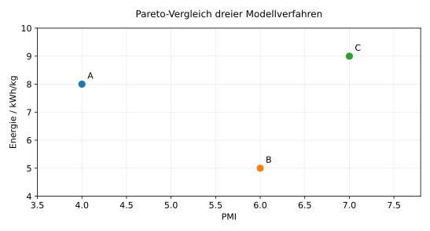

# M24-L5 – Wissenschaftliche Bewertung von Verfahren {#L5}

**Kursbereich:** M24 – Grüne Chemie und chemische Nachhaltigkeit

**Niveau:** Master – Wahlprofil (hochschulabhängig)

**Vorwissen:** [M24-L2](M24-L2.md).

**Lernziel:** Verfahrensalternativen mehrkriteriell und unter Unsicherheit vergleichen.

## Fachliche Grundlagen {#S1}

Ein chemisches Verfahren ist zugleich Stoffumwandlung, Trennung, Energieverbrauch und Risikomanagement. Eine Verbesserung eines Kennwertes kann andere verschlechtern. Lebenszyklusbewertung und grünchemische Kennzahlen beantworten daher unterschiedliche Fragen.

## Methoden und Modellannahmen {#S2}

Bei einer Pareto-Analyse ist eine Alternative dominiert, wenn eine andere in allen betrachteten Kriterien mindestens gleich gut und in mindestens einem besser ist. Gewichtete Nutzwertanalysen benötigen Normalisierung und begründete Gewichte; harte Sicherheitsanforderungen dürfen nicht durch gute andere Werte kompensiert werden.

## Modellrechnung {#S3}

Fiktive Prozesse A, B, C haben (PMI, Energie in kWh/kg) = (4,8), (6,5), (7,9). C ist von A und B dominiert. A und B sind nicht gegenseitig dominiert. Mit normierten Kosten PMI/6 und Energie/8 ergibt sich bei gleichen Gewichten A = (4/6+8/8)/2 = 0,833; B = (6/6+5/8)/2 = 0,813. Bei Gewicht 0,75 auf PMI gewinnt A mit 0,75 gegenüber B mit 0,906.

*Pareto-Vergleich dreier Modellverfahren – fiktive Modelldaten.*

## Grenzen und typische Fehler {#S4}

Die Normierung und Gewichte sind Wertentscheidungen, keine Naturkonstanten. Eine knappe Rangfolge kann bei Datenunsicherheit instabil sein.

## Selbstkontrolle {#S5}

### Aufgaben

1. Welche Alternative ist dominiert?
2. Was geschieht bei hohem PMI-Gewicht?
3. Darf ein schweres Sicherheitsdefizit kompensiert werden?

::: {.lc-solutions data-lc-section="S5"}
1. C.
2. A wird bevorzugt.
3. Nein, Mindestanforderungen müssen separat erfüllt sein.
:::

## Quellen (extern) {#S6}

### Nachweise

- [ACS Green Chemistry Institute – 12 Principles of Green Chemistry](https://www.acs.org/green-chemistry-sustainability/principles/12-principles-of-green-chemistry.html) · Atomökonomie, PMI, Katalyse · M24-L5 – Wissenschaftliche Bewertung von Verfahren · Zuletzt recherchiert: 2026-11-25 (indexed web result; full section review pending).
- [European Commission – Recommendation (EU) 2021/2279](https://eur-lex.europa.eu/legal-content/EN/TXT/?uri=CELEX%3A02021H2279-20211230) · Lebenszyklusbezogene Umweltbewertung · M24-L5 – Wissenschaftliche Bewertung von Verfahren · Zuletzt recherchiert: 2026-11-25 (indexed web result; full section review pending).
