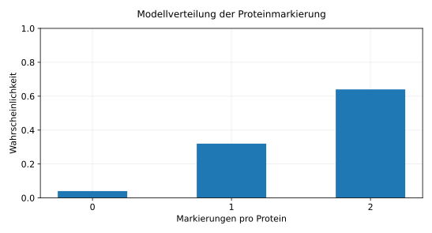

# M25-L1 – Biokonjugation als Konzept {#L1}

**Kursbereich:** M25 – Chemische Biologie und Wirkstoffforschung

**Niveau:** Master – Wahlprofil (hochschulabhängig)

**Vorwissen:** [M17-L4](M17-L4.md).

**Lernziel:** Chemoselektivität, Positionsselektivität und Konjugatverteilung erklären.

## Fachliche Grundlagen {#S1}

Biokonjugation verbindet Biomoleküle mit Markierungen oder anderen funktionellen Einheiten. Chemoselektivität unterscheidet funktionelle Gruppen; Positionsselektivität unterscheidet Stellen innerhalb desselben Moleküls. Bioorthogonale Reaktionen sollen mit biologischen Funktionen möglichst wenig wechselwirken.

## Methoden und Modellannahmen {#S2}

Eine Konjugation kann heterogene Produkte erzeugen. Massenspektrometrie erfasst Massenzunahmen, chromatografische Methoden können Verteilungen unterscheiden, und Aktivitätsmessungen prüfen erhaltene Funktion. Eine mittlere Markierungszahl allein beschreibt keine Verteilung.

## Modellrechnung {#S3}

Ein fiktives Protein besitzt zwei gleichwertige, unabhängig markierte Stellen, jede mit Wahrscheinlichkeit p = 0,8. Die Binomialverteilung liefert P(0) = 0,04, P(1) = 0,32, P(2) = 0,64. Der Mittelwert ist 2p = 1,6 Markierungen pro Protein. Eine zweite Probe mit 80 % zweifach und 20 % unmarkiert hätte denselben Mittelwert, aber eine andere Verteilung.

*Modellverteilung der Proteinmarkierung – fiktive Modelldaten.*

## Grenzen und typische Fehler {#S4}

Unabhängige Stellen sind eine Modellannahme; sterische Effekte können die zweite Markierung beeinflussen. Es werden keine Laborbedingungen oder Syntheseprotokolle angegeben.

## Selbstkontrolle {#S5}

### Aufgaben

1. Wie groß ist P(1) bei p = 0,5?
2. Wie hoch ist der Mittelwert bei p = 0,8?
3. Beweist der Mittelwert ein homogenes Konjugat?

::: {.lc-solutions data-lc-section="S5"}
1. 0,5.
2. 1,6.
3. Nein, verschiedene Verteilungen haben denselben Mittelwert.
:::

## Quellen (extern) {#S6}

### Nachweise

- [Recent developments in bioconjugation: From strategies to design and clinical applications (PubMed abstract)](https://pubmed.ncbi.nlm.nih.gov/40991990/) · Übersicht zu Konjugation, Selektivität und Stabilität · M25-L1 – Biokonjugation als Konzept · Zuletzt recherchiert: 2026-11-25 (indexed web result; full section review pending).
