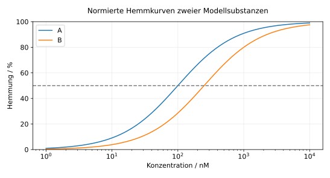

# M25-L2 – Struktur-Wirkungs-Beziehungen {#L2}

**Kursbereich:** M25 – Chemische Biologie und Wirkstoffforschung

**Niveau:** Master – Wahlprofil (hochschulabhängig)

**Vorwissen:** [M17-L5](M17-L5.md).

**Lernziel:** Struktur-Wirkungs-Beziehungen anhand vergleichbarer Assaydaten kritisch interpretieren.

## Fachliche Grundlagen {#S1}

Struktur-Wirkungs-Beziehungen (SAR) beschreiben beobachtete Zusammenhänge zwischen Molekülmerkmalen und biologischen Messwerten. Ein Messwert kann Bindung, funktionelle Aktivität oder ein indirektes Signal widerspiegeln. Eine Korrelation beweist keine kausale Wechselwirkung.

## Methoden und Modellannahmen {#S2}

IC₅₀ bezeichnet unter definierten Assaybedingungen die Konzentration für halbmaximale Hemmung entsprechend der gewählten Normalisierung. pIC₅₀ = −log₁₀(IC₅₀ in mol/L). Vergleiche erfordern dieselbe Messmethode und Angaben zu Streuung, Signalbereich und Kontrollen.

## Modellrechnung {#S3}

Fiktive, nicht strukturell spezifizierte Modellsubstanzen A und B haben unter identischen Bedingungen IC₅₀ = 100 nM und 250 nM. pIC₅₀ beträgt 7,00 beziehungsweise 6,60. B benötigt eine 2,5-fach höhere Konzentration für den Kurvenmittelpunkt. Für eine normierte Hemmkurve mit Hill-Koeffizient 1 gilt I = 100c/(c+IC₅₀); bei 100 nM erhält man 50 % und 28,6 %.

*Normierte Hemmkurven zweier Modellsubstanzen – fiktive Modelldaten.*

## Grenzen und typische Fehler {#S4}

Ein IC₅₀ ist nicht generell ein Kd oder Ki und keine Dosierung. Aus den fiktiven Werten folgt weder klinische Wirksamkeit noch Sicherheit.

## Selbstkontrolle {#S5}

### Aufgaben

1. Wie groß ist pIC₅₀ bei 1 µM?
2. Wie groß ist I für B bei 250 nM?
3. Warum dürfen verschiedene Assays nicht unkritisch verglichen werden?

::: {.lc-solutions data-lc-section="S5"}
1. 6.
2. 50 %.
3. Unterschiedliche Bedingungen, Endpunkte und Kontrollen beeinflussen den Messwert.
:::

## Quellen (extern) {#S6}

### Nachweise

- [NCBI Bookshelf – Assay Guidance Manual: Assay Operations for SAR Support](https://www.ncbi.nlm.nih.gov/sites/books/NBK91994/) · IC50/EC50, Kurvenanpassung und Kontrollen · M25-L2 – Struktur-Wirkungs-Beziehungen · Zuletzt recherchiert: 2026-11-25 (indexed web result; full section review pending).
