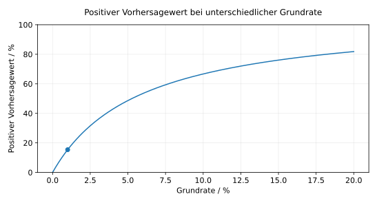

# M25-L4 – Methodische Grenzen der Wirkstoffsuche {#L4}

**Kursbereich:** M25 – Chemische Biologie und Wirkstoffforschung

**Niveau:** Master – Wahlprofil (hochschulabhängig)

**Vorwissen:** [M25-L3](M25-L3.md).

**Lernziel:** Screeningqualität und Fehlbefunde quantitativ beurteilen.

## Fachliche Grundlagen {#S1}

Wirkstoffsuche beginnt häufig mit vielen Kandidaten und einem vereinfachten biologischen Test. Fluoreszenzinterferenz, Aggregation oder allgemeine Reaktivität können scheinbare Aktivität erzeugen. Ein Treffer ist daher eine vorläufige Beobachtung, kein Wirkstoffnachweis.

## Methoden und Modellannahmen {#S2}

Die Sensitivität beschreibt den Anteil erkannter tatsächlich positiver Fälle, die Spezifität den Anteil korrekt negativer Fälle. Der positive Vorhersagewert hängt zusätzlich von der Grundrate ab. Wiederholungen, Gegenassays und unabhängige Messprinzipien sind wesentliche Evidenzschritte.

## Modellrechnung {#S3}

In einer fiktiven Population von 10 000 Testfällen sind 1 % tatsächlich positiv. Bei 90 % Sensitivität entstehen 90 richtig positive und 10 falsch negative Ergebnisse. Bei 95 % Spezifität entstehen 495 falsch positive und 9 405 richtig negative Ergebnisse. Der positive Vorhersagewert ist 90/(90+495) = 15,4 %.

*Positiver Vorhersagewert bei unterschiedlicher Grundrate – fiktive Modelldaten.*

## Grenzen und typische Fehler {#S4}

Die tatsächliche Grundrate ist meist unbekannt. Die Rechnung setzt konstante Testgüte voraus und ist kein Modell klinischer Erfolgswahrscheinlichkeiten.

## Selbstkontrolle {#S5}

### Aufgaben

1. Wie viele falsch positive Ergebnisse entstehen?
2. Wie groß ist der positive Vorhersagewert?
3. Warum können gute Einzelkennzahlen viele Fehlbefunde zulassen?

::: {.lc-solutions data-lc-section="S5"}
1. 495.
2. 15,4 %.
3. Bei niedriger Grundrate überwiegen negative Fälle stark.
:::

## Quellen (extern) {#S6}

### Nachweise

- [NCBI Bookshelf – Assay Guidance Manual: Assay Interference by Chemical Reactivity](https://www.ncbi.nlm.nih.gov/sites/books/NBK326709/) · Störsignale und Gegenassays · M25-L4 – Methodische Grenzen der Wirkstoffsuche · Zuletzt recherchiert: 2026-11-25 (indexed web result; full section review pending).
- [NCBI Bookshelf – Assay Guidance Manual: Assay Operations for SAR Support](https://www.ncbi.nlm.nih.gov/sites/books/NBK91994/) · IC50/EC50, Kurvenanpassung und Kontrollen · M25-L4 – Methodische Grenzen der Wirkstoffsuche · Zuletzt recherchiert: 2026-11-25 (indexed web result; full section review pending).
