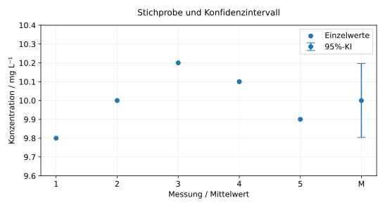

# M26-L3 – Datenaudit und statistische Auswertung {#L3}

**Kursbereich:** M26 – Forschungspraktikum, Projekt und Masterarbeit

**Niveau:** Master – Forschung

**Vorwissen:** [M18-L4](M18-L4.md).

**Lernziel:** Rohdaten auditieren und ein Konfidenzintervall korrekt interpretieren.

## Fachliche Grundlagen {#S1}

Ein Datenaudit prüft Zuordnung, Einheiten, Zeitstempel, Instrumentenstatus und die nachvollziehbare Ableitung der ausgewerteten Daten. Rohdaten werden unverändert erhalten; Bereinigung und Ausschlüsse sind versioniert zu dokumentieren. Ein Prüfprotokoll enthält auch widersprüchliche Befunde.

## Methoden und Modellannahmen {#S2}

Für unabhängige, annähernd normalverteilte Beobachtungen mit unbekannter Varianz gilt das zweiseitige t-Intervall für den Mittelwert: $\bar x \pm t_{1-\alpha/2,n-1}s/\sqrt n$. Technische Wiederholungen desselben Objekts ersetzen keine unabhängigen Proben. Systematische Messabweichungen müssen separat beurteilt werden.

## Modellrechnung {#S3}

Fünf fiktive Konzentrationen (mg/L): 9,8; 10,0; 10,2; 10,1; 9,9. Mittelwert 10,0; Stichprobenstandardabweichung √(0,10/4) = 0,1581 mg/L. Mit t = 2,776 (4 Freiheitsgrade) ist die Halbbreite 0,1963 mg/L; das 95-%-Intervall beträgt rund [9,804; 10,196] mg/L.

*Stichprobe und Konfidenzintervall – fiktive Modelldaten.*

## Grenzen und typische Fehler {#S4}

Das Intervall beschreibt die Unsicherheit des Mittelwertschätzers unter Modellannahmen, nicht den Bereich aller Einzelwerte. Der wahre Mittelwert ist im frequentistischen Modell fest.

## Selbstkontrolle {#S5}

### Aufgaben

1. Wie viele Freiheitsgrade liegen vor?
2. Wie groß ist der Mittelwert?
3. Was ändert eine gemeinsame Kalibrationsabweichung?

::: {.lc-solutions data-lc-section="S5"}
1. Vier.
2. 10,0 mg/L.
3. Sie kann alle Werte verschieben, ohne in der Wiederholstreuung sichtbar zu werden.
:::

## Quellen (extern) {#S6}

### Nachweise

- [DFG – Code of Conduct, Research Process, Guidelines 7–15](https://www.wissenschaftliche-integritaet.de/en/code) · Forschungsdesign, Dokumentation, Autorenschaft (Leitlinienübersicht) · M26-L3 – Datenaudit und statistische Auswertung · Zuletzt recherchiert: 2026-11-25 (indexed web result; full section review pending).
- [NIST/SEMATECH e-Handbook – 1.3.5.2 Confidence Limits for the Mean](https://itl.nist.gov/div898/handbook/eda/section3/eda352.htm) · t-Konfidenzintervall · M26-L3 – Datenaudit und statistische Auswertung · Zuletzt recherchiert: 2026-11-25 (indexed web result; full section review pending).
