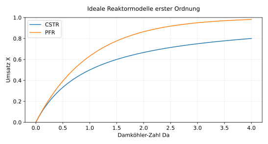

# M27-L2 – Reaktormodelle und Verweilzeit {#L2}

**Kursbereich:** M27 – Technische Chemie und chemische Verfahren

**Niveau:** Bachelor – Kern/Wahlprofil (hochschulabhängig)

**Vorwissen:** [M13-L1](M13-L1.md).

**Lernziel:** Ideale Reaktormodelle anhand dimensionsloser Verweilzeit vergleichen.

## Fachliche Grundlagen {#S1}

Ein idealer kontinuierlicher Rührkessel (CSTR) besitzt überall dieselbe Konzentration wie am Austritt; ein idealer Rohrreaktor (PFR) besitzt keine axiale Rückvermischung. Ein Batchsystem ist geschlossen bezüglich des betrachteten Stoffstroms. Diese Modelle sind Grenzfälle realer Strömungen.

## Methoden und Modellannahmen {#S2}

Für ein isothermes Modell erster Ordnung mit konstanter Dichte wird die dimensionslose Damköhler-Zahl Da = kτ verwendet. Die stationäre Bilanz des CSTR liefert $X=Da/(1+Da)$, die Integration der PFR-Bilanz $X=1-e^{-Da}$. Die mittlere Verweilzeit τ ist bei konstanter Volumenströmung V/Q.

## Modellrechnung {#S3}

Für den abstrakten Fall Da = 1 liefert CSTR 0,500, PFR 0,6321. Bei Da = 2 ergeben sich 0,6667 und 0,8647. Es handelt sich um dimensionslose Vergleichswerte einer fiktiven Reaktion ohne Stoff- oder Betriebsparameter.

*Ideale Reaktormodelle erster Ordnung – fiktive Modelldaten.*

## Grenzen und typische Fehler {#S4}

Reale Verweilzeitverteilungen, Wärmeentwicklung, Mehrphasenströmung und komplexe Kinetik können den Vergleich ändern. Die Modellkurven sind keine Anleitung zur Auslegung realer Reaktoren.

## Selbstkontrolle {#S5}

### Aufgaben

1. Wie groß ist der CSTR-Umsatz bei Da = 1?
2. Wie groß ist der PFR-Umsatz bei Da = 2?
3. Welche ideale Mischannahme besitzt ein CSTR?

::: {.lc-solutions data-lc-section="S5"}
1. 50 %.
2. 86,47 %.
3. Vollständige Durchmischung.
:::

## Quellen (extern) {#S6}

### Nachweise

- [MIT – Department of Chemical Engineering, Course Catalog](https://catalog.mit.edu/schools/engineering/chemical-engineering/) · 10.10 Stoff-/Energiebilanzen; 10.32 Trennprozesse; Transport und Regelung · M27-L2 – Reaktormodelle und Verweilzeit · Zuletzt recherchiert: 2026-11-25 (indexed web result; full section review pending).
- [NYU Chemistry – 1.24 Plug flow reactors and comparison to continuously stirred tank reactors](https://chem.libretexts.org/Courses/New_York_University/CHEM-UA_652%253A_Thermodynamics_and_Kinetics/01%253A_Lectures/1.24%253A_Plug_flow_reactors_and_comparison_to_continuously_stirred_tank_reactors) · Ideale Reaktormodelle erster Ordnung · M27-L2 – Reaktormodelle und Verweilzeit · Zuletzt recherchiert: 2026-11-25 (indexed web result; full section review pending).
