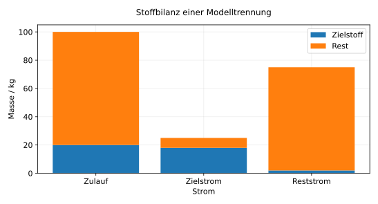

# M27-L3 – Trennverfahren und Prozessführung {#L3}

**Kursbereich:** M27 – Technische Chemie und chemische Verfahren

**Niveau:** Bachelor – Kern/Wahlprofil (hochschulabhängig)

**Vorwissen:** [M8-L4](M8-L4.md).

**Lernziel:** Trennleistung durch Reinheit, Rückgewinnung und Rückkopplung beschreiben.

## Fachliche Grundlagen {#S1}

Trennverfahren nutzen Unterschiede in Gleichgewicht, Transport oder Größe. Destillation beruht auf unterschiedlichen Flüchtigkeiten, Adsorption auf Oberflächenaffinität und Membrantrennung auf selektivem Transport. Keine einzelne Kennzahl beschreibt die Gesamtleistung.

## Methoden und Modellannahmen {#S2}

Für eine Komponente gilt Rückgewinnung = Komponentenmenge im Zielstrom / Komponentenmenge im Zulauf. Reinheit ist ihr Anteil im Zielstrom. Prozessregelung vergleicht Messwert und Sollwert und reagiert über eine Stellgröße; Messverzögerung und Wechselwirkung können die Stabilität begrenzen.

## Modellrechnung {#S3}

Fiktives Trennmodell: Zulauf 100 kg mit 20 kg Zielstoff. Zielstrom 25 kg mit 18 kg Zielstoff, Reststrom 75 kg mit 2 kg Zielstoff. Rückgewinnung 90 %, Reinheit 72 %. Die Stoffbilanz schließt für Gesamtmasse und Zielkomponente.

*Stoffbilanz einer Modelltrennung – fiktive Modelldaten.*

## Grenzen und typische Fehler {#S4}

Hohe Reinheit garantiert keine hohe Rückgewinnung. Energieaufwand, Verluste, Nebenströme und Modellannahmen gehören zur Bewertung; reale Regelkreise bedürfen fachlicher Auslegung.

## Selbstkontrolle {#S5}

### Aufgaben

1. Wie groß ist die Reinheit?
2. Wie groß ist die Rückgewinnung?
3. Wie viel Zielstoff bleibt im Reststrom?

::: {.lc-solutions data-lc-section="S5"}
1. 72 %.
2. 90 %.
3. 2 kg.
:::

## Quellen (extern) {#S6}

### Nachweise

- [MIT – Department of Chemical Engineering, Course Catalog](https://catalog.mit.edu/schools/engineering/chemical-engineering/) · 10.10 Stoff-/Energiebilanzen; 10.32 Trennprozesse; Transport und Regelung · M27-L3 – Trennverfahren und Prozessführung · Zuletzt recherchiert: 2026-11-25 (indexed web result; full section review pending).
