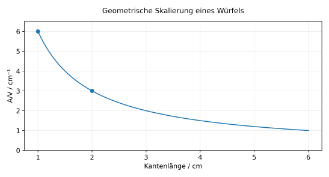

# M27-L4 – Transport und Maßstabsübertragung {#L4}

**Kursbereich:** M27 – Technische Chemie und chemische Verfahren

**Niveau:** Bachelor – Kern/Wahlprofil (hochschulabhängig)

**Vorwissen:** [M13-L5](M13-L5.md).

**Lernziel:** Geometrische Skalierung und Transportkennzahlen als Modellgrenzen verstehen.

## Fachliche Grundlagen {#S1}

Stoff- und Wärmetransport hängen von treibenden Gradienten, Geometrie, Stoffeigenschaften und Strömung ab. Bei Diffusion beschreibt das Fick-Gesetz den Fluss proportional zum negativen Konzentrationsgradienten. Dimensionslose Kennzahlen vergleichen konkurrierende Transportmechanismen.

## Methoden und Modellannahmen {#S2}

Für geometrisch ähnliche Körper wächst das Volumen mit der dritten Potenz einer charakteristischen Länge L, die Oberfläche mit der zweiten. Damit sinkt das Verhältnis A/V proportional zu 1/L. Die Reynolds-Zahl Re = ρuL/μ vergleicht Trägheits- und viskose Effekte. Gleiches A/V und gleiches Re lassen sich bei einer Größenänderung nicht automatisch erhalten.

## Modellrechnung {#S3}

Für einen Würfel gilt A/V = 6/L. Im geometrischen Modell ergibt L = 1 cm ein Verhältnis von 6 cm⁻¹, L = 2 cm dagegen 3 cm⁻¹. Die Oberfläche wächst um Faktor 4, das Volumen um Faktor 8. Dies erklärt, warum geometrische Ähnlichkeit allein keine gleiche Transportleistung garantiert.

*Geometrische Skalierung eines Würfels – fiktive Modelldaten.*

## Grenzen und typische Fehler {#S4}

Reale Apparate besitzen weitere Flächen, Strömungen und Wärmewiderstände. Die geometrische Rechnung ist kein Maßstabsübertragungsrezept für Reaktionsanlagen.

## Selbstkontrolle {#S5}

### Aufgaben

1. Um welchen Faktor wächst die Oberfläche bei Verdopplung von L?
2. Um welchen Faktor das Volumen?
3. Wie verändert sich A/V?

::: {.lc-solutions data-lc-section="S5"}
1. Vier.
2. Acht.
3. Es halbiert sich.
:::

## Quellen (extern) {#S6}

### Nachweise

- [MIT – Department of Chemical Engineering, Course Catalog](https://catalog.mit.edu/schools/engineering/chemical-engineering/) · 10.10 Stoff-/Energiebilanzen; 10.32 Trennprozesse; Transport und Regelung · M27-L4 – Transport und Maßstabsübertragung · Zuletzt recherchiert: 2026-11-25 (indexed web result; full section review pending).
