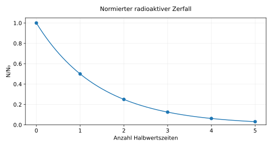

# M28-L1 – Radioaktiver Zerfall und Halbwertszeit {#L1}

**Kursbereich:** M28 – Radiochemie und chemische Toxikologie

**Niveau:** Bachelor-Wahlprofil / Master-Vertiefung (hochschulabhängig)

**Vorwissen:** [M13-L1](M13-L1.md).

**Lernziel:** Zerfallskinetik und Halbwertszeit erklären.

## Fachliche Grundlagen {#S1}

Instabile Atomkerne können sich spontan in andere Kernzustände umwandeln. Alpha- und Betazerfall ändern die Kernzusammensetzung; Gammaemission kann einen angeregten Kern abregen. Für ein Ensemble unabhängiger Kerne einer einzigen Nuklidsorte mit konstanter Zerfallswahrscheinlichkeit gilt $dN/dt=-\lambda N$. Integration liefert $N(t)=N_0 e^{-\lambda t}$; die Aktivität $A=\lambda N$ wird in Bq angegeben.

## Methoden und Modellannahmen {#S2}

Bei der Halbwertszeit $T_{1/2}=\ln(2)/\lambda$ sinkt der Erwartungswert auf die Hälfte. Eine einzelne Kernumwandlung bleibt stochastisch. Bei Zerfallsketten sind Tochteraktivitäten gesondert zu bilanzieren; die einfache Exponentialform beschreibt nur die betrachtete Elternpopulation.

## Modellrechnung {#S3}

Fiktives dimensionsloses Modell: Nach drei Halbwertszeiten beträgt $N/N_0=2^{-3}=0{,}125$. 87,5 % der ursprünglichen Kerne sind umgewandelt. Nach fünf Halbwertszeiten verbleiben 3,125 %.

*Normierter radioaktiver Zerfall – fiktive Modelldaten.*

## Grenzen und typische Fehler {#S4}

Halbwertszeit ist keine Ungefährlichkeitsgrenze. Keine Aussage zu realer Quelle, Beschaffung, Handhabung oder Dosis allein aus diesem Modell.

## Selbstkontrolle {#S5}

### Aufgaben

1. Welcher Anteil bleibt nach zwei Halbwertszeiten?
2. Was misst Bq?
3. Kann der Zeitpunkt eines Einzelzerfalls exakt vorhergesagt werden?

::: {.lc-solutions data-lc-section="S5"}
1. 25 %.
2. Kernumwandlungen pro Sekunde.
3. Nein.
:::

## Quellen (extern) {#S6}

### Nachweise

- [UC Davis Chemistry – 6.4 Rates of Radioactive Decay](https://chem.libretexts.org/Courses/University_of_California_Davis/UCD_Chem_002C/UCD_Chem_2C_%28Larsen%29/Textbook/06%3A_Nuclear_Chemistry/6.04%3A_Rates_of_Radioactive_Decay) · Zerfallsgesetz · M28-L1 – Radioaktiver Zerfall und Halbwertszeit · Zuletzt recherchiert: 2026-11-25 (indexed web result; full section review pending).
- [WHO – Ionizing radiation](https://www.who.int/news-room/questions-and-answers/item/radiation-ionizing-radiation) · Aktivität und Dosisgrößen · M28-L1 – Radioaktiver Zerfall und Halbwertszeit · Zuletzt recherchiert: 2026-11-25 (indexed web result; full section review pending).
