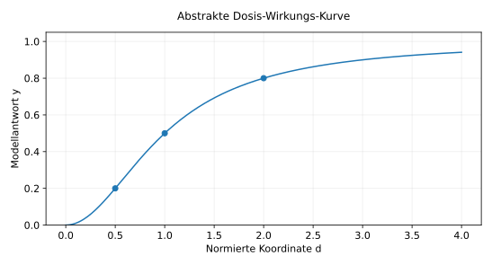

# M28-L4 – Dosis-Wirkungs-Beziehungen {#L4}

**Kursbereich:** M28 – Radiochemie und chemische Toxikologie

**Niveau:** Bachelor-Wahlprofil / Master-Vertiefung (hochschulabhängig)

**Vorwissen:** [M25-L2](M25-L2.md).

**Lernziel:** Dosis-Wirkungs-Kurven als bedingte Modelle interpretieren.

## Fachliche Grundlagen {#S1}

Toxikologische Wirkungen hängen von Expositionsweg, Dauer, Stoffwechsel, biologischem Endpunkt und Empfindlichkeit ab. Eine Dosis-Wirkungs-Beziehung verbindet eine definierte Dosisgröße mit einer beobachteten Antwort; quantale Endpunkte sind Anteile betroffener Individuen, graduelle Endpunkte kontinuierliche Messgrößen.

## Methoden und Modellannahmen {#S2}

Ein sigmoidales Modell kann eine begrenzte Antwort mit $y=d^h/(d_{50}^h+d^h)$ beschreiben. Hier ist d eine abstrakte normierte Koordinate, $d_{50}$ der Modellmittelpunkt und h ein Formparameter. Die Funktion ist keine universelle toxikologische Gesetzmäßigkeit.

## Modellrechnung {#S3}

Für $d_{50}=1$ und $h=2$ beträgt y bei d=0,5 genau 0,2, bei d=1 genau 0,5 und bei d=2 genau 0,8. Diese Werte stellen eine erfundene normierte Antwort dar, keine Daten über einen realen Stoff.

*Abstrakte Dosis-Wirkungs-Kurve – fiktive Modelldaten.*

## Grenzen und typische Fehler {#S4}

Nicht aus einer Modellkurve auf menschliche Verträglichkeit, sichere Dosis oder Schadwirkung konkreter Substanzen schließen. Extrapolationen benötigen Daten und explizite Unsicherheitsbewertung.

## Selbstkontrolle {#S5}

### Aufgaben

1. Welche Antwort ergibt d=1?
2. Was beeinflusst die Kurvensteilheit?
3. Warum ist eine normierte Modellkoordinate keine reale Dosis?

::: {.lc-solutions data-lc-section="S5"}
1. 0,5.
2. Der Parameter h.
3. Sie enthält keine stoff-, einheiten- und endpunktspezifische Information.
:::

## Quellen (extern) {#S6}

### Nachweise

- [EPA – Conducting a Human Health Risk Assessment](https://www.epa.gov/risk/conducting-human-health-risk-assessment) · Gefahr, Exposition, Dosis-Wirkung · M28-L4 – Dosis-Wirkungs-Beziehungen · Zuletzt recherchiert: 2026-11-25 (indexed web result; full section review pending).
