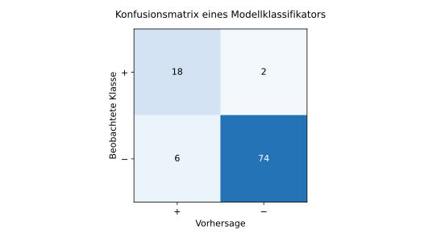

# M29-L3 – Regression und Klassifikation {#L3}

**Kursbereich:** M29 – Chemische Datenwissenschaft und Chemoinformatik

**Niveau:** Bachelor-Wahlprofil / Master-Vertiefung (hochschulabhängig)

**Vorwissen:** [M29-L2](M29-L2.md).

**Lernziel:** Regressions- und Klassifikationsmetriken passend wählen.

## Fachliche Grundlagen {#S1}

Regression schätzt kontinuierliche Größen, Klassifikation diskrete Kategorien. Chemische Daten können Messrauschen und unausgewogene Klassen enthalten. Eine Baseline, etwa der Mittelwert oder die Mehrheitsklasse, bildet den Mindestvergleich für komplexere Modelle.

## Methoden und Modellannahmen {#S2}

Der mittlere absolute Fehler ist $MAE=n^{-1}\sum_i|y_i-\hat y_i|$. Bei binärer Klassifikation gelten Präzision = TP/(TP+FP) und Recall = TP/(TP+FN). Die Entscheidungsschwelle verändert diese beiden Größen. Für verschiedene Fehlkosten sind verschiedene Metriken angemessen.

## Modellrechnung {#S3}

Fiktive Messwerte 1, 3, 5 und Vorhersagen 2, 3, 4 ergeben MAE = 2/3. In einem separaten Modell mit TP=18, FP=6, FN=2, TN=74 beträgt Präzision 75 %, Recall 90 % und Genauigkeit 92 %.

*Konfusionsmatrix eines Modellklassifikators – fiktive Modelldaten.*

## Grenzen und typische Fehler {#S4}

Eine hohe Genauigkeit kann bei seltenen Klassen irreführend sein. MAE hat die Einheit der Zielgröße; unterschiedliche Messbereiche erschweren direkte Vergleiche.

## Selbstkontrolle {#S5}

### Aufgaben

1. Wie groß ist MAE?
2. Wie groß ist Recall?
3. Welche Metrik beschreibt den Anteil korrekter positiver Vorhersagen?

::: {.lc-solutions data-lc-section="S5"}
1. 0,667.
2. 90 %.
3. Präzision.
:::

## Quellen (extern) {#S6}

### Nachweise

- [scikit-learn – Metrics and scoring](https://scikit-learn.org/stable/modules/model_evaluation.html) · Regressions- und Klassifikationsmetriken · M29-L3 – Regression und Klassifikation · Zuletzt recherchiert: 2026-11-25 (indexed web result; full section review pending).
