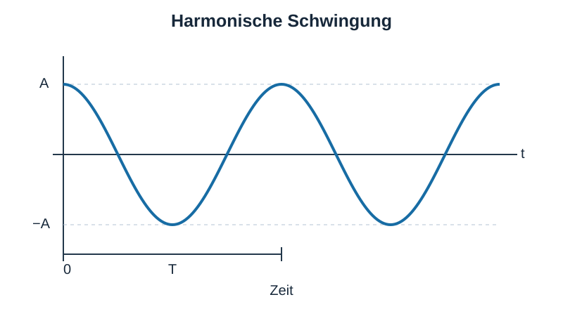

# M3-L3 – Schwingungen und Wellen {#L3}

**Kursbereich:** M3 – Physik und Messtechnik

**Niveau:** Bachelor

**Vorwissen:** [M2-L3](M2-L3.md), [M3-L1](M3-L1.md).

**Lernziel:** Periodische Bewegung, Wellen und Resonanz als Modelle molekularer Dynamik einordnen.

## Harmonischer Oszillator {#S1}
In der Nähe eines stabilen Minimums lässt sich ein Potenzial häufig durch $V(x)=V_0+kx^2/2$ annähern, wobei $x$ die Auslenkung und $k$ die Kraftkonstante ist. Aus $F=-kx$ folgt $m\ddot x=-kx$. Die Lösung $x(t)=A\cos(\omega t+\varphi)$ besitzt die Kreisfrequenz $\omega=\sqrt{k/m}$ und die Frequenz $f=\omega/(2\pi)$. Für eine zweiatomige Molekülschwingung verwendet man statt einer Einzelmasse die reduzierte Masse $\mu=m_1m_2/(m_1+m_2)$.

*Periodische Auslenkung eines idealisierten ungedämpften Oszillators.*

## Wellenausbreitung und Überlagerung {#S2}
Eine ebene harmonische Welle kann durch $y(x,t)=A\cos(k_wx-\omega t+\varphi)$ beschrieben werden. Hier ist $k_w=2\pi/\lambda$ die Wellenzahl im Bogenmaß, nicht die Federkonstante. Es gilt $v=\lambda f$. Bei linearer Überlagerung verstärken sich gleichphasige Wellen, während gegenphasige Wellen gleicher Amplitude einander auslöschen können. In einem gedämpften angetriebenen Oszillator hängt die Antwort von Anregungsfrequenz und Dämpfung ab. Diese Idee bildet eine Brücke zu Resonanzmessungen.
## Rechenbeispiel {#S3}
Für ein didaktisches Molekülmodell mit $k=400$ N/m und $\mu=1,00\cdot10^{-26}$ kg ergibt sich $\omega=2,00\cdot10^{14}$ rad/s, also $f=3,18\cdot10^{13}$ Hz. Bei unveränderter Kraftkonstante und doppelter reduzierter Masse sinkt die Frequenz auf $f/\sqrt2$. Das ist eine qualitative Erklärung für Isotopenverschiebungen. Reale Moleküle besitzen mehrere gekoppelte Normalmoden und anharmonische Potenziale; quantisierte Übergänge werden später behandelt.

## Grenzen und typische Fehler {#S4}

Die lineare Näherung gilt nur nahe einem stabilen Minimum; bei großen Auslenkungen und Kopplung sind weitere Terme nötig.

## Selbstkontrolle {#S5}

### Aufgaben

1. Eine Schwingung hat 50 Hz. Wie groß ist ihre Periodendauer?
2. Eine Welle besitzt 2 m Wellenlänge und 5 Hz Frequenz. Berechne ihre Geschwindigkeit.
3. Was geschieht mit der Eigenfrequenz, wenn die Kraftkonstante vervierfacht wird?

::: {.lc-solutions data-lc-section="S5"}
1. 0,020 s.
2. 10 m/s.
3. Sie verdoppelt sich bei konstanter Masse.
:::

**Weiterlesen:** [M3-L4](M3-L4.md).

## Quellen (extern) {#S6}

### Nachweise

- [OpenStax – University Physics Volume 1, 15.1 Simple Harmonic Motion](https://openstax.org/books/university-physics-volume-1/pages/15-1-simple-harmonic-motion) · Harmonischer Oszillator · Fachlicher Bezug zur Lektion: M3-L3 – Schwingungen und Wellen · Zuletzt abgerufen: 2026-11-25
- [OpenStax – University Physics Volume 1, 16.1 Traveling Waves](https://openstax.org/books/university-physics-volume-1/pages/16-1-traveling-waves) · Wellenlänge, Frequenz, Wellengeschwindigkeit · Fachlicher Bezug zur Lektion: M3-L3 – Schwingungen und Wellen · Zuletzt abgerufen: 2026-11-25
