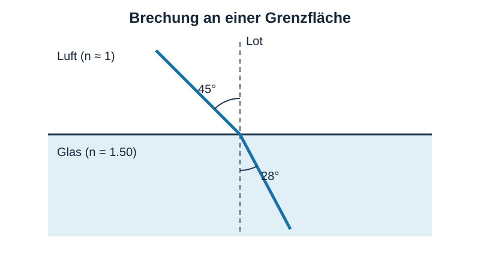

# M3-L4 – Grundlagen der Optik {#L4}

**Kursbereich:** M3 – Physik und Messtechnik

**Niveau:** Bachelor

**Vorwissen:** [M3-L3](M3-L3.md).

**Lernziel:** Brechung, Interferenz und Beugung als Grundlagen optischer Messgeräte erklären.

## Strahlenoptik {#S1}
In einem transparenten Medium gilt für die Phasengeschwindigkeit $v=c_0/n$, wobei $c_0$ die Lichtgeschwindigkeit im Vakuum bezeichnet. An einer Grenzfläche gilt $n_1\sin\theta_1=n_2\sin\theta_2$. Die Winkel werden vom Lot gemessen. Die Frequenz bleibt beim Übergang über eine ruhende Grenzfläche erhalten; Wellenlänge und Phasengeschwindigkeit ändern sich. Bei Dispersion ist der Brechungsindex frequenzabhängig.

*Schematische Brechung bei 45° Einfall und etwa 28° Brechung.*

## Wellenoptik und spektrale Trennung {#S2}
Sind Aperturen oder Strukturen mit der Wellenlänge vergleichbar, reicht Strahlenoptik nicht aus. Für ein idealisiertes Gitter mit Abstand $d$ und senkrechtem Lichteinfall liegen Hauptmaxima bei $d\sin\theta=m\lambda$. Die ganzzahlige Ordnung $m$ kann positiv, negativ oder null sein. Nur Winkel mit $|m\lambda/d|\leq1$ sind möglich. Ein Gitter trennt Wellenlängen über verschiedene Winkel; die spektrale Auflösung hängt unter anderem von beleuchteter Gitterbreite und optischer Abbildung ab.
## Rechenbeispiel {#S3}
Licht fällt aus Luft ($n_1\approx1$) unter 45° auf Glas mit $n_2=1,50$. Damit $\sin\theta_2=0,4714$, also $\theta_2\approx28,1^\circ$. Für ein Gitter mit 500 Linien/mm beträgt $d=2,00\,\mu\mathrm m$. Licht mit 600 nm erscheint in erster Ordnung bei $\arcsin(0,300)\approx17,5^\circ$. Diese idealisierten Beziehungen erklären Strahlengang und spektrale Auswahl, nicht die vollständige Gerätekalibrierung.

## Grenzen und typische Fehler {#S4}

Die Winkel werden stets relativ zum Lot bzw. zur Gitter-Normalen gemessen; eine Gitterordnung außerhalb des zulässigen Sinusbereichs existiert nicht.

## Selbstkontrolle {#S5}

### Aufgaben

1. Wie groß ist der Brechungswinkel bei senkrechtem Einfall?
2. Bestimme den Gitterabstand bei 1000 Linien/mm.
3. Weshalb kann ein Gitter mehrere Wellenlängen am selben Winkel abbilden?

::: {.lc-solutions data-lc-section="S5"}
1. 0° relativ zum Lot.
2. $1,00\,\mu\mathrm m$.
3. Verschiedene Kombinationen aus Ordnung und Wellenlänge können dasselbe Produkt $m\lambda$ besitzen.
:::

**Weiterlesen:** [M3-L5](M3-L5.md).

## Quellen (extern) {#S6}

### Nachweise

- [OpenStax – University Physics Volume 3, 1.3 Refraction](https://openstax.org/books/university-physics-volume-3/pages/1-3-refraction) · Brechung an Grenzflächen · Fachlicher Bezug zur Lektion: M3-L4 – Grundlagen der Optik · Zuletzt abgerufen: 2026-11-25
- [OpenStax – University Physics Volume 3, 4.4 Diffraction Gratings](https://openstax.org/books/university-physics-volume-3/pages/4-4-diffraction-gratings) · Gittergleichung und spektrale Trennung · Fachlicher Bezug zur Lektion: M3-L4 – Grundlagen der Optik · Zuletzt abgerufen: 2026-11-25
