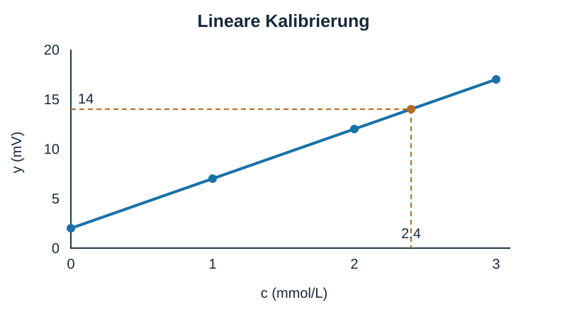

# M3-L5 – Messungen, Kalibrierung und Unsicherheit {#L5}

**Kursbereich:** M3 – Physik und Messtechnik

**Niveau:** Bachelor

**Vorwissen:** [M1-L3](M1-L3.md), [M2-L5](M2-L5.md).

**Lernziel:** Eine Kalibrierfunktion invertieren und ihre Unsicherheit kritisch beurteilen.

## Kalibrierung und Rückführung {#S1}
Eine Kalibrierung stellt unter definierten Bedingungen eine Beziehung zwischen Referenzwerten und Anzeigen her. Sie ist nicht mit einer Justierung gleichzusetzen. Eine Referenz muss ihre eigene Unsicherheit besitzen; metrologische Rückführbarkeit erfordert eine dokumentierte Kette von Kalibrierungen. Bei analytischen Signalen beschreibt das einfache Modell $y=a+bc+\varepsilon$ eine Antwort $y$ auf eine Konzentration $c$, mit Achsenabschnitt $a$, Empfindlichkeit $b$ und Restabweichung $\varepsilon$.

*Synthetisches Modell: y = 2 + 5c, mit c in mmol/L und y in mV.*

## Inverse Schätzung {#S2}
Für $b\ne0$ wird der unbekannte Wert durch $\hat c=(y-a)/b$ geschätzt. Residuen $r_i=y_i-(a+bc_i)$ zeigen Abweichungen vom Modell; ein gekrümmtes Muster kann auf Nichtlinearität hindeuten. Eine hohe Korrelation allein belegt weder Linearität noch Richtigkeit. Bei unabhängigen kleinen Unsicherheiten und vernachlässigbarer Kovarianz ergibt die lineare Fortpflanzung $u_c^2\approx(u_y^2+u_a^2)/b^2+(y-a)^2u_b^2/b^4$. In realer Regression können $a$ und $b$ korreliert sein; dann ist der Kovarianzterm erforderlich.
## Rechenbeispiel {#S3}
Eine synthetische Kalibration in mV und mmol/L liefert bei Konzentrationen 0, 1, 2, 3 die Modellanzeigen 2, 7, 12, 17 mV. Damit $a=2$ mV und $b=5$ mV/(mmol/L). Ein Messsignal von 14 mV ergibt $\hat c=2,4$ mmol/L. Bei $u_y=0,5$ mV und als exakt angenommenen Parametern folgt $u_c=0,1$ mmol/L. Dies ist nur die Signalunsicherheit; die exakt modellierten Kalibrierpunkte sind keine realen Daten. Unbekannte Proben außerhalb des Referenzbereichs erfordern eine gesonderte Validierung.

## Grenzen und typische Fehler {#S4}

Die exakten Modellpunkte sind keine experimentellen Belege. Eine Rückführbarkeitskette allein garantiert keine für den Zweck ausreichende Unsicherheit.

## Selbstkontrolle {#S5}

### Aufgaben

1. Bestimme die Konzentration für 9,5 mV im obigen Modell.
2. Warum ist der Achsenabschnitt nicht automatisch null?
3. Was fehlt, wenn nur $u_y$ fortgepflanzt wird?

::: {.lc-solutions data-lc-section="S5"}
1. 1,5 mmol/L.
2. Blindwert, Hintergrund und Geräteoffset können einen Beitrag liefern.
3. Unsicherheiten und Kovarianzen der Kalibrierparameter sowie weitere Beiträge aus Probe und Methode.
:::

## Quellen (extern) {#S6}

### Nachweise

- [JCGM VIM3 – 2.39 Calibration](https://jcgm.bipm.org/vim/en/2.39.html) · Kalibrierung als metrologischer Begriff · Fachlicher Bezug zur Lektion: M3-L5 – Messungen, Kalibrierung und Unsicherheit · Zuletzt abgerufen: 2026-11-25
- [JCGM VIM3 – 2.41 Metrological traceability](https://jcgm.bipm.org/vim/en/2.41.html) · Rückführbarkeit und Kalibrierkette · Fachlicher Bezug zur Lektion: M3-L5 – Messungen, Kalibrierung und Unsicherheit · Zuletzt abgerufen: 2026-11-25
